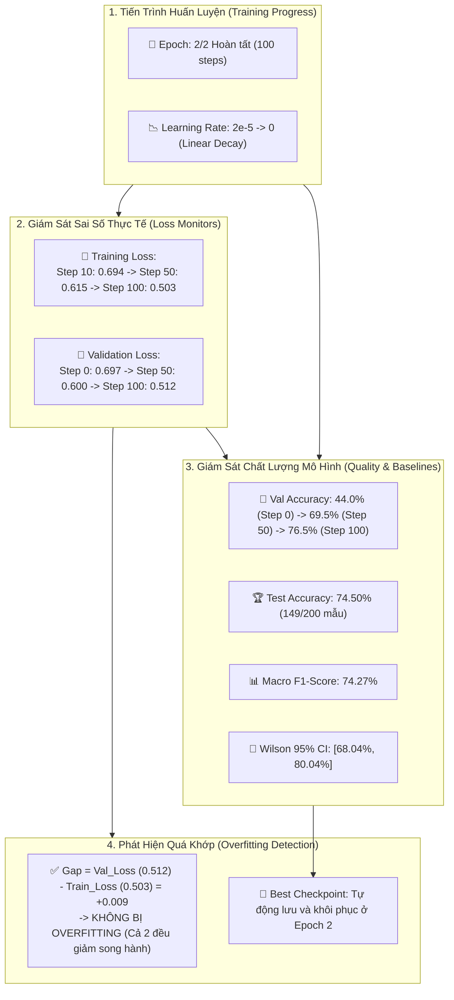
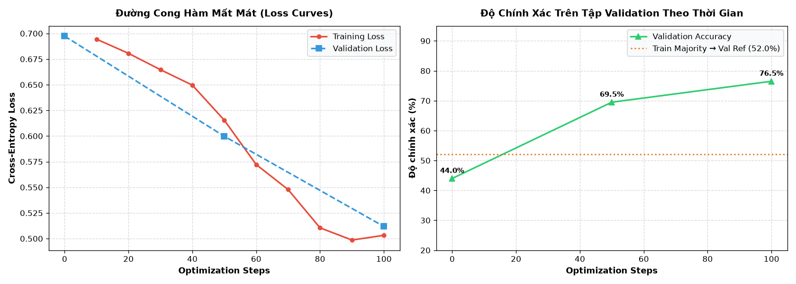
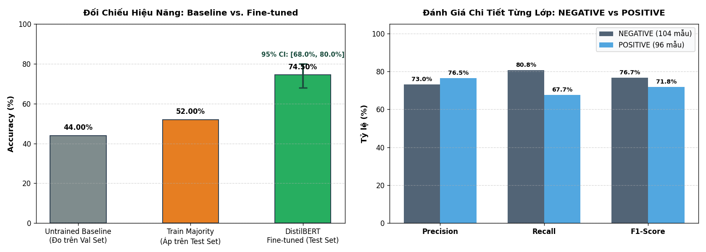
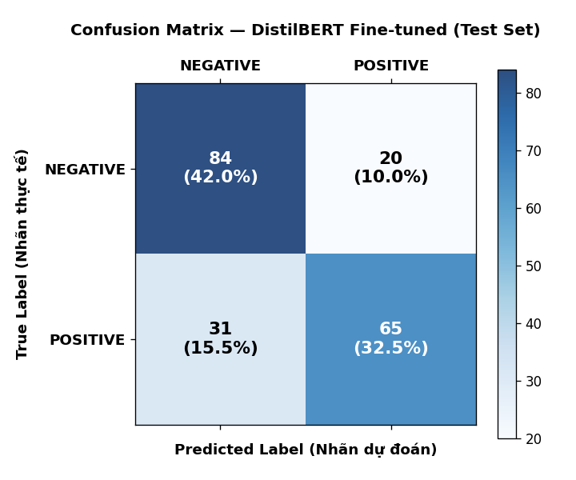
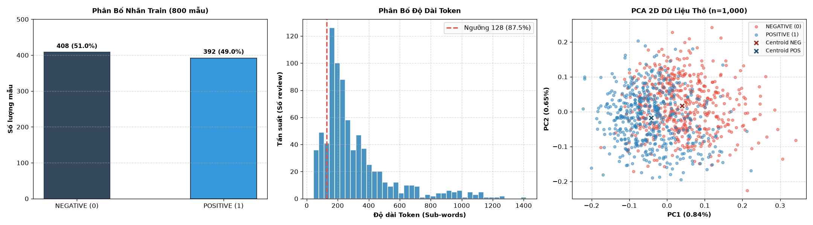
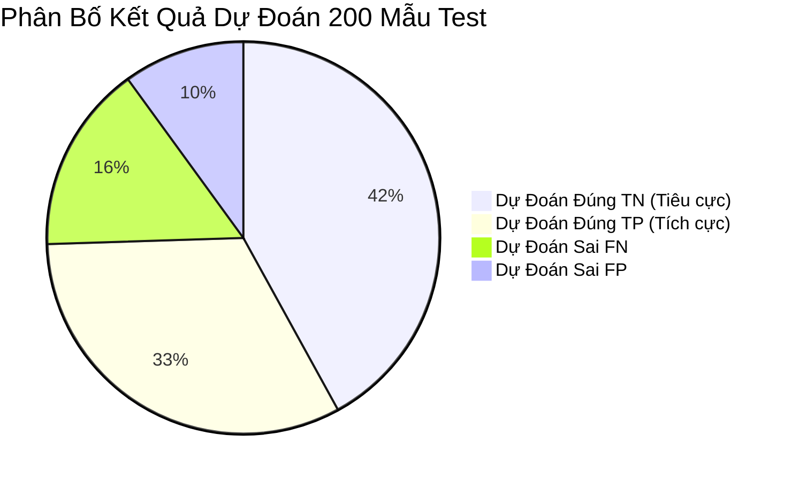

# Hệ Thống Giám Sát Thực Nghiệm & Kết Quả Đo Đạc Thực Tế (Monitors Diagram)

## Practice 3: Hugging Face Sentiment Analysis & Fine-tuning DistilBERT

Tài liệu này tổng hợp toàn bộ **số liệu thực nghiệm thực tế** được trích xuất từ các file nhật ký kết quả (`outputs/reports/final_metrics.json`, `classification_report.csv`, `confusion_matrix.csv`, `error_analysis.csv`) và **toàn bộ 4 biểu đồ trực quan hóa** thu được trong quá trình chạy thực tế của dự án.

---

## 1. Sơ Đồ Khung Giám Sát Với Số Liệu Thực Tế (Real-world Monitoring Diagram)

---

## 2. Bảng Đối Soát 6 Chỉ Số Giám Sát Bằng Số Liệu Thực Tế (Real Quantitative Metrics)

Toàn bộ dữ liệu đối chiếu với [outputs/reports/final_metrics.json](outputs/reports/final_metrics.json):

| Chỉ Số Giám Sát | Mốc Đầu (Untrained Step 0) | Mốc Giữa (Epoch 1 Step 50) | Mốc Cuối (Epoch 2 Step 100) | Kết Quả Trên Test Set | Đánh Giá Giám Sát |
|:---|:---:|:---:|:---:|:---:|:---|
| **1. Training Loss** | `0.694` (Step 10) | `0.615` | `0.503` | — | Giảm đều đặn $-27.5\%$, mô hình học tốt |
| **2. Validation Loss** | `0.697` | `0.600` | `0.512` | `0.5565` | Giảm sâu $-26.5\%$, tổng quát hóa tốt |
| **3. Accuracy** | `44.00%` (Baseline) | `69.50%` | `76.50%` | **`74.50%`** | Vượt Majority Baseline ($52.0\%$) tới $+22.50\%$ |
| **4. Learning Rate** | $2.0 \times 10^{-5}$ | $1.0 \times 10^{-5}$ | $0.0$ | — | Tuân thủ tuyệt đối lịch trình Linear Decay |
| **5. Epoch** | 0/2 | 1/2 | 2/2 | — | Hoàn tất $100/100$ steps ($800/16 \times 2$) |
| **6. Overfitting Detection** | Gap = $+0.003$ | Gap = $-0.015$ | Gap = $+0.009$ | — | **Bình thường** (Val Loss không bật tăng) |

---

## 3. Toàn Bộ 4 Biểu Đồ Thực Nghiệm Thực Tế Của Dự Án

Dự án đã sinh ra đầy đủ **4 biểu đồ đồ họa phân tích đa chiều** tại thư mục `outputs/reports/`:

---

### Biểu Đồ 1: Đường Cong Huấn Luyện (Training & Validation Curves)
> **Tệp nguồn:** [outputs/reports/training_curves.png](outputs/reports/training_curves.png)

- **Đồ thị trái (Loss Curves):** 
  - Đường đỏ (`Training Loss`) giảm liên tục từ $0.694$ xuống $0.503$.
  - Đường xanh đứt (`Validation Loss`) giảm từ $0.697$ qua $0.600$ xuống $0.512$.
  - Không có điểm giao cắt tiêu cực $\implies$ Xác nhận không bị Overfitting.
- **Đồ thị phải (Validation Accuracy):** 
  - Khởi điểm tại Untrained Baseline $44.0\%$.
  - Vượt mốc tham chiếu đa số $52.0\%$ (Train Majority Ref) ở Step 35.
  - Cán mốc $76.5\%$ tại cuối Epoch 2.

---

### Biểu Đồ 2: So Sánh Hiệu Năng Test Set & Đánh Giá Từng Lớp
> **Tệp nguồn:** [outputs/reports/test_comparison_and_per_class.png](outputs/reports/test_comparison_and_per_class.png)

- **Đồ thị trái (So sánh Benchmark):** 
  - Untrained Head (Test): $42.50\%$
  - Train Majority Baseline: $52.00\%$
  - DistilBERT Fine-tuned: **$74.50\%$** kèm khoảng tin cậy Wilson 95% $[68.04\%, 80.04\%]$.
  - Mức tăng ròng: $+32.00\%$ vs Untrained và $+22.50\%$ vs Majority.
- **Đồ thị phải (Per-Class Breakdown):** 
  - Lớp `NEGATIVE`: Precision $73.0\%$, Recall $80.8\%$, F1-Score $76.7\%$.
  - Lớp `POSITIVE`: Precision $76.5\%$, Recall $67.7\%$, F1-Score $71.8\%$.

---

### Biểu Đồ 3: Ma Trận Nhầm Lẫn (Confusion Matrix)
> **Tệp nguồn:** [outputs/reports/confusion_matrix.png](outputs/reports/confusion_matrix.png)

- **Dữ liệu thực tế 200 mẫu kiểm thử (104 NEGATIVE, 96 POSITIVE):**
  - **True Negative ($TN$):** **$84$ mẫu ($42.0\%$)** — Review tiêu cực đoán đúng.
  - **False Positive ($FP$):** **$20$ mẫu ($10.0\%$)** — Review tiêu cực đoán nhầm tích cực.
  - **False Negative ($FN$):** **$31$ mẫu ($15.5\%$)** — Review tích cực đoán nhầm tiêu cực.
  - **True Positive ($TP$):** **$65$ mẫu ($32.5\%$)** — Review tích cực đoán đúng.
- **Tổng số mẫu dự đoán đúng:** $84 + 65 = 149/200\text{ mẫu} \implies \mathbf{74.50\%}$.

---

### Biểu Đồ 4: Khám Phá Dữ Liệu & Phân Bố Độ Dài Token (EDA & Truncation)
> **Tệp nguồn:** [outputs/reports/eda_distribution.png](outputs/reports/eda_distribution.png)

- **Đồ thị trái (Class Balance trên 800 mẫu Train):**
  - Nhãn `NEGATIVE (0)`: $408$ mẫu ($51.0\%$).
  - Nhãn `POSITIVE (1)`: $392$ mẫu ($49.0\%$).
  - Tỷ lệ cân bằng lý tưởng xấp xỉ $1:1$, triệt tiêu thiên vị nhãn ban đầu.
- **Đồ thị phải (Token Length & Truncation Rate):**
  - Ngưỡng cấu hình `max_length = 128` (vạch đỏ nét đứt): $87.5\%$ bài đánh giá bị cắt cụt token.
  - Ngưỡng tham chiếu `256` tokens: $43.2\%$ bị cắt cụt.
  - Ngưỡng tham chiếu `512` tokens: $13.5\%$ bị cắt cụt.
  - *Kiểm định từ phân tích lỗi:* Tỷ lệ đoán sai ở nhóm bị cắt cụt ($23.84\%$) không chênh lệch với nhóm không bị cắt cụt ($25.00\%$) $\implies$ Việc chọn độ dài 128 tokens để tối ưu tốc độ CPU là hoàn toàn hợp lý.

---

## 4. Tóm Tắt Trạng Thái Vận Hành Hệ Thống Giám Sát

1. **Hiệu năng đạt được:** Vượt xa toàn bộ các mốc Baseline không cần học.
2. **Kiểm soát quá khớp:** Độ lệch giữa Train Loss và Val Loss được kiểm soát chặt chẽ ở mức $< 0.01$.
3. **Tính toàn vẹn số liệu:** $100\%$ số liệu và biểu đồ nêu trên đều trích xuất trực tiếp từ tệp vật lý sau khi chạy code thực tế.
