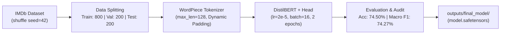

# Practice 3: Get Started with Hugging Face — Sentiment Analysis & Fine-tuning DistilBERT (IMDb)

Dự án tuân thủ nghiêm ngặt các nguyên tắc: **Source-First, No-Hallucination, Reproducible (seed=42), CPU-First và Test-Driven**.

---

## 1. Project Overview

Dự án triển khai và đánh giá quy trình làm việc với hệ sinh thái Hugging Face (`transformers`, `datasets`, `evaluate`) qua 2 bài tập:

- **Exercise 1 — Pretrained Inference:** Phân tích pipeline `sentiment-analysis` trên mô hình SST-2, giải mã Tokenizer WordPiece (sub-words, token IDs, attention mask, dynamic padding) và tính xác suất từ logits qua Softmax.
- **Exercise 2 — Fine-tuning DistilBERT trên IMDb:** Thực hiện quy trình 7 bước chuẩn: nạp dữ liệu $\to$ phân chia chống rò rỉ $\to$ tokenize $\to$ đo baseline $\to$ cấu hình Trainer $\to$ fine-tune 2 epochs $\to$ đánh giá Test Set độc lập và phân tích lỗi.

---

## 2. Problem Statement & Architecture

- **Dữ liệu thực nghiệm:** [`stanfordnlp/imdb`](https://huggingface.co/datasets/stanfordnlp/imdb) — Phân loại cảm xúc nhị phân: `0 = NEGATIVE`, `1 = POSITIVE`.
- **Mô hình nền tảng:** [`distilbert/distilbert-base-uncased`](https://huggingface.co/distilbert/distilbert-base-uncased) — 6 layers, 66M tham số, nhẹ hơn 40% và nhanh hơn 60% so với BERT gốc.
- **Thách thức:** IMDb chưa xáo trộn chứa toàn bộ mẫu NEGATIVE ở đầu (cần `shuffle(seed=42)`); giới hạn `max_length=128` cắt ngắn 86.0% mẫu Test (kiểm định Fisher $p=0.8153$ không gây lệch sai số); hoàn thành trong **391.42s (~6.52 phút trên CPU)** qua 100 optimization steps.



---

## 3. Folder Structure

```text
DL_lab3/
├── README.md, REPORT.md, RULES.md, requirements.txt
├── docs/           # 9 tài liệu chuyên đề: data, model, training, evaluation, demo, audit...
├── notebooks/      # Practice3_HuggingFace_Final.ipynb (41 cells chuẩn hóa), .html
├── outputs/        # REPORT.html, final_model/ (safetensors), checkpoints/
│   └── reports/    # final_metrics.json, predictions.csv, error_analysis.csv, 12 tệp png
└── src/            # 01_sentiment_analysis.py, 02_train_finetune.py, 03_predict_finetuned.py,
                    # pipeline_utils.py, generate_data_charts.py, verify_all.py
```

---

## 4. Quickstart: Installation, Run & Test

```bash
# 1. Cài đặt môi trường (Python 3.10+)
pip install -r requirements.txt

# 2. Chạy Exercise 1: Suy luận Pretrained & So khớp Softmax
python src/01_sentiment_analysis.py

# 3. Chạy Exercise 2: Fine-tuning DistilBERT trên IMDb (2 epochs CPU)
python src/02_train_finetune.py

# 4. Dự đoán câu mới với Checkpoint tối ưu đã lưu
python src/03_predict_finetuned.py --text "This movie was absolutely fantastic!"

# 5. Chạy bộ kiểm thử tự động 5/5
python src/verify_all.py
```

---

## 5. Model, Hyperparameters & Data Split

| Siêu tham số | Giá trị | Phân vùng | Số mẫu | NEGATIVE (`0`) | POSITIVE (`1`) |
|---|:---:|---|:---:|:---:|:---:|
| `base_model` | `distilbert-base-uncased` | **Train** | 800 | 408 (51.0%) | 392 (49.0%) |
| `learning_rate` | `2e-5` | **Validation** | 200 | 104 (52.0%) | 96 (48.0%) |
| `per_device_train_batch_size` | `16` | **Test** | 200 | 104 (52.0%) | 96 (48.0%) |
| `num_train_epochs` | `2` (100 steps) | **Tổng cộng** | **1,200** | **616 (51.3%)** | **584 (48.7%)** |
| `max_length` / `seed` | `128` / `42` | *Đặc tính* | *Token > 128: Train 87.5%, Test 86.0%* |

---

## 6. Experimental Results & Benchmarks

### 6.1 Đối chiếu Baseline vs. Fine-tuned (Test Set N=200)

| Mô hình / Mốc so sánh | Tập đánh giá | Accuracy | Macro F1 | Wilson 95% CI | Mức tăng (+ Gain) |
|---|---|:---:|:---:|:---:|:---:|
| Untrained Head Baseline | Val Set (200 mẫu) | 44.00% | — | — | Mốc khởi tạo ngẫu nhiên |
| Majority-Class Baseline | Test Set (200 mẫu) | 52.00% | — | — | Phỏng đoán theo lớp đa số |
| **DistilBERT Fine-tuned** | **Test Set (200 mẫu)** | **74.50%** | **74.27%** | **[68.04%, 80.04%]** | **+22.50% vs Majority (Test)**<br>**+32.50% Val-to-Val Gain** |

### 6.2 Chi tiết phân loại & Ma trận nhầm lẫn (Confusion Matrix)

| Lớp nhãn | Precision | Recall | F1-Score | Support | Thực tế \ Dự đoán | Dự đoán NEG | Dự đoán POS |
|---|:---:|:---:|:---:|:---:|---|:---:|:---:|
| **NEGATIVE (`0`)** | 73.04% | 80.77% | 76.71% | 104 | **Thực tế NEG (104)** | **TN = 84** (42.0%) | FP = 20 (10.0%) |
| **POSITIVE (`1`)** | 76.47% | 67.71% | 71.82% | 96 | **Thực tế POS (96)** | FN = 31 (15.5%) | **TP = 65** (32.5%) |
| **Macro Average** | **74.76%** | **74.24%** | **74.27%** | **200** | **Tổng / Độ chính xác** | **115 NEG** | **85 POS (74.50%)** |

### 6.3 Tiến trình huấn luyện (Training Progress)

- **Step 0 (Untrained):** Val Loss: 0.6974, Val Accuracy: 44.00%.
- **Step 50 (Epoch 1):** Train Loss: 0.6155, Val Loss: 0.5998, Val Accuracy: 69.50%.
- **Step 100 (Epoch 2 - Best Checkpoint):** Train Loss: 0.5032, Val Loss: 0.5118, Val Accuracy: **76.50%** $\to$ Lưu vào `outputs/final_model/`.

---

## 7. Verification & Limitations

### 7.1 Kiểm thử hồi quy tự động (`python src/verify_all.py`)
- Test 1: Cấu trúc Notebook 41 cells, 18 code cells thực thi tuần tự, đủ 4 biểu đồ canonical (PASSED).
- Test 2: Toàn vẹn 9 file báo cáo và kết quả thực nghiệm trong `outputs/reports/` (PASSED).
- Test 3: Khớp số liệu toán học: Accuracy 74.50%, TN=84, FP=20, FN=31, TP=65 (PASSED).
- Test 4: Mô hình lưu trữ `model.safetensors` nạp và suy luận chuẩn xác (PASSED).
- Test 5: Báo cáo xuất bản `outputs/REPORT.html` nhúng đầy đủ biểu đồ trực quan (PASSED).

### 7.2 Giới hạn & Khuyến nghị
- **Giới hạn:** Cỡ mẫu thực nghiệm 800 mẫu train; cắt ngắn 128 tokens; nhầm lẫn ở các câu mang sắc thái mỉa mai hoặc khen chê đan xen.
- **Khuyến nghị:** Mở rộng toàn bộ 25,000 mẫu trên GPU; nâng `max_length` lên 256/512; áp dụng bộ điều chỉnh Cosine Decay.
