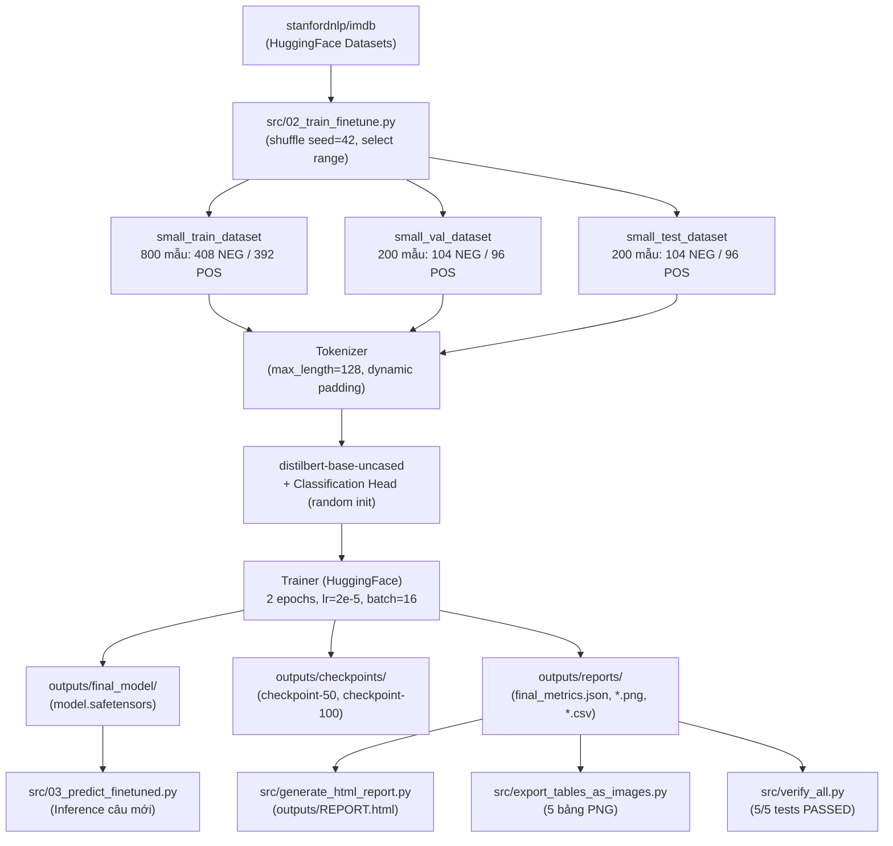

# Practice 3: Get Started with Hugging Face — Sentiment Analysis & Fine-tuning DistilBERT (IMDb)

Dự án tuân thủ các nguyên tắc kỹ thuật: **Source-First, No-Hallucination, Reproducible (seed=42), CPU-First và Test-Driven**.

---

## 1. Project Overview

Dự án triển khai và đánh giá quy trình làm việc với hệ sinh thái Hugging Face (`transformers`, `datasets`, `evaluate`) qua 2 bài tập:

- **Exercise 1 — Pretrained Inference:** Kiểm tra pipeline `sentiment-analysis`, cơ chế Tokenizer (WordPiece sub-words, token IDs, attention mask, dynamic padding) và tính xác suất từ logits qua hàm Softmax.
- **Exercise 2 — Fine-tuning DistilBERT trên IMDb:** Thực hiện quy trình 7 bước chuẩn: nạp dữ liệu → phân chia chống rò rỉ → tokenize → đo baseline → cấu hình Trainer → fine-tune 2 epochs → đánh giá trên Test Set và phân tích lỗi.

Thành phần bàn giao của hệ thống:
- **Mã nguồn modular:** Phân tách rõ ràng từng chức năng (`src/`).
- **Notebook chuẩn hóa:** 41 cells (18 code cells được đánh số thứ tự thực thi 1..18, lưu trữ đầy đủ toàn bộ đầu ra và 4 biểu đồ trực quan hóa canonical).
- **Bộ báo cáo đồng bộ:** 17 file outputs (5 biểu đồ PNG, 5 bảng PNG, 7 file dữ liệu CSV/JSON/Manifest).
- **Báo cáo HTML:** Tự động tổng hợp kết quả trực quan (`outputs/REPORT.html`).
- **Bộ kiểm thử tự động:** Script verify xác thực 5/5 bài test thành công.

---

## 2. Problem Statement

- **Dữ liệu thực nghiệm:** [`stanfordnlp/imdb`](https://huggingface.co/datasets/stanfordnlp/imdb) — Phân loại cảm xúc nhị phân: `0 = NEGATIVE`, `1 = POSITIVE`.
- **Mô hình nền tảng:** [`distilbert/distilbert-base-uncased`](https://huggingface.co/distilbert/distilbert-base-uncased) — 6 layers, 66M tham số, nhẹ hơn 40% và nhanh hơn 60% so với BERT gốc.
- **Thách thức kỹ thuật:**
  1. *Phân phối dữ liệu:* IMDb chưa shuffle chứa toàn bộ 12,500 mẫu NEGATIVE ở đầu; cần gọi `shuffle(seed=42)` trước khi `select()` để cân bằng nhãn.
  2. *Giới hạn độ dài token:* Giới hạn `max_length=128` cắt ngắn **86.0%** (172/200) mẫu Test; kiểm tra tương quan lỗi qua Fisher's Exact Test ($p=0.8153$, không có khác biệt thống kê).
  3. *Tài nguyên thực thi:* Chạy trên môi trường CPU — thời gian hoàn tất huấn luyện: **391.42s (~6.52 phút trên CPU)** qua 100 optimization steps.

---

## 3. Main Features

- **Notebook chuẩn hóa 41 cells:** Cung cấp luồng thực thi từ EDA, training đến đánh giá và phân tích lỗi, tích hợp đầy đủ 4 biểu đồ trực quan hóa (EDA, Learning Curves, Benchmark, Confusion Matrix).
- **Phân tích khám phá dữ liệu (EDA):** Thống kê phân bố nhãn (408 NEG / 392 POS), biểu đồ độ dài token và không gian vector TF-IDF + PCA 2D (PC1=0.84%, PC2=0.65%).
- **Đánh giá đa tầng:** Đo đạc đối chiếu giữa Untrained Baseline (44.00%), Majority Baseline (52.00%) và Fine-tuned (74.50%) kèm khoảng tin cậy Wilson 95% [68.04%, 80.04%].
- **Hệ thống file kết quả đồng bộ:** Xuất đủ 17 files (5 biểu đồ PNG, 5 bảng PNG, 7 file dữ liệu CSV/JSON/Manifest) khớp dữ liệu thực tế.
- **Kiểm thử tự động 5/5:** Chạy lệnh `python src/verify_all.py` để kiểm tra toàn diện notebook, file báo cáo, số liệu, mô hình và báo cáo HTML.

---

## 4. System Architecture



---

## 5. Folder Structure

```text
DL_lab3/
├── .gitignore                              # Quy tắc loại trừ tệp nhị phân lớn (*.safetensors, *.pt), checkpoints và cache
├── README.md                               # Tài liệu tổng quan dự án, hướng dẫn cài đặt và vận hành
├── REPORT.md                               # Báo cáo học thuật chi tiết 8 chương về quá trình thực nghiệm
├── RULES.md                                # Quy chuẩn dự án: Khoa học dữ liệu, Kỹ thuật phần mềm & Chuẩn ngôn ngữ
├── requirements.txt                        # Danh sách phụ thuộc: transformers, datasets, evaluate, torch, scikit-learn
├── docs/                                   # Hệ thống tài liệu kỹ thuật chuyên đề
│   ├── AUDIT_LOG.md                        # Nhật ký kiểm toán 5 giai đoạn, đối soát dữ liệu và phân xử P0/P1
│   ├── data.md                             # Báo cáo phân tích dữ liệu IMDb, phân phối nhãn, độ dài và PCA 2D
│   ├── demo.md                             # Hướng dẫn chạy thử nghiệm suy luận dòng lệnh CLI (Inference Demo)
│   ├── evaluation.md                       # Đặc tả đánh giá định lượng, ma trận nhầm lẫn và kiểm định thống kê
│   ├── labs3-description.md                # Đặc tả toàn diện đề bài Practice 3 và kiến trúc giải pháp
│   ├── model.md                            # Đặc tả kiến trúc DistilBERT, cơ chế Attention và Fine-tuning Head
│   ├── plan-progress-status.md             # Kế hoạch chi tiết, tiến độ các giai đoạn và trạng thái kiểm định
│   ├── REPORT.md                           # Bản sao lưu trữ báo cáo kỹ thuật dự án trong thư mục docs
│   └── training.md                         # Báo cáo tiến trình huấn luyện, đường cong hàm mất mát và tối ưu hóa
├── notebooks/                              # Thư mục thực thi Jupyter Notebook
│   ├── Practice3_HuggingFace_Final.ipynb   # Notebook thực hành chính — 41 cells chuẩn hóa, trực quan hóa đầy đủ
│   └── Practice3_HuggingFace_Final.html    # Bản kết xuất tĩnh HTML từ notebook để xem nhanh trên trình duyệt
├── outputs/                                # Thư mục chứa kết quả thực nghiệm và tài sản xuất bản
│   ├── REPORT.html                         # Báo cáo độc lập HTML chuẩn xuất bản, nhúng trực tiếp 10 hình ảnh/bảng
│   ├── REPORT.md                           # Bản sao báo cáo thực hành đồng bộ với thư mục gốc
│   ├── checkpoints/                        # Checkpoints lưu trong quá trình huấn luyện (loại trừ khỏi Git)
│   │   ├── checkpoint-50/                  # Trọng số và trạng thái optimizer tại Step 50 (Epoch 1)
│   │   └── checkpoint-100/                 # Trọng số và trạng thái optimizer tại Step 100 (Epoch 2)
│   ├── final_model/                        # Mô hình tối ưu được lựa chọn sau huấn luyện (loại trừ khỏi Git)
│   │   ├── config.json                     # Cấu hình mô hình DistilBERT num_labels=2
│   │   ├── model.safetensors               # Trọng số mô hình định dạng SafeTensors an toàn (255.43 MB)
│   │   ├── special_tokens_map.json         # Ánh xạ các token đặc biệt ([CLS], [SEP], [UNK], [PAD], [MASK])
│   │   ├── tokenizer.json                  # Từ điển tokenizer định dạng JSON
│   │   ├── tokenizer_config.json           # Cấu hình tiền xử lý tokenizer
│   │   ├── training_args.bin               # Tham số huấn luyện nhị phân của Hugging Face Trainer
│   │   └── vocab.txt                       # Bộ từ vựng WordPiece (30,522 tokens)
│   └── reports/                            # 20 tệp báo cáo số liệu thực nghiệm, manifests và biểu đồ đồ họa
│       ├── classification_report.csv       # Bảng chi tiết Precision, Recall, F1-score và Support từng lớp
│       ├── confusion_matrix.csv            # Ma trận nhầm lẫn dạng bảng: TN=84, FP=20, FN=31, TP=65
│       ├── confusion_matrix.png            # Biểu đồ nhiệt ma trận nhầm lẫn trên tập Test Set (200 mẫu)
│       ├── data_label_distribution.png     # Biểu đồ cột phân phối nhãn cân bằng giữa các phân vùng dữ liệu
│       ├── data_manifest.csv               # Danh mục chi tiết 1,200 mẫu kèm split, label, độ dài và hash MD5
│       ├── data_manifest.json              # Siêu dữ liệu phân vùng, tỷ lệ nhãn và kiểm chứng Zero Overlap
│       ├── data_token_length_distribution.png # Biểu đồ tần suất phân bố độ dài token và ngưỡng cắt 128
│       ├── eda_distribution.png            # Đồ thị tổng hợp EDA khám phá dữ liệu (nhãn & độ dài câu)
│       ├── error_analysis.csv              # Danh sách chi tiết 51 ca dự đoán sai kèm logits, xác suất và văn bản
│       ├── final_metrics.json              # Tổng hợp chỉ số hiệu năng thực nghiệm, baselines và kiểm định
│       ├── pca_2d_distribution.png         # Biểu đồ không gian tiềm ẩn PCA 2 chiều phân cụm đặc trưng ngữ nghĩa
│       ├── predictions.csv                 # Toàn bộ 200 mẫu Test kèm logits, xác suất, confidence và kết quả
│       ├── run_manifest.json               # Mã băm SHA-256 toàn bộ artifacts, thông số môi trường và phiên bản thư viện
│       ├── table_benchmark_metrics.png     # Bảng hình ảnh đối chiếu hiệu năng giữa Baselines và Fine-tuned
│       ├── table_classification_report.png # Bảng hình ảnh báo cáo phân loại chi tiết từng lớp
│       ├── table_data_split.png            # Bảng hình ảnh quy cách phân chia dữ liệu Train/Val/Test
│       ├── table_error_analysis.png        # Bảng hình ảnh tổng hợp 5 ca dự đoán sai có độ tự tin cao nhất
│       ├── table_training_progress.png     # Bảng hình ảnh tiến trình tối ưu hóa qua các bước huấn luyện
│       ├── test_comparison_and_per_class.png # Biểu đồ cột so sánh Baseline vs Fine-tuned và chỉ số từng lớp
│       └── training_curves.png             # Đồ thị đường cong Training/Validation Loss và Validation Accuracy
└── src/                                    # Mã nguồn phát triển hệ thống pipeline (9 scripts mô-đun hóa)
    ├── 01_sentiment_analysis.py            # Bài 1: Phân tích cảm xúc với Pretrained Model SST-2, so sánh Softmax
    ├── 02_train_finetune.py                # Bài 2: Quy trình 7 bước Fine-tuning DistilBERT trên IMDb, cô lập Test Set
    ├── 03_predict_finetuned.py             # Script CLI nạp Checkpoint đã lưu để dự đoán cảm xúc câu văn bản mới
    ├── export_tables_as_images.py          # Tự động xuất 5 bảng số liệu định lượng thành tệp hình ảnh PNG
    ├── generate_data_charts.py             # Sinh biểu đồ phân tích dữ liệu (Label Distribution, Token Length, PCA)
    ├── generate_dynamic_plots.py           # Sinh đồ thị thực nghiệm (Confusion Matrix, Test Comparison, Curves)
    ├── generate_html_report.py             # Tạo báo cáo độc lập REPORT.html nhúng toàn bộ biểu đồ và bảng PNG
    ├── pipeline_utils.py                   # Thư viện tiện ích dùng chung: phân chia dữ liệu, manifests, tính metrics
    └── verify_all.py                       # Bộ kiểm thử hồi quy tự động 5 pha kiểm tra toàn vẹn toàn diện hệ thống
```

---

## 6. Installation / Run / Test

### 6.1. Cài đặt môi trường

Dự án hỗ trợ Python 3.10+ (đã xác thực trên Python 3.13.15, Windows 11).

```bash
pip install -r requirements.txt
```

### 6.2. Chạy kiểm thử hồi quy tự động

```bash
python src/verify_all.py
```

Kết quả chuẩn: `TẤT CẢ 5/5 BÀI TEST ĐỀU ĐẠT CHUẨN (PASSED 100%)`

### 6.3. Chạy Exercise 1 — Sentiment Analysis với Pretrained Model

```bash
python src/01_sentiment_analysis.py
```

*Tải model SST-2, chạy inference qua pipeline, xuất bảng token và tính xác suất qua Softmax.*

### 6.4. Chạy Exercise 2 — Fine-tuning DistilBERT

```bash
python src/02_train_finetune.py
```

*Thực hiện 7 bước: Nạp dữ liệu → shuffle → chia tập → tokenize → đo baseline → fine-tune 2 epochs → lưu model và xuất báo cáo.*

### 6.5. Dự đoán câu mới với model đã fine-tune

```bash
python src/03_predict_finetuned.py --text "This movie was absolutely amazing!"
```

### 6.6. Xuất bảng số liệu dạng PNG

```bash
python src/export_tables_as_images.py
```

### 6.7. Render báo cáo HTML

```bash
python src/generate_html_report.py
```

---

## 7. Model & Hyperparameters

| Siêu tham số | Giá trị | Lý do |
|---|:---:|---|
| `base_model` | `distilbert-base-uncased` | 66M tham số, nhẹ và nhanh hơn 60% so với BERT gốc |
| `learning_rate` | `2e-5` | Tốc độ học chuẩn cho Transfer Learning, tránh quên tri thức cũ |
| `per_device_train_batch_size` | `16` | Cân bằng giữa tốc độ xử lý và độ ổn định của gradient |
| `num_train_epochs` | `2` | Tránh học vẹt (overfitting) trên tập dữ liệu nhỏ 800 mẫu |
| `max_length` | `128` | Cân đối giữa mức sử dụng RAM và độ bao phủ câu |
| `seed` | `42` | Cố định ngẫu nhiên để tái lập kết quả |
| `load_best_model_at_end` | `True` | Tự động nạp lại checkpoint có Val Accuracy cao nhất |
| `metric_for_best_model` | `accuracy` | Tiêu chí chọn mô hình tối ưu |

---

## 8. Dataset Split

| Tập | Nguồn | Mẫu | NEGATIVE | POSITIVE |
|---|---|:---:|:---:|:---:|
| **Train** | IMDb train, shuffle(42), select(0–799) | 800 | 408 (51.0%) | 392 (49.0%) |
| **Validation** | IMDb train, shuffle(42), select(800–999) | 200 | 104 (52.0%) | 96 (48.0%) |
| **Test** | IMDb test, shuffle(42), select(0–199) | 200 | 104 (52.0%) | 96 (48.0%) |

> Token > 128 trên Train: **87.5%** (700/800) | Trên Test: **86.0%** (172/200)

---

## 9. Example Output

### Console output khi chạy `src/02_train_finetune.py`

```text
=================================================================
EXERCISE 2: FINE-TUNING DISTILBERT TRÊN BỘ DỮ LIỆU IMDB
=================================================================
Dataset: stanfordnlp/imdb | Seed: 42
Train: 800 mẫu (408 NEG, 392 POS) | Val: 200 | Test: 200

Baseline (Untrained Head) trên Val Set:
  Accuracy: 44.00% | Loss: 0.6972

Training: 2 epochs | lr=2e-5 | batch=16
  Step  50 | Val Loss: 0.5998 | Val Acc: 69.50%
  Step 100 | Val Loss: 0.5118 | Val Acc: 76.50% ← Best Model

Test Set Evaluation (Final):
  Accuracy: 74.50% (149/200)
  Macro F1: 74.27% | Precision: 74.76% | Recall: 74.24%
  Wilson 95% CI: [68.04%, 80.04%]

Files saved to outputs/reports/:
  - final_metrics.json
  - confusion_matrix.png / .csv
  - training_curves.png
  - eda_distribution.png
  - pca_2d_distribution.png
  - test_comparison_and_per_class.png
  - classification_report.csv / error_analysis.csv
=================================================================
```

### File `outputs/reports/final_metrics.json` (trích)

```json
{
  "test_accuracy": 74.5,
  "test_macro_f1": 74.27,
  "test_precision": 74.76,
  "test_recall": 74.24,
  "test_loss": 0.5565,
  "correct_predictions": 149,
  "total_samples": 200,
  "wilson_95_ci": [68.04, 80.04],
  "majority_baseline": 52.0,
  "untrained_head_val_baseline": 44.0,
  "confusion_matrix": [[84, 20], [31, 65]]
}
```

---

## 10. Results

### Baseline vs Fine-tuned (Test Set N=200)

| Mô hình | Tập đánh giá | Accuracy | Macro F1 | 95% CI (Wilson) |
|---|---|:---:|:---:|:---:|
| Untrained Head Baseline | Val Set (200 mẫu) | 44.00% | — | — |
| Majority-Class Baseline | Test Set (200 mẫu) | 52.00% | — | — |
| **DistilBERT Fine-tuned** | **Test Set (200 mẫu)** | **74.50%** | **74.27%** | **[68.04%, 80.04%]** |

> **Phân tích tăng trưởng (+ Gain):**
> - **Same-split Val Gain:** Untrained Val (44.00%) → Fine-tuned Best Val (76.50%): **+32.50%**.
> - **Same-split Test Gain vs Majority:** Train Majority áp lên Test (52.00%) → Fine-tuned Test (74.50%): **+22.50%**.
> - **Cross-split Reference:** Untrained Val (44.00%) → Fine-tuned Test (74.50%): **+30.50%** (tham chiếu chéo).

### Confusion Matrix (200 mẫu Test)

| | Dự đoán NEG | Dự đoán POS |
|---|:---:|:---:|
| **Thực tế NEG (104)** | **84** TN (42.0%) | 20 FP (10.0%) |
| **Thực tế POS (96)** | 31 FN (15.5%) | **65** TP (32.5%) |

### Per-class Metrics

| Lớp | Precision | Recall | F1-Score | Support |
|---|:---:|:---:|:---:|:---:|
| NEGATIVE | 73.0% | 80.8% | 76.7% | 104 |
| POSITIVE | 76.5% | 67.7% | 71.8% | 96 |
| **Macro Avg** | **74.76%** | **74.24%** | **74.27%** | **200** |

### Training Progress

| Epoch | Step | Train Loss | Val Loss | Val Accuracy |
|---|:---:|:---:|:---:|:---:|
| 0 (Untrained) | 0 | — | 0.6974 | 44.00% |
| Epoch 1 | 50 | 0.6155 | 0.5998 | 69.50% |
| **Epoch 2 (Best)** | **100** | **0.5032** | **0.5118** | **76.50%** |

> *Chi tiết báo cáo định lượng, biểu đồ và phân tích lỗi đầy đủ tại [`outputs/REPORT.html`](outputs/REPORT.html) và [`notebooks/Practice3_HuggingFace_Final.ipynb`](notebooks/Practice3_HuggingFace_Final.ipynb).*

---

## 11. Verification (Test-Driven)

```bash
python src/verify_all.py
```

| Test | Nội dung kiểm tra | Kết quả |
|---|---|:---:|
| 1 | Notebook chuẩn hóa: 41 cells, chứa đủ 4 biểu đồ trực quan hóa | PASSED |
| 2 | 9 file `outputs/reports/` tồn tại & không rỗng | PASSED |
| 3 | `accuracy=74.5%`, `TN=84, FP=20, FN=31, TP=65` | PASSED |
| 4 | Model nạp từ `outputs/final_model/` → suy luận POSITIVE (78.23%) | PASSED |
| 5 | `outputs/REPORT.html` nhúng đủ 5 biểu đồ | PASSED |

---

## 12. Limitations

1. **Cỡ mẫu nhỏ:** Dùng 800 mẫu train và 200 mẫu test trên tổng số 25,000 mẫu của IMDb, độ chính xác có thể dao động nhẹ theo seed.
2. **Cắt ngắn độ dài token:** Giới hạn `max_length=128` khiến 86% mẫu Test bị cắt phần đuôi văn bản.
3. **Môi trường CPU:** Tốc độ huấn luyện ~2 phút/epoch, phù hợp mục đích học tập và kiểm thử cục bộ.
4. **Thử nghiệm đơn seed:** Toàn bộ kết quả thực hiện trên `seed=42`, cần chạy thêm nhiều seed để lấy độ lệch chuẩn.
5. **Cảm xúc phức hợp (Mixed Sentiment):** Mô hình gặp khó khăn với các bài đánh giá có sắc thái mỉa mai hoặc khen chê đan xen.

---

## 13. Future Improvements

1. **Mở rộng dữ liệu:** Huấn luyện trên toàn bộ 25,000 mẫu của IMDb để tăng độ khái quát hóa.
2. **Tăng độ dài token:** Nâng `max_length` lên 256 hoặc 512 trên GPU để giữ trọn vẹn ngữ cảnh.
3. **Bộ điều chỉnh tốc độ học:** Áp dụng `warmup_ratio` và `CosineDecay` giúp mô hình hội tụ mượt mà hơn.
4. **Thực nghiệm đa seed:** Chạy pipeline trên 5 seed độc lập để tính trung bình và độ lệch chuẩn.
5. **Trực quan hóa Attention:** Phân tích trọng số attention weights để giải thích các trường hợp phân loại sai.

---

## 14. AI Usage

Khai báo công cụ và phạm vi hỗ trợ của AI được trình bày tại [`docs/AUDIT_LOG.md`](docs/AUDIT_LOG.md).
