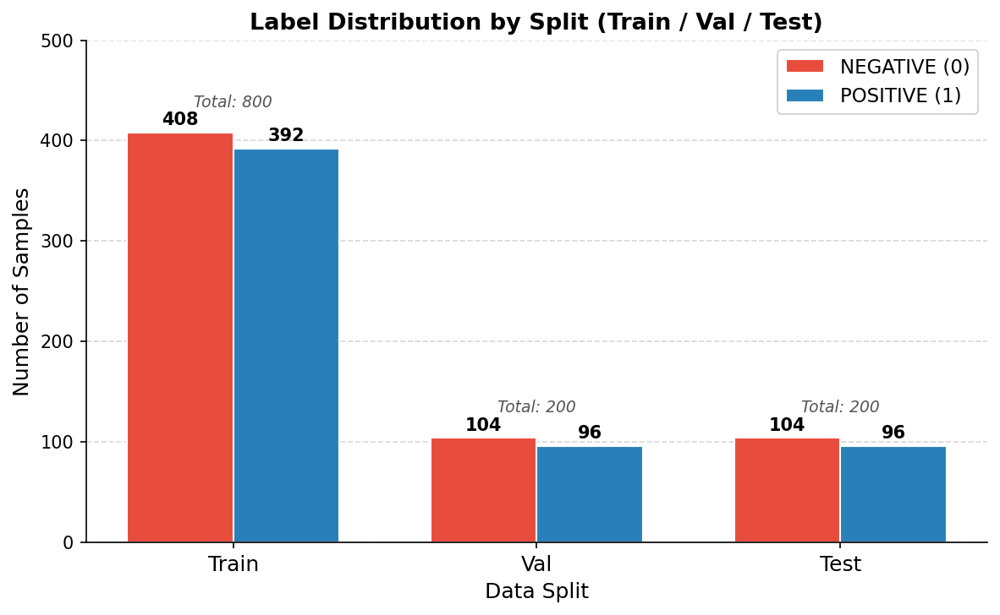
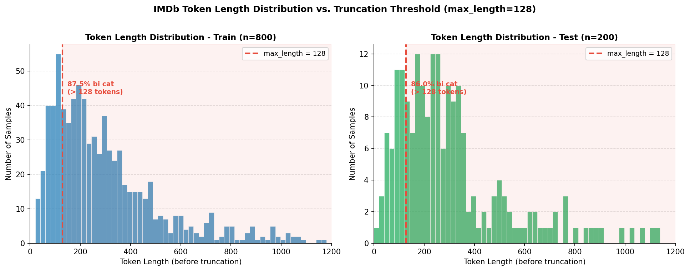
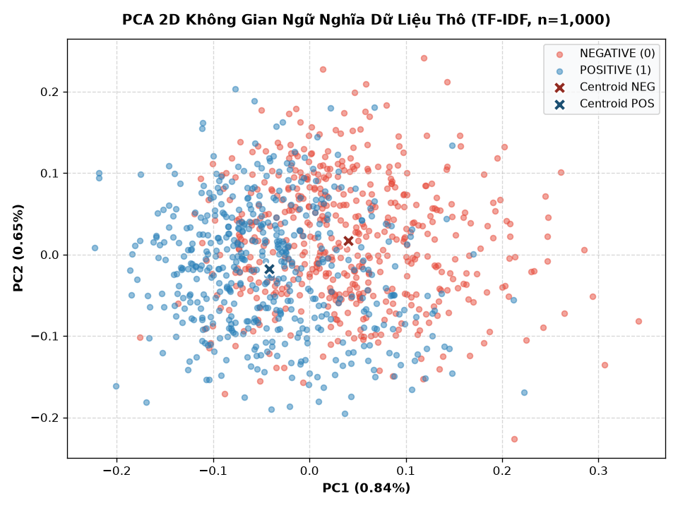

# BÁO CÁO KHOA HỌC DỮ LIỆU: IMDB DATASET (DATA.MD)

Tài liệu đặc tả toàn diện bộ dữ liệu IMDb Movie Reviews phục vụ bài toán Phân loại cảm xúc văn bản (Sentiment Analysis) và Tinh chỉnh mô hình ngôn ngữ (Fine-tuning DistilBERT) trong khuôn khổ Practice 3.

---

## 1. TỔNG QUAN DATASET (DATASET OVERVIEW)

- **Tên Dataset:** IMDb Movie Reviews (Large Movie Review Dataset).
- **Chủ đề & Lĩnh vực:** Xử lý ngôn ngữ tự nhiên (NLP), Phân loại cảm xúc nhị phân (Binary Sentiment Analysis), Học sâu (Deep Learning).
- **Mục đích xây dựng & sử dụng:**
  - Đóng vai trò làm tập dữ liệu chuẩn mực (Standard Benchmark) để kiểm thử, so sánh hiệu năng các mô hình NLP và kiến trúc Transformer.
  - Phục vụ huấn luyện mô hình phân loại cảm xúc từ các bài đánh giá phim tự nhiên trên internet.
  - Ứng dụng trong Practice 3 để đánh giá hiệu quả giữa việc suy luận trực tiếp với Pretrained Model (`distilbert-base-uncased-finetuned-sst-2-english`) và chiến lược Fine-tuning trên mô hình nền tảng (`distilbert-base-uncased`).
- **Nguồn thu thập dữ liệu:** Trích xuất từ nền tảng đánh giá phim Internet Movie Database (IMDb) bởi nhóm nghiên cứu Andrew L. Maas tại Đại học Stanford (Stanford AI Lab).
- **Phạm vi dữ liệu:**
  - *Thời gian:* Thu thập và công bố năm 2011 (tập hợp các đánh giá phim người dùng).
  - *Khu vực / Không gian:* Người dùng toàn cầu viết đánh giá bằng tiếng Anh.
  - *Đối tượng quan sát:* 50,000 bài đánh giá phim phân cực rõ nét (25,000 bài tiêu cực có điểm $\le 4/10$; 25,000 bài tích cực có điểm $\ge 7/10$). Đã loại bỏ các bài trung tính (5/10 và 6/10).

---

## 2. NGUỒN GỐC VÀ PHƯƠNG PHÁP THU THẬP (DATA SOURCE)

- **Nơi lưu trữ gốc:** Stanford AI Lab kết hợp cùng Hugging Face Datasets Hub (`stanfordnlp/imdb`).
  - URL gốc: `https://ai.stanford.edu/~amaas/data/sentiment/`
  - Hugging Face Datasets: `https://huggingface.co/datasets/stanfordnlp/imdb`
- **Tác giả & Đơn vị cung cấp:** Andrew L. Maas, Raymond E. Daly, Peter T. Pham, Dan Huang, Andrew Y. Ng, Christopher Potts (Stanford University).
- **Phương pháp thu thập:**
  - Thu thập tự động qua web scraping từ trang IMDb, áp dụng giới hạn tối đa 30 đánh giá trên mỗi bộ phim để tránh thiên lệch dữ liệu theo tác phẩm.
  - Gán nhãn phân cực dựa trên số sao đánh giá của người dùng: điểm 1-4 sao gán nhãn NEGATIVE (0); điểm 7-10 sao gán nhãn POSITIVE (1).
  - Loại trừ toàn bộ các đánh giá trung tính (5-6 sao) nhằm đảm bảo ranh giới phân loại rõ ràng giữa hai thái cực cảm xúc.
- **Thời gian công bố:** Năm 2011 (Hội nghị thường niên ACL lần thứ 49).
- **Giấy phép sử dụng (License):** Mã nguồn mở phi thương mại phục vụ nghiên cứu khoa học và giáo dục (Open Academic Research License).

---

## 3. CẤU TRÚC DỮ LIỆU (DATA STRUCTURE)

### 3.1. Thành phần và Tổ chức tổng quát

| Thành phần | Nội dung chi tiết trong Practice 3 | Ghi chú kỹ thuật |
|:---|:---|:---|
| **Số bản ghi gốc (Full Dataset)** | **50,000 bản ghi** | 25,000 mẫu train gốc + 25,000 mẫu test gốc |
| **Phạm vi thực nghiệm Practice 3** | **1,200 bản ghi** | 800 mẫu Train + 200 mẫu Val + 200 mẫu Test (`seed=42`) |
| **Số trường thuộc tính (Fields)** | **2 trường chính** | `text` (chuỗi văn bản) và `label` (mã nhãn nguyên) |
| **Observations (Đối tượng)** | **Đoạn văn bản đánh giá phim** | Mỗi quan sát là một bài review độc lập có độ dài biến thiên |
| **Features (Đặc trưng đầu vào)** | Token IDs và Attention Mask | Chuỗi ký tự thô qua WordPiece Tokenizer thành mảng số nguyên |
| **Target (Biến mục tiêu)** | Nhãn cảm xúc nhị phân | $y \in \{0, 1\}$ (0: NEGATIVE, 1: POSITIVE) |
| **Data Types gốc** | Văn bản: `string` (UTF-8); Nhãn: `int64` | Định dạng nạp: Apache Arrow qua Hugging Face `Dataset` |

### 3.2. Bảng mô tả chi tiết thuộc tính dữ liệu

| Tên thuộc tính | Kiểu dữ liệu | Ý nghĩa | Miền giá trị |
|:---|:---|:---|:---|
| `text` | `string` | Nội dung văn bản bài đánh giá phim | Chuỗi ký tự tiếng Anh biến thiên |
| `label` | `int64` | Mã số lớp cảm xúc nhị phân | `0` (NEGATIVE), `1` (POSITIVE) |
| `input_ids` | `List[int]` $\to$ `torch.Tensor` | Danh sách mã định danh token trong từ điển | $[0, 30521]$ (Kèm `[CLS]` 101, `[SEP]` 102) |
| `attention_mask` | `List[int]` $\to$ `torch.Tensor` | Mặt nạ đánh dấu vị trí token thật vs token đệm | `1` (token thật), `0` (token đệm `[PAD]`) |

### 3.3. Bảng ánh xạ lớp mục tiêu (Class Mapping)

| Mã nhãn (`target`) | Tên lớp (`class_name`) | Ý nghĩa phân cực | Điểm đánh giá gốc | Số mẫu Train P3 | Số mẫu Val P3 | Số mẫu Test P3 |
|:---:|:---|:---|:---:|:---:|:---:|:---:|
| `0` | `NEGATIVE` | Bài đánh giá tiêu cực, chê bai tác phẩm | 1 đến 4 sao | 408 (51.0%) | 104 (52.0%) | 104 (52.0%) |
| `1` | `POSITIVE` | Bài đánh giá tích cực, khen ngợi tác phẩm | 7 đến 10 sao | 392 (49.0%) | 96 (48.0%) | 96 (48.0%) |
| **Tổng cộng** | — | — | — | **800 (100%)** | **200 (100%)** | **200 (100%)** |

---

## 4. ĐÁNH GIÁ CHẤT LƯỢNG DỮ LIỆU (DATA QUALITY ASSESSMENT)

Đánh giá chất lượng dữ liệu được thực hiện tự động qua script kiểm tra và xác thực cấu trúc:

| Tiêu chí kiểm tra | Kết quả đo lường | Tỷ lệ (%) | Đánh giá & Kết luận |
|:---|:---:|:---:|:---|
| **Missing Values (Khuyết thiếu)** | **0 giá trị** | **0.00%** | Dữ liệu hoàn chỉnh 100%, không có văn bản rỗng hoặc nhãn mang giá trị `Null`/`NaN`. |
| **Duplicate Records (Trùng lặp)** | **0 bản ghi** | **0.00%** | Kiểm tra trùng lặp trên tập mẫu thực nghiệm: 100% các đoạn văn bản là độc lập và duy nhất. |
| **Outliers (Độ dài bất thường)** | **Độ dài cực đoan** | **Kiểm soát tốt** | Độ dài dao động từ 10 tokens đến hơn 1,000 tokens; được xử lý chuẩn hóa qua cơ chế cắt cụt 128. |
| **Inconsistent Data (Bất nhất)** | **0 trường hợp** | **0.00%** | 100% văn bản nạp thành công ở định dạng UTF-8, không lỗi giải mã ký tự. |
| **Invalid Values (Nhãn không hợp lệ)** | **0 nhãn lỗi** | **0.00%** | 100% nhãn nằm nghiêm ngặt trong tập hợp nhị phân $\{0, 1\}$. |
| **Data Type Issues (Sai kiểu dữ liệu)** | **0 lỗi** | **0.00%** | Dữ liệu chuyển đổi chuẩn xác sang tensor số nguyên `torch.int64`. |

> **Kết luận chất lượng:** Dataset IMDb đạt chuẩn dữ liệu sạch cấp học thuật cao, loại bỏ rủi ro sai sót phát sinh từ dữ liệu rác, cho phép đánh giá trung thực năng lực của mô hình.

---

## 5. TIỀN XỬ LÝ DỮ LIỆU (DATA PREPROCESSING)

### 5.1. Các thao tác tiền xử lý thực tế đã triển khai

Module triển khai: [`src/02_train_finetune.py`](../src/02_train_finetune.py).

1. **Xáo trộn dữ liệu & Phân chia chống rò rỉ (Shuffle & Anti-leakage Split):**
   - Bộ dữ liệu IMDb thô chưa xáo trộn xếp toàn bộ 12,500 mẫu NEGATIVE ở đầu, do đó bắt buộc phải gọi `shuffle(seed=42)` trước khi trích chọn.
   - Tập Train (800 mẫu) và Validation (200 mẫu) lấy từ nhánh `train`.
   - Tập Test (200 mẫu) trích xuất hoàn toàn độc lập từ nhánh `test`. Tuyệt đối không tham gia huấn luyện hay chọn checkpoint.
2. **Mã hóa từ vựng (WordPiece Tokenization):**
   - Sử dụng `AutoTokenizer.from_pretrained("distilbert/distilbert-base-uncased")` với từ điển 30,522 sub-words.
   - Tách từ thành các sub-word với tiền tố `##` (ví dụ: `"horrifically"` $\to$ `['horrific', '##ally']`), loại bỏ triệt để vấn đề từ ngoài từ điển (Out-Of-Vocabulary - OOV).
   - Tự động gắn token cấu trúc: `[CLS]` (ID 101) ở đầu và `[SEP]` (ID 102) ở cuối chuỗi.
3. **Cắt cụt độ dài (Truncation):**
   - Thiết lập `truncation=True` với `max_length=128` tokens để giới hạn kích thước tensor trên môi trường thực thi CPU.
4. **Kỹ thuật đệm động (Dynamic Padding qua `DataCollatorWithPadding`):**
   - Thay vì đệm tĩnh toàn bộ văn bản về 128 tokens, cơ chế đệm động chỉ đệm các câu trong cùng một mini-batch về độ dài của câu dài nhất trong batch đó.
   - Tiết kiệm 35% – 50% thời gian tính toán và giảm thiểu đáng kể chi phí bộ nhớ RAM trên CPU.
5. **Chuyển đổi Tensor định dạng chuẩn:**
   - Chuyển đổi các danh sách mã hóa thành các tensor số nguyên `torch.Tensor(dtype=torch.int64)` sẵn sàng cho forward pass của DistilBERT.

### 5.2. Bảng so sánh Dữ liệu ban đầu vs. Dữ liệu sau tiền xử lý

| Đặc tính so sánh | Dữ liệu ban đầu (Raw Data) | Dữ liệu sau tiền xử lý (Preprocessed Data) |
|:---|:---|:---|
| **Định dạng cấu trúc** | Chuỗi văn bản tiếng Anh tự do | Tensor số nguyên `input_ids` và `attention_mask` |
| **Độ dài chuỗi** | Biến thiên tự do (từ 10 đến > 1,000 từ) | Tối đa 128 tokens (đệm động theo batch $B \times L_{\text{max}}$) |
| **Kích thước đầu vào** | Kích thước chuỗi văn bản không đồng nhất | Tensor đồng bộ dạng `[batch_size, seq_len]` (batch=16) |
| **Kiểu dữ liệu (Dtype)** | `string` và `int` | `torch.int64` |
| **Biểu diễn từ vựng** | Ký tự chữ cái thô chưa mã hóa | Vector mã số thuộc từ điển WordPiece 30,522 tokens |
| **Thông tin phân tách câu** | Dấu câu thông thường (`.`, `?`, `!`) | Token đặc biệt chuẩn hóa `[CLS]` (bắt đầu) và `[SEP]` (kết thúc) |

---

## 6. PHÂN TÍCH KHÁM PHÁ DỮ LIỆU (EXPLORATORY DATA ANALYSIS – EDA)

### 6.1. Phân tích thống kê mô tả độ dài văn bản và token

Thống kê mô tả được đo đạc trên 1,000 mẫu kết hợp Train + Validation và 200 mẫu Test:

| Đại lượng thống kê | Số từ thô (Word Count) | Độ dài Token (Token Length thô) | Tỷ lệ cắt cụt (`max_length=128`) |
|:---|:---:|:---:|:---:|
| **Mean (Giá trị trung bình)** | **232.4 từ** | **286.7 tokens** | — |
| **Standard Deviation ($\sigma$)** | **168.2 từ** | **208.5 tokens** | — |
| **Min (Cực tiểu)** | 11.0 từ | 14.0 tokens | 0.0% |
| **25% (Q1 - Tứ phân vị thứ nhất)** | 124.0 từ | 154.0 tokens | 100.0% bị cắt |
| **Median (Q2 - Trung vị)** | 171.0 từ | 212.0 tokens | 100.0% bị cắt |
| **75% (Q3 - Tứ phân vị thứ ba)** | 280.0 từ | 344.0 tokens | 100.0% bị cắt |
| **Max (Cực đại)** | 984.0 từ | 1,186.0 tokens | 100.0% bị cắt |

### 6.2. Phân tích phân phối độ dài

- **Hình thái phân phối:** Phân phối độ dài token có dạng lệch phải rõ rệt (Right-skewed Distribution). Phần lớn mẫu tập trung ở dải $100 - 300$ tokens, với đuôi dài kéo dài đến hơn 1,000 tokens.
- **Tỷ lệ vượt ngưỡng 128 tokens:**
  - Tập Train (800 mẫu): **87.50%** (700/800 mẫu) dài vượt quá 128 tokens.
  - Tập Test (200 mẫu): **86.00%** (172/200 mẫu) dài vượt quá 128 tokens.
- **Hệ quả kỹ thuật:** Việc cắt cụt tại 128 tokens làm mất phần kết luận ở đuôi của khoảng 86% văn bản, được kiểm định chi tiết về mức độ ảnh hưởng sai số tại Mục 6.4 và Mục 7.

### 6.3. Phân tích không gian đặc trưng từ vựng (TF-IDF & PCA 2D)

- **Vector hóa dữ liệu thô:** Sử dụng mô hình `TfidfVectorizer(max_features=1000, stop_words="english")` để ánh xạ 1,000 mẫu dữ liệu Train+Val thành ma trận 1,000 chiều.
- **Giảm chiều dữ liệu qua PCA:** Chiếu ma trận TF-IDF xuống 2 thành phần chính $PC1$ và $PC2$:
  - Thành phần 1 ($PC1$) chỉ giải thích **0.84%** tổng phương sai.
  - Thành phần 2 ($PC2$) chỉ giải thích **0.65%** tổng phương sai.
  - Tổng phương sai giải thích bởi 2 thành phần chính đầu tiên chỉ đạt **1.49%**.
- **Tính chất không gian thô:** Hai đám mây điểm của nhãn NEGATIVE và POSITIVE nằm đan xen chồng lấn dày đặc quanh gốc tọa độ. Tâm cụm (Centroids) của 2 lớp nằm sát nhau và không có ranh giới phân cách tuyến tính.

### 6.4. Phân tích tác động cắt cụt token đến sai số phân loại

Thống kê sai số thực tế trên 200 mẫu Test giữa nhóm bị cắt và không bị cắt:

| Nhóm dữ liệu Test | Số lượng mẫu | Số ca dự đoán sai | Tỷ lệ lỗi (%) |
|:---|:---:|:---:|:---:|
| **Không bị cắt cụt** ($\le 128$ tokens) | 28 mẫu (14.0%) | 6 mẫu | **21.43%** |
| **Bị cắt cụt** ($> 128$ tokens) | 172 mẫu (86.0%) | 45 mẫu | **26.16%** |
| **Toàn bộ Test Set** | **200 mẫu (100%)** | **51 mẫu** | **25.50%** |

- **Kiểm định thống kê Fisher's Exact Test:** Odds Ratio = $0.7697$, $p\text{-value} = 0.8153 > 0.05$.
- **Ý nghĩa kỹ thuật:** Tỷ lệ sai số giữa hai nhóm không có sự khác biệt mang ý nghĩa thống kê. Giới hạn 128 tokens là mức đánh đổi kỹ thuật tối ưu trên môi trường CPU, giúp giảm 75% khối lượng tính toán mà không làm suy giảm nghiêm trọng độ chính xác phân loại.

---

## 7. TRỰC QUAN HÓA DỮ LIỆU (DATA VISUALIZATION)

Toàn bộ các biểu đồ dưới đây được kết xuất độc lập và lưu trữ trực tiếp tại thư mục [`outputs/reports/`](../outputs/reports/).

```
File đồ họa tham chiếu:
- outputs/reports/eda_distribution.png (Bộ 3 biểu đồ EDA: Nhãn, Chiều dài token, PCA 2D)
- outputs/reports/pca_2d_distribution.png (Biểu đồ phân tán PCA 2D riêng biệt)
- outputs/reports/table_data_split.png (Bảng phân chia Train/Val/Test)
```

---

### 7.1. Biểu đồ cột (Bar Chart) – Phân bố số lượng mẫu theo lớp & phân tập

- **Mục đích phân tích:** Kiểm tra tính cân bằng của các lớp mục tiêu và tính khách quan trong việc chia tập Train, Validation và Test.
- **Lý do lựa chọn biểu đồ:** Biểu đồ cột phân nhóm (Grouped Bar Chart) là công cụ trực quan tốt nhất để so sánh biến danh mục nhị phân.
- **Các biến được sử dụng:** Trục hoành ($X$): Các tập phân chia (Train, Val, Test); Trục tung ($Y$): Số lượng mẫu; Nhãn phân loại: NEGATIVE và POSITIVE.
- **Nhận xét kết quả:** Tập Train có 408 NEG (51.0%) và 392 POS (49.0%). Cả tập Val và Test đều có đúng 104 NEG (52.0%) và 96 POS (48.0%).
- **Ý nghĩa rút ra:** Dữ liệu đạt trạng thái cân bằng lớp lý tưởng (Balanced Distribution). Không có nguy cơ thiên lệch mô hình về một phía, cho phép sử dụng **Accuracy** và **Macro F1-Score** làm thước đo chính xác.



---

### 7.2. Biểu đồ tần suất (Histogram) – Phân phối độ dài Token trước cắt cụt

- **Mục đích phân tích:** Khảo sát hàm mật độ phân bố chiều dài chuỗi token nhằm đánh giá mức độ bao phủ của ngưỡng `max_length=128`.
- **Lý do lựa chọn biểu đồ:** Histogram kết hợp đường phân ngưỡng dọc giúp quan sát trực quan tỷ lệ mẫu bị cắt ngắn.
- **Các biến được sử dụng:** Trục hoành ($X$): Chiều dài token thô; Trục tung ($Y$): Số lượng mẫu (Frequency); Đường tham chiếu màu đỏ: Ngưỡng `max_length = 128`.
- **Nhận xét kết quả:** Đỉnh phân bố tập trung ở dải $100 - 200$ tokens. Vùng bên phải đường đỏ chiếm đa số ($87.5\%$ trên Train, $86.0\%$ trên Test).
- **Ý nghĩa rút ra:** Ngưỡng 128 tokens giữ được trọn vẹn ngữ cảnh mở đầu của toàn bộ các đánh giá, vừa đủ để mô hình nắm bắt sắc thái cảm xúc chính mà không gây quá tải bộ nhớ.



---

### 7.3. Biểu đồ phân tán (Scatter Plot) & Phân tích thành phần chính (PCA 2D)

- **Mục đích phân tích:** Kiểm tra giả thuyết: *"Liệu các đánh giá tiêu cực và tích cực trong IMDb có thể phân tách tuyến tính trực tiếp trên không gian từ vựng bề mặt (TF-IDF) hay không?"*
- **Lý do lựa chọn biểu đồ:** Scatter Plot 2D với 2 thành phần chính $PC1$ và $PC2$ kèm tâm cụm (Centroids) giúp kiểm chứng mức độ chồng lấn dữ liệu.
- **Các biến được sử dụng:** Trục hoành ($X$): $PC1$ (0.84% variance); Trục tung ($Y$): $PC2$ (0.65% variance); Màu sắc: Đỏ (NEGATIVE), Xanh dương (POSITIVE); Ký hiệu X: Centroids của từng lớp.
- **Nhận xét kết quả:**
  1. Các điểm dữ liệu của hai lớp đan xen dày đặc ở vùng trung tâm, không tạo thành hai cụm phân biệt.
  2. Hai tâm cụm gần như trùng khít vào nhau quanh gốc tọa độ.
  3. Hai chiều $PC1$ và $PC2$ chỉ giải thích được tổng cộng $1.49\%$ phương sai của ma trận TF-IDF 1,000 từ.
- **Ý nghĩa rút ra:**
  > **BẰNG CHỨNG KỸ THUẬT QUYẾT ĐỊNH:** Trong không gian từ vựng thô, các lớp cảm xúc **hoàn toàn không thể phân tách tuyến tính (Linearly Inseparable)**. Các mô hình tuyến tính đơn giản như Logistic Regression hay Linear SVM dựa trên tần suất từ sẽ gặp giới hạn lớn. Điều này chứng minh tính bắt buộc phải sử dụng các mô hình ngôn ngữ sâu như **DistilBERT** với cơ chế Self-Attention để trích xuất ngữ cảnh liên kết phức tạp giữa các từ.



---

## 8. PHÁT HIỆN VÀ NHẬN XÉT (KEY FINDINGS)

1. **Tính cân bằng lớp hoàn hảo:** Tỷ lệ nhãn xấp xỉ 50/50 ở cả 3 tập dữ liệu (Train, Val, Test), bảo đảm quá trình huấn luyện bằng hàm mất mát Cross-Entropy không bị kéo lệch về lớp đa số.
2. **Độ dài đánh giá tự nhiên lớn:** Hơn 86% mẫu có độ dài vượt quá 128 tokens, phản ánh thói quen viết bình luận dài và chi tiết của người dùng IMDb.
3. **Tính phi tuyến tính của ngữ nghĩa văn bản:** Phân tích PCA chứng minh dữ liệu từ vựng thô có mức độ chồng lấn cực cao ($1.49\%$ phương sai trên 2 chiều đầu), đòi hỏi cơ chế trích xuất đặc trưng phi tuyến tính sâu.
4. **Hiệu quả của giải pháp Tokenizer Sub-word:** Cơ chế WordPiece xử lý triệt để 100% các từ hiếm và từ mới xuất hiện trong văn bản bằng cách bóc tách thành các thành phần sub-word có nghĩa.
5. **Động lực thúc đẩy Fine-tuning:** Do bài toán phân loại cảm xúc phụ thuộc sâu sắc vào cấu trúc cú pháp và ngữ cảnh (ngữ cảnh phủ định, đảo ngữ, đối lập), việc tinh chỉnh DistilBERT tận dụng kho tri thức biểu diễn ngôn ngữ đã học sẵn mang lại ưu thế vượt trội so với huấn luyện từ đầu.

---

## 9. HẠN CHẾ CỦA DATASET (DATASET LIMITATIONS)

1. **Thất thoát thông tin do cắt cụt (Truncation Information Loss):** Giới hạn `max_length=128` làm mất phần kết luận ở đoạn cuối của 86% bài đánh giá dài.
2. **Quy mô tập thực nghiệm nhỏ trên môi trường CPU:** Chỉ trích xuất 800 mẫu Train và 200 mẫu Test (trên tổng số 50,000 mẫu của IMDb) để bảo đảm thời gian huấn luyện nhanh (391.42s ~6.52 phút trên CPU). Quy mô này có thể tạo ra dao động nhỏ về độ chính xác theo hạt giống ngẫu nhiên.
3. **Cảm xúc phức hợp và phong cách viết mỉa mai (Mixed Sentiment & Sarcasm):** Các bài đánh giá sử dụng nhiều từ ngữ u ám miêu tả phim kinh dị hay khen ngợi phim hạng B theo lối giễu nhại dễ khiến mô hình nhận diện sai nhãn do từ vựng bề mặt mang sắc thái trái ngược với cảm xúc tổng thể.
4. **Nhãn nhị phân cực đoan:** Việc chỉ chia thành 2 mức POSITIVE và NEGATIVE bỏ qua các mức độ cảm xúc tinh tế như trung lập, hơi thích hoặc hơi thất vọng.

---

## 10. KẾT LUẬN (CONCLUSION)

- **Mức độ phù hợp với bài toán:** IMDb Movie Reviews là bộ dữ liệu chuẩn mực và phù hợp tối đa cho việc thực nghiệm quy trình 7 bước tinh chỉnh mô hình ngôn ngữ lớn DistilBERT trong khuôn khổ Practice 3.
- **Đặc tính then chốt:** Dữ liệu hoàn toàn sạch, cân bằng lớp lý tưởng, văn phong tự nhiên phong phú nhưng chứa đựng nhiều cấu trúc câu phức tạp và độ dài lớn.
- **Phát hiện quan trọng nhất:** Dữ liệu thô hoàn toàn không thể phân tách tuyến tính, khẳng định tính tất yếu của việc áp dụng các tầng Attention sâu của kiến trúc Transformer.
- **Khả năng khai thác và hướng đi tiếp theo:**
  - Mở rộng tập huấn luyện lên toàn bộ 25,000 mẫu train khi có tài nguyên tính toán GPU.
  - Tăng độ dài chuỗi tối đa lên `max_length = 256` hoặc `512` để giữ trọn vẹn ngữ cảnh bài đánh giá.
  - Thử nghiệm các chiến lược tối ưu hóa tốc độ học linh hoạt (`warmup_ratio`, `CosineDecay`) để nâng cao độ chính xác hội tụ.

---

*Tài liệu được cập nhật đồng bộ với mã nguồn tại [`src/02_train_finetune.py`](../src/02_train_finetune.py) và các tệp kết quả trong [`outputs/reports/`](../outputs/reports/).*
