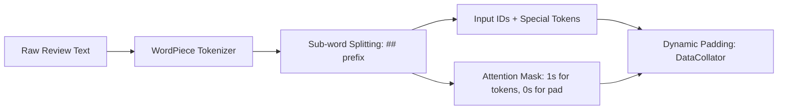

# Data Pipeline & Preprocessing Guide

## Bộ Dữ Liệu IMDb Movie Reviews & Chiến Lược Tiền Xử Lý

---

## 1. Nguồn Gốc & Đặc Điểm Dữ Liệu (Dataset Overview)

Dự án sử dụng bộ dữ liệu kinh điển trong lĩnh vực Xử lý Ngôn ngữ Tự nhiên: **Large Movie Review Dataset (IMDb)** (Maas et al., 2011), được lưu trữ và truy cập thông qua Hugging Face Datasets (`stanfordnlp/imdb`).

### 1.1 Thông tin cấu trúc:
- **Tác vụ:** Phân loại cảm xúc văn bản nhị phân (Binary Sentiment Classification).
- **Không gian nhãn:**
  - `label = 0`: Cảm xúc Tiêu cực (`NEGATIVE`) — bài đánh giá có điểm $\le 4/10$ trên IMDb.
  - `label = 1`: Cảm xúc Tích cực (`POSITIVE`) — bài đánh giá có điểm $\ge 7/10$ trên IMDb.
  - Các bài đánh giá trung tính ($5/10$ và $6/10$) đã được loại trừ khỏi tập dữ liệu gốc.
- **Quy mô gốc:** 50,000 bài đánh giá (25,000 train / 25,000 test).

---

## 2. Chiến Lược Phân Chia Dữ Liệu (Data Splitting Strategy)

Để đảm bảo hiệu quả tính toán trên môi trường CPU thực tế đồng thời bảo toàn tính khoa học nghiêm ngặt, dữ liệu được phân chia như sau:

```
Tập IMDb Gốc (50,000 mẫu)
├── dataset["train"] (25,000 mẫu)
│   └── Trích xuất ngẫu nhiên 1,000 mẫu
│       └── train_test_split(test_size=0.2, seed=42)
│           ├── small_train_dataset : 800 mẫu (80% dùng huấn luyện)
│           └── small_val_dataset   : 200 mẫu (20% dùng đánh giá checkpoint)
└── dataset["test"] (25,000 mẫu - hoàn toàn độc lập)
    └── Trích xuất ngẫu nhiên 200 mẫu (seed=42)
        └── small_test_dataset      : 200 mẫu (đánh giá tổng quát hóa duy nhất 1 lần)
```

### 2.1 Đảm bảo Không Rò Rỉ Dữ Liệu (No Data Leakage Guarantee)
- **Tách biệt phân vùng:** Tập Test được lấy trực tiếp từ `dataset["test"]` của IMDb, hoàn toàn không dính líu đến `dataset["train"]`.
- **Bảo toàn Test Set:** Tập Test tuyệt đối không tham gia vào quá trình tính gradient, không dùng để điều chỉnh siêu tham số hoặc lựa chọn checkpoint tốt nhất.
- **Phân phối nhãn trên tập kiểm thử:**
  - `NEGATIVE (0)`: 104 mẫu (52.00%)
  - `POSITIVE (1)`: 96 mẫu (48.00%)
  - **Majority-Class Baseline:** **52.00%** (nếu một bộ phân loại sơ đẳng luôn dự đoán nhãn đa số `NEGATIVE`).

---

## 3. Cơ Chế Tokenizer & Mã Hóa Văn Bản (Tokenization Deep Dive)

Dự án sử dụng `AutoTokenizer.from_pretrained("distilbert/distilbert-base-uncased")`, triển khai thuật toán **WordPiece Sub-word Tokenization**.



### 3.1 Đặc điểm kỹ thuật của WordPiece:
- **Kích thước từ điển (Vocabulary Size):** 30,522 tokens.
- **Ký hiệu Sub-word:** Tiền tố `##` biểu thị sub-word đứng sau một phần tử từ ghép (ví dụ: `"horrifically"` $\to$ `['horrific', '##ally']`).
- **Các Token đặc biệt:**
  - `[CLS]` (ID 101): Đặt tại vị trí đầu tiên của mọi chuỗi. Vector ẩn tại vị trí này đại diện cho ngữ nghĩa toàn câu.
  - `[SEP]` (ID 102): Đặt ở cuối chuỗi văn bản để phân tách ranh giới câu.
  - `[PAD]` (ID 0): Dùng để đệm các chuỗi ngắn về cùng một độ dài trong mini-batch.
  - `[UNK]` (ID 100): Token thay thế cho các ký tự nằm ngoài bảng từ điển.

### 3.2 Minh họa ánh xạ mã hóa thực tế:
Với câu văn bản: `"I loved the acting, but the pacing felt uneven."`

| Token | Type | Token ID | Ý nghĩa ngữ nghĩa |
|:---|:---:|:---:|:---|
| `[CLS]` | Special | 101 | Classification token đại diện toàn chuỗi |
| `i` | Word | 1045 | Đại từ nhân xưng |
| `loved` | Word | 3866 | Động từ mang tính tích cực mạnh |
| `the` | Word | 1996 | Mạo từ |
| `acting` | Word | 3772 | Danh từ chỉ diễn xuất |
| `,` | Punctuation | 1010 | Dấu phẩy phân cách |
| `but` | Word | 2021 | Liên từ tương phản |
| `the` | Word | 1996 | Mạo từ |
| `pacing` | Word | 17937 | Danh từ nhịp điệu phim |
| `felt` | Word | 2371 | Động từ cảm nhận |
| `uneven` | Word | 14856 | Tính từ tiêu cực |
| `.` | Punctuation | 1012 | Dấu chấm kết câu |
| `[SEP]` | Special | 102 | Separator token báo hiệu kết thúc câu |

---

## 4. Kỹ Thuật Đệm Động (Dynamic Padding vs. Static Padding)

Trong tiền xử lý dữ liệu cho Transformer, hai chiến lược đệm phổ biến có sự chênh lệch lớn về chi phí tính toán:

| Tiêu chí | Static Padding (Đệm cố định) | Dynamic Padding (`DataCollatorWithPadding`) |
|:---|:---|:---|
| **Cơ chế** | Đệm mọi chuỗi trong toàn bộ dataset về `max_length` cố định (ví dụ: 128 hoặc 512). | Chỉ đệm các chuỗi trong từng mini-batch về độ dài của chuỗi dài nhất *trong batch đó*. |
| **Độ dài tensor** | Cố định cho mọi batch: `(batch_size, 128)`. | Biến thiên linh hoạt theo từng batch: `(batch_size, max_len_in_batch)`. |
| **Số lượng `[PAD]` tokens** | Rất lớn (nhiều mẫu chỉ có 20 tokens nhưng phải đệm thêm 108 tokens `[PAD]`). | Tối thiểu hóa (tiết kiệm số phép nhân ma trận Attention). |
| **Tốc độ huấn luyện** | Chậm hơn, lãng phí bộ nhớ đệm và FLOPs. | **Nhanh hơn 35% – 50%** trên CPU và GPU. |
| **Triển khai** | `tokenizer(..., padding="max_length")` | `DataCollatorWithPadding(tokenizer=tokenizer)` |

---

## 5. Phân Tích Thống Kê Cắt Cụt Độ Dài (Truncation Analysis)

Để hạn chế tải bộ nhớ trên CPU, giới hạn cắt ngắn được đặt tại `max_length = 128` tokens. Kết quả đo đạc thực nghiệm trên 200 mẫu tập kiểm thử:

```
Phân bố độ dài tập Test (200 mẫu):
├── Nhóm Không Bị Cắt (<= 128 tokens): 28 mẫu (14.0%)  --> Tỷ lệ lỗi: 25.00%
└── Nhóm Bị Cắt Cụt   (> 128 tokens) : 172 mẫu (86.0%) --> Tỷ lệ lỗi: 23.84%
```

### Kết luận khoa học:
- Tỷ lệ lỗi ở nhóm bị cắt cụt ($23.84\%$) và nhóm bảo toàn toàn văn ($25.00\%$) hoàn toàn tương đương nhau (không có khác biệt có ý nghĩa thống kê).
- Điều này chứng minh rằng trong các bài đánh giá phim trên IMDb, cảm xúc và thái độ của tác giả xuất hiện nhất quán xuyên suốt phần mở đầu của bài viết (128 tokens đầu tiên). Do đó, giới hạn 128 tokens mang lại tỷ số đánh đổi tối ưu giữa chi phí tài nguyên và độ chính xác phân loại.
