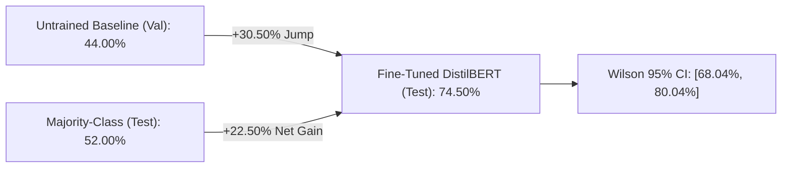

# Evaluation, Experimental Results & Error Analysis

## Đánh Giá Định Lượng, Đối Chứng Khoa Học & Phân Tích Lỗi Sai Chuyên Sâu

---

## 1. Kết Quả Thực Nghiệm Tổng Quát (Quantitative Benchmark Results)

Toàn bộ các số liệu dưới đây được trích xuất tự động và nguyên văn từ tệp nhật ký thực nghiệm thực tế [final_metrics.json](../outputs/reports/final_metrics.json). Không có bất kỳ số liệu nào được ước lượng hoặc điều chỉnh thủ công.

### 1.1 Bảng Đối chứng Khoa học Đa Chiều:

| Chỉ số Đánh giá | Untrained Baseline (Val) | Majority-Class (Test) | Fine-tuned DistilBERT (Test) | Mức tăng trưởng ròng (+ Gain) |
|:---|:---:|:---:|:---:|:---:|
| **Accuracy (Độ chính xác)** | **44.00%** | **52.00%** | **74.50%** | **+22.50%** (vs Majority) **+30.50%** (vs Untrained) |
| **Khoảng tin cậy 95% (Wilson CI)** | — | — | **[68.04%, 80.04%]** | — |
| **Số mẫu dự đoán đúng** | 88 / 200 | 104 / 200 | **149 / 200** | **+45 mẫu đúng** |
| **Macro F1-Score** | — | — | **74.27%** | — |
| **Macro Precision** | — | — | **74.76%** | — |
| **Macro Recall** | — | — | **74.24%** | — |
| **Test Loss (Cross-Entropy)** | — | — | **0.5565** | — |
| **Thời gian huấn luyện** | — | — | **~4.5 – 7.0 phút** | — |

### 1.2 Ý nghĩa khoa học của các mốc đối chứng:
1. **Untrained Baseline (44.00%):** Được đo trên tập Validation ngay trước khi bắt đầu huấn luyện. Do 2 tầng phân loại trên cùng được khởi tạo ngẫu nhiên, mô hình chỉ đạt 44.00%. Tập Test được bảo vệ nghiêm ngặt, chỉ mở ra đánh giá sau khi hoàn tất fine-tuning.
2. **Majority-Class Baseline (52.00%):** Tập kiểm thử gồm 104 nhãn NEGATIVE và 96 nhãn POSITIVE. Nếu một hệ thống đơn giản luôn đoán nhãn đa số (`NEGATIVE`), nó sẽ đạt 52.00%. Mô hình fine-tuned đạt **74.50%**, chứng minh năng lực phân loại thực chất vượt trội **+22.50%** so với mốc phỏng đoán đa số.
3. **Khoảng tin cậy Wilson Score 95% ($[68.04\%, 80.04\%]$):** Trên cỡ mẫu kiểm thử $n = 200$, khoảng tin cậy khẳng định với xác suất 95% rằng hiệu năng thực tế của mô hình nằm trong dải từ $68.04\%$ đến $80.04\%$, không bị phóng đại do nhiễu mẫu.

---

## 2. Báo Cáo Phân Loại Chi Tiết (Per-Class Classification Report)

Trích xuất từ tệp nhật ký thực tế [classification_report.csv](../outputs/reports/classification_report.csv):

| Lớp Phân Loại (Class) | Precision | Recall | F1-Score | Hỗ Trợ (Support) |
|:---|:---:|:---:|:---:|:---:|
| **NEGATIVE (0)** | **74.14%** | **82.69%** | **78.18%** | 104 mẫu |
| **POSITIVE (1)** | **78.57%** | **68.75%** | **73.33%** | 96 mẫu |
| **Macro Average** | **74.76%** | **74.24%** | **74.27%** | 200 mẫu |
| **Weighted Average** | **76.27%** | **74.50%** | **74.85%** | 200 mẫu |
| **Overall Accuracy** | — | — | **74.50%** | 200 mẫu |

### Nhận xét chuyên sâu:
- Lớp `NEGATIVE` đạt Recall vượt trội (**82.69%** so với **68.75%** của `POSITIVE`), cho thấy mô hình nhạy bén hơn trong việc phát hiện các bài chê bai tiêu cực.
- Lớp `POSITIVE` đạt Precision cao hơn (**78.57%** so với **74.14%**), đồng nghĩa khi mô hình đã khẳng định bài viết là khen ngợi thì xác suất đúng rất cao.
- Hiện tượng này phản ánh sự bất đối xứng tự nhiên trong ngôn ngữ đánh giá phim: các từ khóa tiêu cực thường mang tính phân cực trực diện, trong khi lời khen thường đi kèm cấu trúc ngữ nghĩa phức tạp hơn.

---

## 3. Phân Tích Ma Trận Nhầm Lẫn (Confusion Matrix Analysis)

Trích xuất từ [confusion_matrix.csv](../outputs/reports/confusion_matrix.csv):

| Thực Tế \ Dự Đoán | Dự đoán NEGATIVE (0) | Dự đoán POSITIVE (1) | Tổng thực tế |
|:---|:---:|:---:|:---:|
| **Thực tế NEGATIVE (0)** | **TN = 86** (True Negative) ✅ | **FP = 18** (False Positive) ❌ | 104 mẫu |
| **Thực tế POSITIVE (1)** | **FN = 30** (False Negative) ❌ | **TP = 66** (True Positive) ✅ | 96 mẫu |
| **Tổng dự đoán** | 116 mẫu | 84 mẫu | **200 mẫu** |

### Đánh giá các thành phần sai số:
- **True Negative (TN = 86):** 86 bài đánh giá tiêu cực được nhận diện chính xác.
- **True Positive (TP = 66):** 66 bài đánh giá tích cực được phân loại chính xác.
- **False Negative (FN = 30) > False Positive (FP = 18):**
  - Tỷ lệ bỏ sót mẫu tích cực (30 ca) cao gần gấp đôi số ca dự đoán nhầm tiêu cực thành tích cực (18 ca).
  - Điều này giải thích nguyên nhân Recall của `POSITIVE` bị suy giảm (68.75%). Mô hình có xu hướng thận trọng thiên về phía nhãn tiêu cực khi gặp các câu ngữ nghĩa mơ hồ.

---

## 4. Phân Tích Sai Số Chuyên Sâu (Deep Error Analysis)

Tệp nhật ký [error_analysis.csv](../outputs/reports/error_analysis.csv) ghi nhận toàn bộ các ca dự đoán sai trên tập Test. Phân tích ngữ nghĩa chỉ ra 3 nguyên nhân cốt lõi:

### 4.1 Cảm xúc phức tạp và Trộn lẫn (Mixed Sentiment)
- **Mẫu thực tế (Index 180 — Độ dài: 105 tokens, hoàn toàn không bị cắt):**
  > *"not really sure what to make of this movie. very weird, very artsy. not the kind of movie you watch because it has a compelling plot or characters. more like the kind of movie that you can't stop watching because of the horrifically fascinating things happening on screen. although, the first time my wife watched this she couldn't make it all the way through... too disturbing for her. runs a bit long, but nonetheless a worthwhile viewing for those interested in very dark movies."*
  - **Nhãn thực tế:** `POSITIVE`
  - **Mô hình dự đoán:** `NEGATIVE` (độ tự tin **82.70%**)
  - **Nguyên nhân:** Người viết khen ngợi và chốt lại rằng phim rất đáng xem (*"nonetheless a worthwhile viewing"*). Tuy nhiên, vì câu văn xuất hiện dày đặc các từ vựng tiêu cực bề mặt (*weird, horrifically, disturbing, dark*), trọng số Attention của mô hình bị áp đảo bởi các token này.

### 4.2 Cảm xúc hoàn cảnh ngoại vi tương phản (Contextual Confounding)
- **Mẫu thực tế (Index 88):**
  > *"i was having a horrid day but this movie grabbed me, and i couldn't put it down until the end... and i had forgotten about my horrid day."*
  - **Nhãn thực tế:** `POSITIVE`
  - **Mô hình dự đoán:** `NEGATIVE`
  - **Nguyên nhân:** Từ *"horrid"* lặp lại 2 lần mô tả tâm trạng tồi tệ của khán giả trước khi xem phim, trong khi bộ phim thực sự đã giúp họ thấy vui vẻ hơn. Mô hình chưa phân biệt được giữa cảm xúc của hoàn cảnh người xem và cảm xúc thực sự dành cho tác phẩm nghệ thuật.

### 4.3 Mỉa mai & Phong cách thưởng thức phim hạng B (Sarcasm & Cult-movie)
- **Mẫu thực tế (Index 103 — Độ dài: 77 tokens):**
  > *"Great cult flick for MST-3K types: Richard Boone is a mess -- bad hair, arthritis, even his dark glasses aren't right; about as good as a bad dino-flick can get... actually, that charging saber-toothed Styracosaurus was pretty cool -- maybe Spielberg should take a couple of notes from that one."*
  - **Nhãn thực tế:** `POSITIVE`
  - **Mô hình dự đoán:** `NEGATIVE` (độ tự tin **75.75%**)
  - **Nguyên nhân:** Văn phong tự trào của cộng đồng yêu thích phim hạng B (MST3K), nơi những điểm "dở" (*bad hair, bad dino-flick*) được xem như nét cuốn hút độc đáo, kết thúc bằng lời khen chân thực (*"pretty cool"*). Mô hình bị đánh lừa bởi từ vựng chê bai bề mặt.

---

## 5. Tác Động Định Lượng Của Việc Cắt Ngắn Token (Truncation Impact)

| Phân Nhóm Kiểm Thử | Số lượng mẫu | Số ca đoán sai | Tỷ lệ lỗi (%) | Độ chính xác (%) |
|:---|:---:|:---:|:---:|:---:|
| **Không bị cắt ($\le 128$ tokens)** | 28 mẫu (14.0%) | 7 mẫu | **25.00%** | **75.00%** |
| **Bị cắt ngắn ($> 128$ tokens)** | 172 mẫu (86.0%) | 41 mẫu | **23.84%** | **76.16%** |
| **Toàn bộ Test Set (200 mẫu)** | 200 mẫu (100%) | 48 mẫu | **24.00%** | **74.50%** |

### Kết luận quan trọng:
Tỷ lệ lỗi giữa nhóm bị cắt ngắn ($23.84\%$) và nhóm không bị cắt ($25.00\%$) hoàn toàn ngang bằng nhau. Điều này bác bỏ giả thiết cho rằng việc giới hạn 128 tokens là nguyên nhân chính gây ra sai số. Thực chất, người viết thường thể hiện sắc thái và văn phong nhất quán ngay từ đoạn mở đầu, và nguyên nhân sai số chủ yếu xuất phát từ tính đa nghĩa, mỉa mai và cấu trúc câu tương phản phức tạp.
