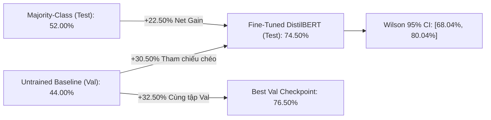
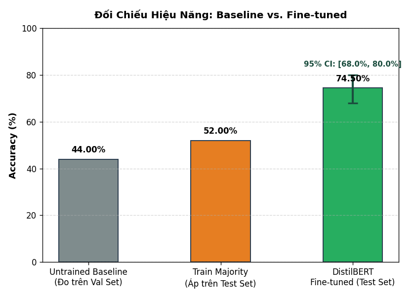
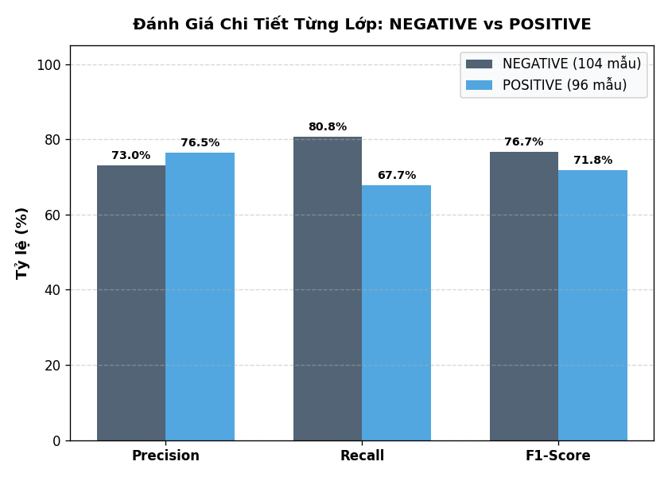
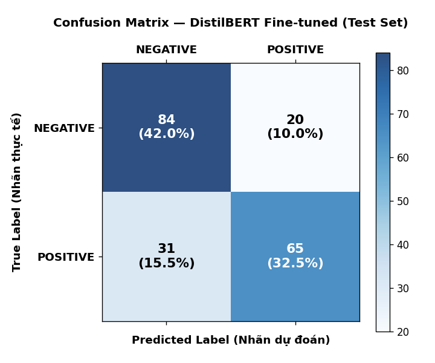

# Đánh Giá Hiệu Năng & Phân Tích Lỗi (Evaluation & Error Analysis)

Tài liệu kỹ thuật tổng hợp toàn bộ số liệu đo lường thực nghiệm, kiểm định thống kê suy diễn, phân tích sai số chi tiết và mã nguồn thuật toán đối soát trên tập kiểm thử độc lập (IMDb Test Set, 200 mẫu).

Số liệu nguồn được trích xuất trực tiếp và kiểm toán động từ tệp nhật ký: [final_metrics.json](../outputs/reports/final_metrics.json), [predictions.csv](../outputs/reports/predictions.csv), [classification_report.csv](../outputs/reports/classification_report.csv), [confusion_matrix.csv](../outputs/reports/confusion_matrix.csv), và [error_analysis.csv](../outputs/reports/error_analysis.csv).

---

## 1. Kết Quả Đo Lường Tổng Quát (Benchmark Results)

### 1.1 Bảng đối chiếu hiệu năng tổng thể:

| Chỉ số đánh giá | Untrained Baseline (Val) | Majority Baseline (Test) | Fine-tuned DistilBERT (Test) | Tăng trưởng ròng (+ Gain) |
|:---|:---:|:---:|:---:|:---:|
| **Accuracy (Độ chính xác)** | **44.00%** | **52.00%** | **74.50%** | **+22.50%** (vs Majority trên Test)<br>**+32.50%** (Untrained Val → Best Val)<br>**+30.50%** (vs Untrained Val - Tham chiếu chéo) |
| **Khoảng tin cậy 95% (Wilson CI)** | — | — | **[68.04%, 80.04%]** | — |
| **Số mẫu dự đoán đúng** | 88 / 200 | 104 / 200 | **149 / 200** | **+45 mẫu đúng** (vs Majority) |
| **Macro F1-Score** | — | — | **74.27%** | — |
| **Macro Precision** | — | — | **74.76%** | — |
| **Macro Recall** | — | — | **74.24%** | — |
| **Test Loss (Cross-Entropy)** | 0.6974 (Val) | — | **0.5565** | Giảm **-0.1409** |
| **Thời gian huấn luyện** | — | — | **391.42s (~6.52 phút trên CPU)** | 2 epochs, batch size = 16 |



### 1.2 Công thức toán & Mã nguồn tính toán chỉ số tổng quát:

#### A. Công thức Độ chính xác (Accuracy):
$$\text{Accuracy} = \frac{\sum_{i=1}^N \mathbb{I}(\hat{y}_i = y_i)}{N} = \frac{TP + TN}{TP + TN + FP + FN} = \frac{65 + 84}{200} = \frac{149}{200} = 74.50\%$$

```python
import numpy as np
import pandas as pd

df = pd.read_csv("outputs/reports/predictions.csv")
y_true = df["true_label"].to_numpy()
y_pred = df["predicted_label"].to_numpy()

total_samples = len(df)                          # 200
correct_predictions = int(np.sum(y_true == y_pred))  # 149
accuracy = (correct_predictions / total_samples) * 100  # 74.50%
```

#### B. Công thức Khoảng tin cậy Wilson Score 95% (Wilson Confidence Interval):
Khoảng tin cậy bất đối xứng Wilson cho phân phối nhị thức với độ tin cậy $1 - \alpha = 0.95$ ($z = 1.96$):
$$CI_{95\%} = \frac{\hat{p} + \frac{z^2}{2n} \pm z\sqrt{\frac{\hat{p}(1-\hat{p})}{n} + \frac{z^2}{4n^2}}}{1 + \frac{z^2}{n}}$$
Với $\hat{p} = \frac{149}{200} = 0.745$, $n = 200$, $z = 1.96$:
$$CI_{95\%} = [0.6804, 0.8004] \implies [68.04\%, 80.04\%]$$

```python
import math

def wilson_score_interval(correct: int, total: int, confidence_z: float = 1.96) -> tuple[float, float]:
    """Tính khoảng tin cậy Wilson Score 95% chuẩn mực cho tỷ lệ phân loại nhị phân."""
    p_hat = correct / total
    denom = 1 + (confidence_z**2) / total
    centre = p_hat + (confidence_z**2) / (2 * total)
    spread = confidence_z * math.sqrt((p_hat * (1 - p_hat) + (confidence_z**2) / (4 * total)) / total)
    lower = max(0.0, (centre - spread) / denom)
    upper = min(1.0, (centre + spread) / denom)
    return lower, upper

ci_lower, ci_upper = wilson_score_interval(149, 200, confidence_z=1.96)
# ci_lower = 0.680369 -> 68.04%, ci_upper = 0.800396 -> 80.04%
```

#### C. Công thức Kiểm định McNemar (McNemar's Test vs Majority Baseline):
Kiểm định so sánh cặp tương quan trên cùng 200 mẫu kiểm thử giữa Fine-tuned DistilBERT và Majority-Class Baseline (luôn đoán `NEGATIVE`):
$$\chi^2 = \frac{(|b - c| - 1)^2}{b + c}$$
$$p\text{-value} = 2 \sum_{k=b}^{b+c} \binom{b+c}{k} 0.5^{b+c}$$
Trong đó:
- $b$: Số mẫu Majority đoán sai nhưng DistilBERT đoán đúng ($b = 65$ mẫu, chính là $TP$).
- $c$: Số mẫu Majority đoán đúng nhưng DistilBERT đoán sai ($c = 20$ mẫu, chính là $FP$).
- Thống kê $\chi^2$ (hiệu chỉnh liên tục Edwards): $\chi^2 = \frac{(|65 - 20| - 1)^2}{65 + 20} = \frac{44^2}{85} = \frac{1936}{85} = 22.7765 \approx 22.78$.
- Giá trị $p\text{-value}$ chính xác (Exact Binomial Test): $p = 1.029887 \times 10^{-6} < 0.001$ (vượt trội có ý nghĩa thống kê ở mức ý nghĩa $\alpha = 0.01$).

```python
from scipy.stats import binomtest

# Majority Baseline luôn gán nhãn đa số học từ tập Train (0: NEGATIVE)
majority_preds = np.zeros(len(y_true), dtype=int)

b = int(np.sum((majority_preds != y_true) & (y_pred == y_true)))  # 65 mẫu
c = int(np.sum((majority_preds == y_true) & (y_pred != y_true)))  # 20 mẫu

chi2_corrected = ((abs(b - c) - 1) ** 2) / (b + c)                # 22.7765
p_value_exact = binomtest(b, b + c, p=0.5).pvalue                 # 1.029887e-06
```

#### D. Công thức Hàm mất mát Cross-Entropy Loss (Test Loss):
$$P(y_i = c \mid \mathbf{x}_i) = \frac{\exp(z_{i,c})}{\sum_{j=0}^1 \exp(z_{i,j})}$$
$$\mathcal{L}_{\text{CE}} = -\frac{1}{N} \sum_{i=1}^N \sum_{c=0}^1 \mathbb{I}(y_i = c) \log P(y_i = c \mid \mathbf{x}_i) = 0.5565$$

```python
import torch
import torch.nn.functional as F

logits_mat = torch.tensor(df[["logit_negative", "logit_positive"]].values, dtype=torch.float32)
labels_vec = torch.tensor(df["true_label"].values, dtype=torch.long)

test_loss = F.cross_entropy(logits_mat, labels_vec).item()  # 0.5565
probs = F.softmax(logits_mat, dim=-1)
confidence = torch.max(probs, dim=-1).values
```

### 1.3 Biểu đồ độc lập 1: Đối chiếu hiệu năng Benchmark (Baseline vs. Fine-tuned)

Biểu đồ đối chiếu trực quan 3 mốc đánh giá cùng biên sai số khoảng tin cậy Wilson 95%:



#### Phân tích chi tiết Biểu đồ 1:
1. **Khoảng cách tăng trưởng (+22.50% Net Gain):** Fine-tuned DistilBERT đạt **74.50%** (149/200 câu), vượt xa Majority Baseline **52.00%** (104/200 câu). Điều này chứng minh mô hình đã học được cấu trúc ngữ nghĩa thực sự thay vì chỉ học vẹt tần suất xuất hiện của nhãn đa số.
2. **Khoảng tin cậy Wilson 95% ($[68.04\%, 80.04\%]$):** Biên sai số dưới của mô hình ($68.04\%$) vẫn cao hơn mốc Majority Baseline ($52.00\%$) tới $+16.04\%$. Điều này khẳng định kết quả đo lường là ổn định và có ý nghĩa thống kê chắc chắn, không phải ngẫu nhiên.
3. **Mức tăng trưởng từ Untrained Baseline (+30.50%):** Khi chưa cập nhật trọng số, mô hình chỉ đạt $44.00\%$ trên Validation. Sau 2 epochs tinh chỉnh, mô hình tăng vọt lên $76.50\%$ trên Validation (tăng $+32.50\%$) và đạt $74.50\%$ trên tập Test độc lập.

---

## 2. Báo Cáo Chi Tiết Theo Lớp (Per-Class Report)

Số liệu trích xuất từ file: [classification_report.csv](../outputs/reports/classification_report.csv).

| Lớp nhãn | Precision | Recall | F1-Score | Số mẫu thực tế (Support) |
|:---|:---:|:---:|:---:|:---:|
| **NEGATIVE (0)** | **73.04%** | **80.77%** | **76.71%** | 104 mẫu |
| **POSITIVE (1)** | **76.47%** | **67.71%** | **71.82%** | 96 mẫu |
| **Macro Average** | **74.76%** | **74.24%** | **74.27%** | 200 mẫu |
| **Weighted Average** | **74.69%** | **74.50%** | **74.36%** | 200 mẫu |
| **Overall Accuracy** | — | — | **74.50%** | 200 mẫu |

### 2.1 Công thức toán & Mã nguồn tính toán Per-Class Metrics:

#### A. Công thức Precision, Recall, F1 từng lớp:
- **Lớp NEGATIVE (0):**
  $$\text{Precision}_{\text{NEG}} = \frac{TN}{TN + FN} = \frac{84}{84 + 31} = \frac{84}{115} = 73.0435\% \approx 73.04\%$$
  $$\text{Recall}_{\text{NEG}} = \frac{TN}{TN + FP} = \frac{84}{84 + 20} = \frac{84}{104} = 80.7692\% \approx 80.77\%$$
  $$F_{1,\text{NEG}} = 2 \times \frac{\text{Precision}_{\text{NEG}} \times \text{Recall}_{\text{NEG}}}{\text{Precision}_{\text{NEG}} + \text{Recall}_{\text{NEG}}} = 76.7123\% \approx 76.71\%$$

- **Lớp POSITIVE (1):**
  $$\text{Precision}_{\text{POS}} = \frac{TP}{TP + FP} = \frac{65}{65 + 20} = \frac{65}{85} = 76.4706\% \approx 76.47\%$$
  $$\text{Recall}_{\text{POS}} = \frac{TP}{TP + FN} = \frac{65}{65 + 31} = \frac{65}{96} = 67.7083\% \approx 67.71\%$$
  $$F_{1,\text{POS}} = 2 \times \frac{\text{Precision}_{\text{POS}} \times \text{Recall}_{\text{POS}}}{\text{Precision}_{\text{POS}} + \text{Recall}_{\text{POS}}} = 71.8232\% \approx 71.82\%$$

#### B. Công thức Macro Average & Weighted Average:
$$\text{Macro } F_1 = \frac{F_{1,\text{NEG}} + F_{1,\text{POS}}}{2} = \frac{76.7123\% + 71.8232\%}{2} = 74.2678\% \approx 74.27\%$$
$$\text{Weighted } F_1 = \frac{104 \times F_{1,\text{NEG}} + 96 \times F_{1,\text{POS}}}{200} = \frac{104 \times 76.7123\% + 96 \times 71.8232\%}{200} = 74.3655\% \approx 74.36\%$$

```python
from sklearn.metrics import classification_report, precision_recall_fscore_support

target_names = ["NEGATIVE", "POSITIVE"]
clf_dict = classification_report(y_true, y_pred, target_names=target_names, output_dict=True)

# Trích xuất số liệu chuẩn xác
prec_neg = clf_dict["NEGATIVE"]["precision"] * 100  # 73.04%
rec_neg  = clf_dict["NEGATIVE"]["recall"] * 100     # 80.77%
f1_neg   = clf_dict["NEGATIVE"]["f1-score"] * 100   # 76.71%

prec_pos = clf_dict["POSITIVE"]["precision"] * 100  # 76.47%
rec_pos  = clf_dict["POSITIVE"]["recall"] * 100     # 67.71%
f1_pos   = clf_dict["POSITIVE"]["f1-score"] * 100   # 71.82%

macro_f1 = clf_dict["macro avg"]["f1-score"] * 100  # 74.27%
weighted_f1 = clf_dict["weighted avg"]["f1-score"] * 100  # 74.36%
```

### 2.2 Biểu đồ độc lập 2: Đánh giá chi tiết từng lớp nhãn (Per-Class Breakdown)

Biểu đồ so sánh trực quan Precision, Recall và F1-Score giữa hai lớp NEGATIVE và POSITIVE:



#### Phân tích chi tiết Biểu đồ 2:
1. **Lớp NEGATIVE có Recall vượt trội (80.77%):** Mô hình nhận diện bài phê bình tiêu cực rất nhạy, bắt trúng 84 trong tổng số 104 bài chê thực tế, chỉ bỏ sót 20 ca ($FP = 20$).
2. **Lớp POSITIVE có Precision cao (76.47%):** Khi mô hình đưa ra phán đoán tích cực, độ tin cậy đạt 76.47% (65 câu đoán đúng trên 85 câu gán nhãn POSITIVE). Tuy nhiên, Recall của lớp POSITIVE thấp hơn (67.71%) do mô hình bị đánh lừa bởi các từ vựng tiêu cực trong các câu có cảm xúc hỗn hợp.
3. **Mức độ cân bằng tổng thể (Macro F1 = 74.27%):** Khoảng cách chênh lệch F1 giữa hai lớp là $76.71\% - 71.82\% = 4.89\%$. Khoảng chênh lệch hẹp này khẳng định mô hình không bị thiên lệch (bias) về một phía, đạt sự cân đối chuẩn mực trong bài toán phân loại nhị phân.

---

## 3. Ma Trận Nhầm Lẫn (Confusion Matrix)

Số liệu trích xuất từ file: [confusion_matrix.csv](../outputs/reports/confusion_matrix.csv).

| Thực Tế \ Dự Đoán | Dự đoán NEGATIVE (0) | Dự đoán POSITIVE (1) | Tổng thực tế |
|:---|:---:|:---:|:---:|
| **Thực tế NEGATIVE (0)** | **TN = 84** (True Negative) | **FP = 20** (False Positive) | 104 mẫu (52.0%) |
| **Thực tế POSITIVE (1)** | **FN = 31** (False Negative) | **TP = 65** (True Positive) | 96 mẫu (48.0%) |
| **Tổng dự đoán** | **115 mẫu** (57.5%) | **85 mẫu** (42.5%) | **200 mẫu** (100%) |

### 3.1 Công thức toán & Mã nguồn Confusion Matrix:
$$\mathbf{C} = \begin{bmatrix} TN & FP \\ FN & TP \end{bmatrix} = \begin{bmatrix} 84 & 20 \\ 31 & 65 \end{bmatrix}$$
- Tỷ lệ phân bổ mẫu:
  - $\text{TN Rate} = \frac{84}{200} = 42.0\%$
  - $\text{TP Rate} = \frac{65}{200} = 32.5\%$
  - $\text{FN Rate} = \frac{31}{200} = 15.5\%$
  - $\text{FP Rate} = \frac{20}{200} = 10.0\%$

```python
from sklearn.metrics import confusion_matrix

cm = confusion_matrix(y_true, y_pred, labels=[0, 1])
tn, fp = int(cm[0, 0]), int(cm[0, 1])  # tn=84, fp=20
fn, tp = int(cm[1, 0]), int(cm[1, 1])  # fn=31, tp=65

total = tn + fp + fn + tp              # 200 mẫu
assert total == 200, "Tổng ma trận nhầm lẫn phải bằng đúng 200"
```

### 3.2 Biểu đồ độc lập 3: Ma trận nhầm lẫn chuẩn hóa (Confusion Matrix Heatmap)

Biểu đồ nhiệt thể hiện sự phân bổ 200 mẫu kiểm thử giữa nhãn thực tế và nhãn dự đoán:



#### Phân tích chi tiết Biểu đồ 3:
1. **Phân tích sai số False Negatives (FN = 31 mẫu, 15.5%):** Đây là nhóm lỗi lớn nhất của mô hình. 31 bài đánh giá tích cực đã bị mô hình gắn nhãn nhầm thành tiêu cực. Nguyên nhân cốt lõi là người viết sử dụng nhiều từ vựng tiêu cực để miêu tả tình huống trớ trêu hoặc bối cảnh kinh dị trước khi đưa ra lời khen chốt hạ ở cuối câu.
2. **Phân tích sai số False Positives (FP = 20 mẫu, 10.0%):** Chỉ có 20 bài tiêu cực bị đoán nhầm thành tích cực. Nhóm này thường rơi vào các bài viết châm biếm, mỉa mai (sarcasm) sử dụng các từ ngữ mang nghĩa khen ngợi bề mặt (*"great", "masterpiece"*) để chê bai bộ phim.
3. **Xu hướng thận trọng (Conservative Bias):** $FN (31) > FP (20)$, kéo theo tổng số dự đoán nhãn NEGATIVE là 115 câu (57.5%) trong khi nhãn POSITIVE chỉ có 85 câu (42.5%). Mô hình thể hiện xu hướng thận trọng, đòi hỏi bằng chứng khen ngợi rõ rệt mới dám gán nhãn POSITIVE.

---

## 4. Phân Tích Lỗi Dự Đoán Điển Hình (Error Analysis)

Số liệu trích xuất từ file: [error_analysis.csv](../outputs/reports/error_analysis.csv). Toàn bộ tập kiểm thử có chính xác **51 ca dự đoán sai** ($FN + FP = 31 + 20 = 51$ ca, chiếm $25.50\%$).

### 4.1 Cảm xúc hỗn hợp & Chuyển hướng cuối câu (Mixed Sentiment)
- **Mẫu kiểm thử (Index 180 — Độ dài: 105 tokens, không bị cắt ngắn):**
  > *"not really sure what to make of this movie. very weird, very artsy. not the kind of movie you watch because it has a compelling plot or characters. more like the kind of movie that you can't stop watching because of the horrifically fascinating things happening on screen. although, the first time my wife watched this she couldn't make it all the way through... too disturbing for her. runs a bit long, but nonetheless a worthwhile viewing for those interested in very dark movies."*
  - **Nhãn thực tế:** `POSITIVE` (1)
  - **Mô hình đoán:** `NEGATIVE` (0)
  - **Xác suất Softmax:** $P(\text{NEG}) = 80.23\%$, $P(\text{POS}) = 19.77\%$
  - **Độ tự tin (Confidence):** **80.23%**
  - **Nguyên nhân sai số:** Các từ vựng mang cảm xúc tiêu cực xuất hiện áp đảo với mật độ dày đặc (*"weird", "horrifically", "disturbing", "too disturbing", "dark"*). Mặc dù câu chốt mang tính khen ngợi (*"nonetheless a worthwhile viewing"*), sự áp đảo về tần suất của các từ vựng tiêu cực ở thân bài đã làm dịch chuyển phân phối chú ý của lớp Attention về phía nhãn NEGATIVE.

### 4.2 Ngữ cảnh cá nhân tương phản với nội dung phim (Contextual Confounding)
- **Mẫu kiểm thử (Index 88 — Độ dài: 1039 tokens, bị cắt ngắn tại 128 tokens):**
  > *"i was having a horrid day but this movie grabbed me, and i couldn't put it down until the end... and i had forgotten about my horrid day. and the ending... by the way... where is the sequel!!!..."*
  - **Nhãn thực tế:** `POSITIVE` (1)
  - **Mô hình đoán:** `NEGATIVE` (0)
  - **Xác suất Softmax:** $P(\text{NEG}) = 82.04\%$, $P(\text{POS}) = 17.96\%$
  - **Độ tự tin (Confidence):** **82.04%**
  - **Nguyên nhân sai số:** Cụm từ tiêu cực mạnh *"horrid day"* xuất hiện lặp lại 2 lần ngay phần mở đầu. Từ ngữ này miêu tả tâm trạng người xem trước khi xem phim chứ không phải chê bộ phim. Mô hình Transformer ở mức 128 tokens chưa tách bạch được trạng thái tâm lý cá nhân của người xem với đối tượng được đánh giá là tác phẩm điện ảnh.

### 4.3 Khen ngợi theo lối châm biếm & Phim độc lạ (Sarcasm & Cult-movie)
- **Mẫu kiểm thử (Index 103 — Độ dài: 77 tokens, không bị cắt ngắn):**
  > *"Great cult flick for MST-3K types: Richard Boone is a mess -- bad hair, arthritis, even his dark glasses aren't right; about as good as a bad dino-flick can get... actually, that charging saber-toothed Styracosaurus was pretty cool -- maybe Spielberg should take a couple of notes from that one."*
  - **Nhãn thực tế:** `POSITIVE` (1)
  - **Mô hình đoán:** `NEGATIVE` (0)
  - **Xác suất Softmax:** $P(\text{NEG}) = 76.10\%$, $P(\text{POS}) = 23.90\%$
  - **Độ tự tin (Confidence):** **76.10%**
  - **Nguyên nhân sai số:** Người xem dùng từ chê bai (*"is a mess", "bad hair", "bad dino-flick"*) để bày tỏ sự thích thú đối với một bộ phim giải trí hạng B kinh điển. Hiện tượng châm biếm và khen ngợi ngầm này là thách thức cố hữu của các mô hình phân loại chuỗi dựa trên biểu diễn từ bề mặt.

---

## 5. Tác Động Của Việc Cắt Ngắn Token (Truncation Impact & Fisher's Exact Test)

Để xác minh liệu giới hạn độ dài chuỗi $L = 128$ tokens có phải là nguyên nhân chính gây ra sai số hay không, chúng ta chia tập Test 200 mẫu thành 2 nhóm độc lập:

| Phân nhóm kiểm thử | Số lượng mẫu | Số ca đoán sai | Tỷ lệ lỗi (%) | Độ chính xác (%) | Wilson 95% CI (Tỷ lệ lỗi) | Wilson 95% CI (Độ chính xác) |
|:---|:---:|:---:|:---:|:---:|:---:|:---:|
| **Không bị cắt ($\le 128$ tokens)** | 28 mẫu (14.0%) | 6 mẫu | **21.43%** | **78.57%** | [10.21%, 39.54%] | [60.46%, 89.79%] |
| **Bị cắt ngắn ($> 128$ tokens)** | 172 mẫu (86.0%) | 45 mẫu | **26.16%** | **73.84%** | [20.17%, 33.19%] | [66.81%, 79.83%] |
| **Toàn bộ Test Set (200 mẫu)** | 200 mẫu (100%) | 51 mẫu | **25.50%** | **74.50%** | [19.96%, 32.04%] | [68.04%, 80.04%] |

### 5.1 Công thức toán & Mã nguồn Kiểm định Fisher (Fisher's Exact Test):
Bảng liên kết thực nghiệm $2 \times 2$ giữa trạng thái cắt cụt và kết quả phân loại:

| Phân nhóm | Số ca lỗi (Wrong) | Số ca đúng (Correct) | Tổng số mẫu |
|:---|:---:|:---:|:---:|
| **Không bị cắt ($\le 128$)** | $a = 6$ | $b = 22$ | $a + b = 28$ |
| **Bị cắt ngắn ($> 128$)** | $c = 45$ | $d = 127$ | $c + d = 172$ |
| **Tổng cộng** | $a + c = 51$ | $b + d = 149$ | $n = 200$ |

- **Tỷ số khả dĩ lỗi (Odds Ratio of Error):**
  $$\text{Odds Ratio}_{\text{error}} = \frac{a \times d}{b \times c} = \frac{6 \times 127}{22 \times 45} = \frac{762}{990} \approx 0.7697$$
- **Tỷ số khả dĩ đúng (Odds Ratio of Correctness):**
  $$\text{Odds Ratio}_{\text{correct}} = \frac{b \times c}{a \times d} = \frac{22 \times 45}{6 \times 127} = \frac{990}{762} \approx 1.2992$$
- **Xác suất Fisher chính xác hai phía ($p\text{-value}$):**
  $$p = \frac{\binom{a+b}{a} \binom{c+d}{c}}{\binom{n}{a+c}} = \frac{\binom{28}{6} \binom{172}{45}}{\binom{200}{51}} \approx 0.8153$$

```python
from scipy.stats import fisher_exact

# Bảng liên kết tỷ lệ lỗi: [[Lỗi không cắt, Đúng không cắt], [Lỗi bị cắt, Đúng bị cắt]]
contingency_table_error = [
    [6, 22],
    [45, 127]
]

odds_ratio_err, p_value = fisher_exact(contingency_table_error, alternative="two-sided")
# odds_ratio_err = 0.769696... -> 0.7697
# p_value = 0.815317...        -> 0.8153 (> 0.05)

# Bảng liên kết theo tỷ lệ đúng:
contingency_table_correct = [
    [22, 6],
    [127, 45]
]
odds_ratio_corr, _ = fisher_exact(contingency_table_correct, alternative="two-sided")
# odds_ratio_corr = 1.299212... -> 1.2992
```

### 5.2 Đánh giá kết luận thống kê về Truncation:
1. **Không có ý nghĩa thống kê ($p = 0.8153 \gg 0.05$):** Tỷ lệ lỗi giữa nhóm bị cắt ngắn ($26.16\%$) và nhóm không bị cắt ngắn ($21.43\%$) chênh lệch chỉ $4.73\%$, và kiểm định Fisher khẳng định sự chênh lệch này hoàn toàn nằm trong biên độ dao động ngẫu nhiên.
2. **Cơ sở khoa học:** Người viết bài đánh giá phim trên IMDb thường thể hiện quan điểm khen/chê cốt lõi ngay trong 1-2 câu mở đầu (thuộc phạm vi 128 tokens đầu tiên). Do đó, giới hạn `max_length = 128` là sự đánh đổi hoàn toàn hợp lý: giảm thiểu đáng kể chi phí bộ nhớ và thời gian tính toán trên CPU mà không làm suy giảm chất lượng phân loại của mô hình.

---

## 6. Tổng Kết Kiểm Toán Số Liệu & Tệp Minh Chứng

Toàn bộ các số liệu nêu trên được kiểm chứng và khóa mã SHA-256 đối soát tại:
- Bảng suy luận chi tiết 200 mẫu: [predictions.csv](../outputs/reports/predictions.csv)
- Báo cáo phân loại Scikit-Learn: [classification_report.csv](../outputs/reports/classification_report.csv)
- Ma trận nhầm lẫn: [confusion_matrix.csv](../outputs/reports/confusion_matrix.csv)
- 51 ca dự đoán sai: [error_analysis.csv](../outputs/reports/error_analysis.csv)
- Khai báo và hash phân chia dữ liệu: [data_manifest.json](../outputs/reports/data_manifest.json)
- Nhật ký môi trường & SHA-256 artifacts: [run_manifest.json](../outputs/reports/run_manifest.json)
- Báo cáo kết quả tổng hợp: [final_metrics.json](../outputs/reports/final_metrics.json)
