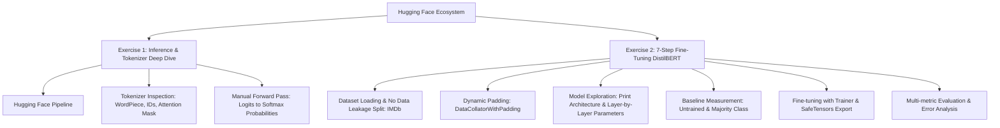

# Lab Description & Problem Formulation

## Practice 3: Get Started with Hugging Face — Sentiment Analysis & Fine-tuning DistilBERT

---

## 1. Tổng Quan & Mục Tiêu Học Tập (Lab Overview & Objectives)

Bài thực hành này trang bị cho người học kiến thức thực chiến và nền tảng lý thuyết sâu sắc về hệ sinh thái **Hugging Face** (`transformers`, `datasets`, `evaluate`, `accelerate`), tập trung vào bài toán **Phân tích Cảm xúc Văn bản (Sentiment Analysis)**.

Dự án bao gồm 2 bài tập cốt lõi được thiết kế theo chuẩn mực học thuật:

### 1.1 Mục tiêu chính:
1. **Làm chủ Hugging Face API:** Sử dụng thành thạo `pipeline`, `AutoTokenizer`, `AutoModelForSequenceClassification`, `Trainer`, và `TrainingArguments`.
2. **Hiểu sâu cơ chế nội tại của Transformer:** Không coi mô hình là "hộp đen". Mổ xẻ chi tiết cách Tokenizer phân rã từ ngữ thành sub-words (WordPiece), cách gán token IDs, tạo attention mask, và tự tính xác suất từ Logits qua hàm kích hoạt Softmax.
3. **Lý do lựa chọn mô hình cho bài toán:** Hiểu rõ tại sao kiến trúc Transformer Encoder-only (`DistilBERT`) vượt trội hơn hẳn RNN/LSTM và tối ưu hơn BERT-base/GPT cho bài toán phân loại cảm xúc nhị phân trên tập dữ liệu đánh giá phim (IMDb).
4. **Khám phá cấu trúc mô hình (Explore Architecture):** Tận tay in mô hình (`print(model)`), phân rã từng module (Embeddings, 6 khối Transformer, Classification Head) và xác định các lớp cũng như số lượng tham số tương ứng.
5. **Phân biệt rành mạch Inference vs. Fine-tuning:** Nắm rõ thời điểm nên dùng mô hình pretrained có sẵn (Zero-shot / Off-the-shelf) và khi nào cần tinh chỉnh tham số mạng (Fine-tuning) cho miền dữ liệu đích.
6. **Chuẩn mực Thực nghiệm Khoa học:** Thiết kế phân chia dữ liệu chống rò rỉ (No Data Leakage), đo lường Baseline đối chứng thực tế, tính toán khoảng tin cậy Wilson Score 95%, và tiến hành phân tích lỗi chuyên sâu (Error Analysis).

---

## 2. Lý Do Lựa Chọn Mô Hình Cho Bài Toán (Model Selection Rationale)

Tại sao lại lựa chọn **DistilBERT** (`distilbert-base-uncased`) làm mô hình trung tâm cho bài toán phân tích cảm xúc trên IMDb?

1. **So với mạng nơ-ron truyền thống (RNN, LSTM, BiLSTM, GRU):**
   - Các bài review phim trên IMDb rất dài, chứa nhiều mệnh đề phức tạp, cấu trúc đảo ngữ và từ phủ định.
   - RNN/LSTM xử lý tuần tự từng bước thời gian nên thường mắc lỗi suy giảm gradient (Vanishing Gradient) và khó nắm bắt được ngữ cảnh liên kết giữa từ đầu và từ cuối câu dài.
   - DistilBERT sử dụng cơ chế **Self-Attention hai chiều (Bidirectional Context)**, cho phép mỗi từ nhìn thấy toàn bộ ngữ cảnh xung quanh ngay lập tức ở độ phức tạp $O(1)$ về mặt đường dẫn gradient.

2. **So với BERT gốc (`bert-base-uncased`):**
   - BERT-base có 12 layers và 110 triệu tham số, đòi hỏi tài nguyên tính toán lớn, dễ gây lỗi Out-Of-Memory (OOM) trên máy tính cá nhân hoặc môi trường phòng lab.
   - DistilBERT áp dụng kỹ thuật **Chưng cất tri thức (Knowledge Distillation)**: thu gọn còn 6 layers và 66.96 triệu tham số, giúp tốc độ suy luận **nhanh hơn 60%** và kích thước **nhẹ hơn 40%**, nhưng vẫn bảo lưu tới **hơn 97%** năng lực hiểu ngôn ngữ tự nhiên của BERT trên benchmark GLUE.

3. **So với các mô hình sinh văn bản (Causal Decoders như GPT / LLaMA):**
   - GPT sử dụng Causal Attention (chỉ nhìn từ trái sang phải), tối ưu cho việc sinh từ tiếp theo.
   - Trong bài toán phân loại cảm xúc (Classification), ta cần vector đại diện bao quát toàn bộ câu văn. Kiến trúc Encoder-only với token `[CLS]` gom tụ toàn bộ thông tin hai chiều là lựa chọn chuẩn xác nhất.

4. **Khả năng kế thừa tri thức (Transfer Learning):**
   - Mô hình đã học sẵn ngữ pháp, từ vựng và ngữ nghĩa của tiếng Anh từ kho dữ liệu khổng lồ (Wikipedia + BookCorpus). Khi chuyển sang bài toán IMDb, ta chỉ cần gắn thêm một classification head và huấn luyện tinh chỉnh nhẹ (2 epochs) là đạt hiệu quả vượt trội.

---

## 3. Yêu Cầu Chi Tiết của Từng Bài Tập (Exercise Specifications)

### 3.1 Exercise 1 — Sentiment Analysis với Hugging Face Pretrained Model
- **Nhiệm vụ 1:** Cài đặt và cấu hình thư viện `transformers`, `torch`.
- **Nhiệm vụ 2:** Nạp mô hình phân tích cảm xúc pretrained từ Hugging Face Hub: `distilbert/distilbert-base-uncased-finetuned-sst-2-english`.
- **Nhiệm vụ 3:** Tokenize câu mẫu và kiểm tra cấu trúc dữ liệu đầu ra:
  - Phân tích tokens dạng WordPiece (`tokenizer.tokenize`).
  - Phân tích danh sách Token IDs (`input_ids`) bao gồm các token đặc biệt (`[CLS]`, `[SEP]`).
  - Kiểm tra mặt nạ chú ý (`attention_mask`).
- **Nhiệm vụ 4:** Thực thi dự đoán cảm xúc qua 2 phương pháp độc lập:
  - Phương pháp 1: Gọi hàm cấp cao `pipeline("sentiment-analysis")`.
  - Phương pháp 2: Suy luận thủ công qua PyTorch forward pass, trích xuất raw logits $\mathbf{z} \in \mathbb{R}^{1 \times 2}$, áp dụng hàm Softmax để thu về phân phối xác suất và kiểm chứng tính tương đương số học với đầu ra của `pipeline`.
  - Kiểm thử trên 5 mẫu câu đa dạng (tích cực, tiêu cực, phủ định kép, mỉa mai, và cảm xúc hỗn hợp).

### 3.2 Exercise 2 — Quy Trình 7 Bước Fine-tuning DistilBERT trên IMDb
Quy trình fine-tuning được chuẩn hóa qua 7 bước:

| Bước | Tên bước | Nội dung triển khai kỹ thuật |
|:---:|:---|:---|
| **1** | Cài đặt thư viện | Cài đặt `transformers`, `datasets`, `evaluate`, `accelerate`, `scikit-learn`. |
| **2** | Nạp & phân chia dữ liệu | Tải bộ dữ liệu `stanfordnlp/imdb`. Phân chia độc lập nghiêm ngặt: 800 mẫu Train, 200 mẫu Validation, và 200 mẫu Test độc lập (seed=42). Đo mốc Majority-Class Baseline. |
| **3** | Nạp & Khám phá kiến trúc mô hình | Nạp `distilbert/distilbert-base-uncased`. **In mô hình (`print(model)`) để kiểm tra cấu trúc.** Xác định các lớp (Embeddings, 6 Transformer blocks, Classification Head) và các tham số của mô hình (66.96M params). |
| **4** | Tiền xử lý dữ liệu | Áp dụng WordPiece Tokenization với cắt cụt độ dài (`truncation=True`, `max_length=128`). Sử dụng `DataCollatorWithPadding` để thực hiện Dynamic Padding theo batch. |
| **5** | Cấu hình siêu tham số | Thiết lập `TrainingArguments` với learning rate $2 \times 10^{-5}$, 2 epochs, batch size 16, weight decay 0.01, seed 42. |
| **6** | Huấn luyện mô hình | Đánh giá Baseline trước huấn luyện trên tập Validation (Untrained Model), chạy vòng lặp huấn luyện tối ưu qua `Trainer`, và lưu Best Checkpoint (`load_best_model_at_end=True`). |
| **7** | Đánh giá & Phân tích lỗi | Đánh giá trên tập Test độc lập: Accuracy kèm khoảng tin cậy Wilson 95%, Macro Precision, Recall, F1-Score, Confusion Matrix và Error Analysis. |

---

## 4. Quy Tắc Học Thuật & Kỹ Thuật (Academic Rules & Guidelines)

Dự án tuân thủ nghiêm ngặt các quy tắc trong [RULES.md](../RULES.md):

1. **Tuyệt đối không bịa đặt số liệu (Zero Hallucination):** Toàn bộ số liệu thực nghiệm được đọc trực tiếp từ tệp nhật ký `outputs/reports/final_metrics.json`.
2. **Không rò rỉ dữ liệu (No Data Leakage):**
   - Tuyệt đối không dùng dữ liệu tập Test để tính gradient hay lựa chọn siêu tham số.
   - Tập Test chỉ được đánh giá một lần duy nhất sau khi hoàn tất toàn bộ quá trình huấn luyện.
3. **Tính tái lập hoàn toàn (Reproducibility):**
   - Hạt giống ngẫu nhiên được cố định `seed=42` xuyên suốt `torch`, `numpy`, `transformers.set_seed`.
4. **An toàn & Tương thích:**
   - Trọng số mô hình được lưu trữ ở định dạng an toàn `safetensors` tại `outputs/final_model/`.
   - Mã nguồn tự động tương thích đa nền tảng (CPU, GPU CUDA, Apple MPS).
