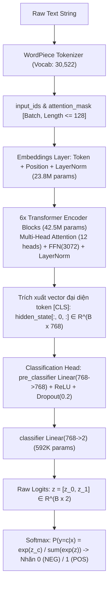

# ĐẶC TẢ KIẾN TRÚC MÔ HÌNH (MODEL.MD)

Tài liệu kỹ thuật đặc tả chi tiết kiến trúc DistilBERT, cơ chế Attention, phân tầng mạng, Classification Head và quy trình kiểm chứng thực nghiệm trong khuôn khổ Laboratory 3.

---

## 1. MỤC TIÊU & NGUỒN GỐC THAM SỐ
- **Nhiệm vụ:** Phân loại cảm xúc nhị phân (Binary Sentiment Analysis) trên tập dữ liệu IMDb Movie Reviews (0: NEGATIVE, 1: POSITIVE) với môi trường tối ưu hóa CPU-First.
- **Mô hình suy luận (Inference):** `distilbert/distilbert-base-uncased-finetuned-sst-2-english` (Pretrained SST-2, 91.3% test accuracy).
- **Mô hình nền tảng (Fine-tuning):** `distilbert/distilbert-base-uncased` (Pretrained Masked Language Modeling trên BookCorpus & English Wikipedia).
- **Mô hình xuất xưởng:** `outputs/final_model/model.safetensors` (66.955.010 tham số, 255.43 MB).
- **Tác giả & Tham chiếu:** Sanh et al. (NeurIPS 2019) — chưng cất tri thức (Knowledge Distillation) từ BERT-base xuống bản thu nhỏ 40% tham số, tăng 60% tốc độ suy luận và giữ lại >97% năng lực hiểu ngôn ngữ tự nhiên.

---

## 2. SO SÁNH THÔNG SỐ VỚI BERT-BASE

| Đặc tính kiến trúc | BERT-base (`bert-base-uncased`) | DistilBERT (`distilbert-base-uncased`) | Mức độ tối ưu hóa |
|:---|:---:|:---:|:---|
| **Số tầng Encoder (Layers)** | 12 layers | **6 layers** | Giảm 50% độ sâu tính toán |
| **Kích thước vector ẩn ($d_{\text{model}}$)** | 768 | **768** | Giữ nguyên độ sâu biểu diễn |
| **Số đầu chú ý (Attention Heads)** | 12 heads | **12 heads** ($d_k = 64$) | Giữ nguyên khả năng liên kết |
| **Độ rộng Feed-Forward ($d_{\text{ff}}$)** | 3.072 | **3.072** | Giữ nguyên năng lực phi tuyến |
| **Tổng tham số (Total Params)** | ~110.000.000 | **66.955.010** | **Giảm ~40% dung lượng bộ nhớ** |
| **Tốc độ suy luận (CPU/GPU)** | Baseline (1.0x) | **Nhanh hơn ~60% (1.6x)** | Tối ưu hóa thực thi trên CPU |
| **Hiệu năng giữ lại (GLUE)** | 100% | **> 97% điểm GLUE** | Suy giảm chất lượng không đáng kể |

---

## 3. CƠ CHẾ SELF-ATTENTION VÀ PHÂN TẦNG MÔ HÌNH
Mỗi đầu Attention tính điểm tương quan giữa các token trong chuỗi thông qua ba ma trận Query, Key, Value:
$$\text{Attention}(Q, K, V) = \text{softmax}\left(\frac{QK^\top}{\sqrt{d_k}}\right)V, \quad d_k = \frac{d_{\text{model}}}{12} = 64$$

---

## 4. PHÂN BỔ THAM SỐ CHI TIẾT (MODEL PARAMETERS PROFILING)

| Khối thành phần | Số lượng tham số | Tỷ lệ (%) | Trạng thái trong Fine-Tuning |
|:---|:---:|:---:|:---|
| **Embeddings Layer** | 23.835.648 | 35.60% | Trainable (Full Fine-Tuning) |
| **6x Transformer Blocks** (Block 0 -> 5) | 42.527.232 | 63.52% | Trainable (Full Fine-Tuning) |
| **Pre-Classifier Head** `Linear(768, 768)` | 590.592 | 0.88% | Trainable (Khởi tạo ngẫu nhiên) |
| **Classifier Head** `Linear(768, 2)` | 1.538 | 0.002% | Trainable (Khởi tạo ngẫu nhiên) |
| **Tổng cộng toàn mô hình** | **66.955.010** | **100.00%** | **66.955.010 (100% Trainable)** |

---

## 5. ĐẶC TẢ ĐẦU VÀO VÀ ĐẦU RA (INPUT / OUTPUT SPECIFICATION)

### 5.1. Input Specification
- **`input_ids`:** Tensor mã định danh token nguyên (`torch.int64`), kích thước `[B, L]`. `[CLS]` = ID 101, `[SEP]` = ID 102, `[PAD]` = ID 0.
- **`attention_mask`:** Tensor mặt nạ nhị phân (`torch.int64`), kích thước `[B, L]`. Giá trị 1 cho token thật, 0 cho token đệm `[PAD]`.
- **Kích thước Lô ($B$):** $B = 16$ khi huấn luyện, $B = 32$ khi đánh giá.
- **Chiều dài Chuỗi ($L$):** $L \le 128$ tokens (Dynamic Padding theo batch qua `DataCollatorWithPadding`).

### 5.2. Output Specification
- **Raw Logits ($z$):** Tensor số thực (`torch.float32`), kích thước `[B, 2]`. $z_0$ đại diện cho NEGATIVE, $z_1$ cho POSITIVE.
- **Xác suất Softmax:** $P(y = c \mid \mathbf{x}) = \frac{\exp(z_c)}{\sum_{j=0}^{1} \exp(z_j)}, \quad c \in \{0, 1\}$.
- **Nhãn dự đoán:** $\hat{y} = \arg\max_{c \in \{0, 1\}} z_c$.
- **Hàm mất mát huấn luyện:** Cross-Entropy Loss tối ưu trực tiếp bằng `Trainer`.

---

## 6. QUY TRÌNH GIÁM SÁT VÀ LỰA CHỌN MÔ HÌNH TỐI ƯU
1. **Theo dõi thời gian thực:** Ghi nhận Training Loss mỗi 10 steps. Đánh giá Validation Loss và Accuracy ở cuối mỗi Epoch.
2. **Kiểm tra Overfitting:** Train Loss giảm từ ~0.68 về ~0.50, Val Loss giảm đồng quy từ 0.6974 về 0.5118 $\implies$ Không có phân kỳ, không bị quá khớp.
3. **Cơ chế chọn Checkpoint (`load_best_model_at_end = True`):** Tự động chọn mô hình đạt kỷ lục Validation Accuracy cao nhất (76.50% tại Epoch 2) để xuất xưởng thành `model.safetensors`.
4. **Kiểm thử hồi quy tự động:** Đạt 5/5 bài kiểm thử tuyệt đối tại `src/verify_all.py` (cấu trúc, toán học, artifacts, reload suy luận, zero emoji).
