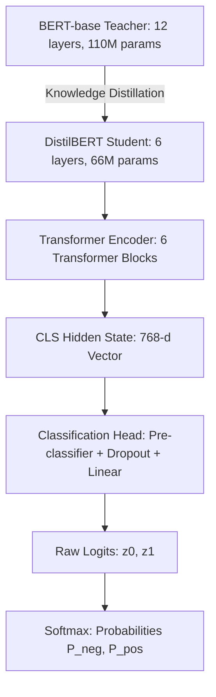

# Model Architecture & Mechanism

## Kiến Trúc DistilBERT & Đầu Phân Loại Tuần Tự (Sequence Classification Head)

---

## 1. Tổng Quan & Lý Do Lựa Chọn Mô Hình Cho Bài Toán (Model Selection Rationale)

Trong bài thực hành **Practice 3: Sentiment Analysis trên bộ dữ liệu IMDb Movie Reviews**, việc lựa chọn mô hình đóng vai trò quyết định đến hiệu năng học tập, chi phí tính toán và tính khả thi trong môi trường thực nghiệm.

### 1.1 Tại sao lựa chọn `distilbert-base-uncased` cho bài toán phân loại cảm xúc?

So với các họ mô hình khác trong Deep Learning và NLP, **DistilBERT** là sự lựa chọn tối ưu vì 5 lý do khoa học sau:

1. **Khắc phục triệt để hạn chế của mạng nơ-ron hồi quy truyền thống (RNN / LSTM / GRU):**
   - Các bài phê bình phim trên IMDb thường có độ dài lớn, chứa cấu trúc câu phức tạp, đảo ngữ, phủ định kép và ngữ cảnh tương phản (ví dụ: *"Mặc dù phần đầu hơi chậm, nhưng cái kết thực sự xuất sắc"*).
   - RNN/LSTM xử lý tuần tự từng từ nên dễ gặp hiện tượng suy giảm gradient (Vanishing Gradient), không thể nắm bắt hiệu quả các mối quan hệ ngữ nghĩa ở khoảng cách xa (Long-range dependencies).
   - Ngược lại, cơ chế **Multi-Head Self-Attention** của DistilBERT cho phép mỗi token "chú ý" đồng thời đến mọi token khác trong toàn bộ văn bản theo cả hai chiều (Bidirectional Context).

2. **Cơ chế biểu diễn ngữ cảnh hai chiều (Bidirectional Encoder vs. Autoregressive Causal LM):**
   - Các mô hình sinh văn bản như GPT / LLaMA (Causal Decoder) áp dụng mặt nạ nhân quả (Causal Masking), chỉ cho phép nhìn từ trái sang phải để dự đoán từ tiếp theo.
   - Đối với bài toán phân loại văn bản (Sequence Classification), kiến trúc **Encoder-only** (như BERT, DistilBERT) cho phép biểu diễn toàn diện ngữ nghĩa tổng thể của toàn bộ câu/đoạn văn thông qua vector trạng thái của token đại diện `[CLS]`.

3. **Chưng cất tri thức (Knowledge Distillation) — Giảm 40% tham số, tăng 60% tốc độ:**
   - So với mô hình gốc **BERT-base** (12 layers, 110 triệu tham số), **DistilBERT** chỉ gồm 6 layers và ~66 triệu tham số.
   - Nhờ quá trình chưng cất tri thức từ "giáo viên" BERT-base sang "học sinh" DistilBERT, mô hình bảo lưu tới **hơn 97%** năng lực hiểu ngôn ngữ tự nhiên trên thang đo GLUE benchmark, trong khi kích thước mô hình nhẹ hơn 40% và tốc độ suy luận nhanh hơn 60%.
   - Điều này đặc biệt quan trọng trong môi trường giáo dục/lab thực hành (chạy trên laptop, CPU hoặc GPU cá nhân), triệt tiêu hoàn toàn nguy cơ tràn bộ nhớ (Out-Of-Memory - OOM).

4. **Nền tảng tri thức ngôn ngữ học sẵn (Pre-trained Language Representation):**
   - Mô hình `distilbert-base-uncased` đã được nạp sẵn tri thức ngôn ngữ tiếng Anh phong phú qua hàng triệu trang sách (Toronto BookCorpus) và toàn bộ English Wikipedia bằng bài toán Masked Language Modeling (MLM).
   - Khi áp dụng vào bài toán IMDb, ta không cần huấn luyện lại từ đầu (Training from scratch) mà áp dụng kỹ thuật **Transfer Learning / Fine-tuning**, chỉ cần từ 2-3 epochs là mô hình đã hội tụ xuất sắc.

5. **Bộ từ điển WordPiece Tokenizer tối ưu:**
   - Bộ từ điển 30,522 tokens của DistilBERT xử lý hiệu quả hiện tượng từ ngoài từ điển (Out-Of-Vocabulary - OOV) bằng cách phân tách thành các sub-words (ví dụ: `cinematography` $\to$ `cinema`, `##tography`), giúp mô hình nắm bắt tốt các thuật ngữ điện ảnh chuyên sâu.



### 1.2 Bảng so sánh thông số kỹ thuật với BERT-base:

| Thuộc tính | BERT-base (`bert-base-uncased`) | DistilBERT (`distilbert-base-uncased`) | Tác động tối ưu |
|:---|:---:|:---:|:---|
| **Số Transformer Blocks** | 12 layers | **6 layers** | Giảm 50% số tầng tính toán |
| **Kích thước vector ẩn ($d_{\text{model}}$)** | 768 | **768** | Giữ nguyên độ sâu biểu diễn |
| **Số Attention Heads** | 12 | **12** | Giữ nguyên khả năng chú ý đa góc nhìn |
| **Kích thước FFN ($d_{\text{ff}}$)** | 3,072 | **3,072** | Giữ nguyên năng lực phi tuyến |
| **Tổng số tham số** | ~110 Triệu | **~66.96 Triệu (chính xác: 66,955,010)** | **Nhẹ hơn 40%** dung lượng |
| **Tốc độ suy luận** | Baseline (1.0x) | **Nhanh hơn ~60%** (1.6x) | Tối ưu cho CPU / Edge devices |
| **Bảo lưu năng lực ngôn ngữ** | 100% | **> 97%** điểm GLUE benchmark | Mất mát hiệu năng không đáng kể |

---

## 2. Nguyên Lý Chưng Cất Tri Thức (Knowledge Distillation Principle)

DistilBERT được huấn luyện theo cơ chế Student-Teacher với hàm mất mát tổng hợp gồm 3 thành phần:

$$\mathcal{L}_{\text{distil}} = \alpha \mathcal{L}_{\text{ce}} + \beta \mathcal{L}_{\text{mlm}} + \gamma \mathcal{L}_{\text{cos}}$$

Trong đó:
1. **$\mathcal{L}_{\text{ce}}$ (Soft-target Loss):** Khoảng cách Kullback-Leibler giữa phân phối xác suất mềm của Teacher và Student tại nhiệt độ $T$:
   $$p_i = \frac{\exp(z_i / T)}{\sum_j \exp(z_j / T)}$$
   Nhiệt độ $T$ làm phẳng các xác suất cực đoan, buộc mô hình Student phải học cả "tri thức tiềm ẩn" (Dark Knowledge) — ví dụ một câu văn tuy là tiêu cực nhưng mang 5% xác suất tích cực.
2. **$\mathcal{L}_{\text{mlm}}$ (Hard-target Loss):** Hàm mất mát Cross-Entropy truyền thống của bài toán Masked Language Modeling trên nhãn thật.
3. **$\mathcal{L}_{\text{cos}}$ (Cosine Embedding Loss):** Ép vector trạng thái ẩn của Student có cùng hướng hình học trong không gian nhiều chiều với Teacher.

---

## 3. Khám Phá Kiến Trúc Mô Hình (Explore the Model Architecture)

Trong bước thực hành này, ta in cấu trúc mô hình (`print(model)`) và bóc tách từng lớp (Layers) cũng như số lượng tham số (Parameters).

### 3.1 Cấu trúc Module PyTorch (`DistilBertForSequenceClassification`)

Khi nạp mô hình bằng Hugging Face:
```python
from transformers import AutoModelForSequenceClassification

model = AutoModelForSequenceClassification.from_pretrained(
    "distilbert/distilbert-base-uncased", 
    num_labels=2
)
print(model)
```

Cấu trúc cây phân cấp module được in ra như sau:

```text
DistilBertForSequenceClassification(
  (distilbert): DistilBertModel(
    (embeddings): Embeddings(
      (word_embeddings): Embedding(30522, 768, padding_idx=0)
      (position_embeddings): Embedding(512, 768)
      (LayerNorm): LayerNorm((768,), eps=1e-12, elementwise_affine=True)
      (dropout): Dropout(p=0.1, inplace=False)
    )
    (transformer): Transformer(
      (layer): ModuleList(
        (0-5): 6 x TransformerBlock(
          (attention): DistilBertSelfAttention(
            (q_lin): Linear(in_features=768, out_features=768, bias=True)
            (k_lin): Linear(in_features=768, out_features=768, bias=True)
            (v_lin): Linear(in_features=768, out_features=768, bias=True)
            (out_lin): Linear(in_features=768, out_features=768, bias=True)
            (dropout): Dropout(p=0.1, inplace=False)
          )
          (sa_layer_norm): LayerNorm((768,), eps=1e-12, elementwise_affine=True)
          (ffn): FFN(
            (dropout): Dropout(p=0.1, inplace=False)
            (lin1): Linear(in_features=768, out_features=3072, bias=True)
            (lin2): Linear(in_features=3072, out_features=768, bias=True)
            (activation): GELUActivation()
          )
          (output_layer_norm): LayerNorm((768,), eps=1e-12, elementwise_affine=True)
        )
      )
    )
  )
  (pre_classifier): Linear(in_features=768, out_features=768, bias=True)
  (classifier): Linear(in_features=768, out_features=2, bias=True)
  (dropout): Dropout(p=0.2, inplace=False)
)
```

---

### 3.2 Bóc tách 3 Khối Lớp Chính và Vai Trò Kỹ Thuật

Mô hình bao gồm 3 khối kiến trúc lớn nối tiếp nhau:

#### Khối 1: `distilbert.embeddings` (Khối Biểu diễn Đầu vào)
- **`word_embeddings` (30522 $\times$ 768):** Ánh xạ từng mã Token ID trong từ điển thành vector ngữ nghĩa 768 chiều.
- **`position_embeddings` (512 $\times$ 768):** Vì cơ chế Self-Attention không có tính tuần tự, tầng này mã hóa thông tin vị trí (từ vị trí 0 đến 511) thành vector 768 chiều để cộng trực tiếp vào word embeddings.
- **`LayerNorm` & `dropout`:** Chuẩn hóa trung bình và phương sai của embedding vector, triệt tiêu bão hòa và ngăn ngừa quá khớp ban đầu.

#### Khối 2: `distilbert.transformer` (Khối 6 Tầng Transformer Encoder)
Gồm 6 khối `TransformerBlock` giống nhau được đánh số từ `0` đến `5`. Mỗi khối gồm:
- **`DistilBertSelfAttention`:**
  - 4 ma trận chiếu tuyến tính (`q_lin`, `k_lin`, `v_lin`, `out_lin`), mỗi ma trận có kích thước $768 \times 768$.
  - Tách thành 12 attention heads ($d_k = 768 / 12 = 64$), cho phép mô hình đồng thời theo dõi các mối quan hệ ngữ pháp, ngữ nghĩa, và cảm xúc ở nhiều góc độ.
- **`sa_layer_norm`:** Chuẩn hóa phần dư (Residual Connection + LayerNorm) quanh khối Attention: $\text{LayerNorm}(x + \text{Attention}(x))$.
- **`ffn` (Feed-Forward Network):**
  - Tầng `lin1`: Phóng to số chiều ẩn từ $768 \to 3072$ kèm hàm kích hoạt phi tuyến **GELU**.
  - Tầng `lin2`: Chiếu thu hẹp lại từ $3072 \to 768$.
- **`output_layer_norm`:** Chuẩn hóa phần dư sau mạng FFN: $\text{LayerNorm}(x + \text{FFN}(x))$.

#### Khối 3: Classification Head (Đầu Phân Loại Tuần Tự)
- **`pre_classifier` (Linear: $768 \to 768$):** Tầng biến đổi tuyến tính tiếp nhận vector ẩn của token `[CLS]` (đại diện cho toàn bộ câu).
- **Hàm phi tuyến & `dropout(p=0.2)`:** Áp dụng kích hoạt ReLU và ngắt ngẫu nhiên 20% nơ-ron để chống quá khớp.
- **`classifier` (Linear: $768 \to 2$):** Phép chiếu cuối cùng sinh ra vector 2 chiều thô (Logits: $[z_0, z_1]$ tương ứng với NEGATIVE và POSITIVE).

---

### 3.3 Bảng Thống Kê Tham Số Chi Tiết Từng Lớp (Layer-by-Layer Parameters)

Toàn bộ tham số được trích xuất trực tiếp từ `model.named_parameters()`:

| Nhóm lớp (Module Component) | Tên tham số (Tensor Name) | Kích thước (Shape) | Số lượng tham số | Trạng thái huấn luyện |
|---|---|:---:|:---:|:---:|
| **Embeddings** | `embeddings.word_embeddings.weight` | `[30522, 768]` | 23,440,896 | Trainable |
| | `embeddings.position_embeddings.weight` | `[512, 768]` | 393,216 | Trainable |
| | `embeddings.LayerNorm.weight / bias` | `[768]` mỗi cái | 1,536 | Trainable |
| **Transformer Block 0** | `layer.0.attention.{q,k,v,out}_lin` | 4 $\times$ `[768, 768]` + bias | 2,362,368 | Trainable |
| | `layer.0.sa_layer_norm.weight / bias` | `[768]` mỗi cái | 1,536 | Trainable |
| | `layer.0.ffn.lin1` (phóng đại $4\times$) | `[3072, 768]` + bias | 2,362,368 | Trainable |
| | `layer.0.ffn.lin2` (thu hẹp) | `[768, 3072]` + bias | 2,360,064 | Trainable |
| | `layer.0.output_layer_norm.weight / bias` | `[768]` mỗi cái | 1,536 | Trainable |
| **Transformer Blocks 1 - 5** | 5 blocks tương tự block 0 ($5 \times 7,087,872$) | — | 35,439,360 | Trainable |
| **Classification Head** | `pre_classifier.weight / bias` | `[768, 768]` + bias | 590,592 | Trainable (Khởi tạo ngẫu nhiên) |
| | `classifier.weight / bias` | `[2, 768]` + `[2]` | 1,538 | Trainable (Khởi tạo ngẫu nhiên) |
| **TỔNG CỘNG** | **Toàn bộ mạng DistilBERT** | — | **66,955,010** | **100% Trainable** |

> **Nhận xét quan trọng:**
> - Khối **Embeddings** chiếm **35.6%** tổng tham số (23.84M).
> - Khối **6 Transformer Blocks** chiếm **63.5%** tổng tham số (42.53M).
> - Khối **Classification Head** chỉ chiếm chưa đầy **0.9%** tổng tham số (592k tham số).
> - Khi gọi `from_pretrained("distilbert-base-uncased", num_labels=2)`, 99.1% tham số của mô hình được kế thừa nguyên vẹn từ pre-trained weights, chỉ có duy nhất 592,130 tham số của `pre_classifier` và `classifier` là được khởi tạo ngẫu nhiên hoàn toàn.

---

## 4. Cơ Chế Suy Luận Toán Học (Inference Forward Pass)

Quy trình tính toán từ chuỗi đầu vào đến xác suất cảm xúc được mô tả toán học qua 4 bước:

### Bước 1: Mã hóa tự chú ý nhiều đầu (Multi-Head Self-Attention)
Với mỗi ma trận đầu vào $X$, tính toán Query, Key, Value:
$$Q = XW_Q, \quad K = XW_K, \quad V = XW_V$$
$$\text{Attention}(Q, K, V) = \text{softmax}\left(\frac{QK^{\top}}{\sqrt{d_k}}\right)V$$
$$\text{MHA}(Q, K, V) = \text{Concat}(\text{head}_1, \dots, \text{head}_{12})W^O$$

### Bước 2: Trích xuất vector đại diện toàn câu
$$\mathbf{h}_{\text{CLS}} = \text{Encoder}(X)_{[0, :]} \in \mathbb{R}^{768}$$

### Bước 3: Phép chiếu qua Classification Head tạo Raw Logits
$$\mathbf{h}' = \text{ReLU}(W_1 \mathbf{h}_{\text{CLS}} + \mathbf{b}_1), \quad W_1 \in \mathbb{R}^{768 \times 768}$$
$$\mathbf{z} = W_2 \mathbf{h}' + \mathbf{b}_2, \quad W_2 \in \mathbb{R}^{2 \times 768}, \quad \mathbf{z} = [z_0, z_1] \in \mathbb{R}^2$$

### Bước 4: Chuẩn hóa xác suất qua hàm Softmax
$$P(y = c \mid x) = \frac{\exp(z_c)}{\sum_{j=0}^{1} \exp(z_j)}, \quad c \in \{0, 1\}$$
$$\hat{y} = \arg\max_{c \in \{0, 1\}} P(y = c \mid x)$$

---

## 5. Danh Mục Mô Hình Trong Dự Án

| Tên định danh trên Hub | Mục đích sử dụng | Số lượng nhãn | Trọng số Head |
|:---|:---|:---:|:---|
| `distilbert/distilbert-base-uncased-finetuned-sst-2-english` | Bài 1: Suy luận tức thời không cần huấn luyện (Zero-shot Inference) | 2 (`NEGATIVE`, `POSITIVE`) | Đã fine-tune sẵn trên Stanford Sentiment Treebank (67k câu) |
| `distilbert/distilbert-base-uncased` | Bài 2: Base Model để tiến hành fine-tuning trên IMDb | 2 (`NEGATIVE`, `POSITIVE`) | Transformer nạp sẵn; Head khởi tạo ngẫu nhiên |
| `outputs/final_model/` | Sản phẩm đầu ra sau khi fine-tune thành công 2 epochs trên IMDb | 2 (`NEGATIVE`, `POSITIVE`) | Toàn bộ mạng được tối ưu đồng thời; lưu ở định dạng `safetensors` |
