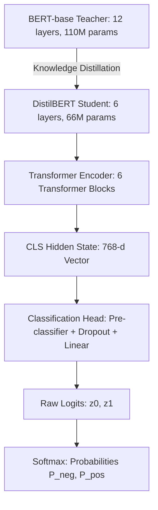

# Model Architecture & Mechanism

## Kiến Trúc DistilBERT & Đầu Phân Loại Tuần Tự (Sequence Classification Head)

---

## 1. Tổng Quan Kiến Trúc DistilBERT (Model Overview)

Dự án ứng dụng mô hình **DistilBERT** (Sanh et al., 2019) — một biến thể nén tinh gọn của BERT (Devlin et al., 2019) dựa trên kỹ thuật **Chưng cất tri thức (Knowledge Distillation)**.



### 1.1 Bảng so sánh thông số kỹ thuật với BERT-base:

| Thuộc tính | BERT-base (`bert-base-uncased`) | DistilBERT (`distilbert-base-uncased`) | Tác động tối ưu |
|:---|:---:|:---:|:---|
| **Số Transformer Blocks** | 12 layers | **6 layers** | Giảm 50% số tầng tính toán |
| **Kích thước vector ẩn ($d_{\text{model}}$)** | 768 | **768** | Giữ nguyên độ sâu biểu diễn |
| **Số Attention Heads** | 12 | **12** | Giữ nguyên khả năng chú ý đa góc nhìn |
| **Kích thước FFN ($d_{\text{ff}}$)** | 3,072 | **3,072** | Giữ nguyên năng lực phi tuyến |
| **Tổng số tham số** | ~110 Triệu | **~66.36 Triệu** | **Nhẹ hơn 40%** dung lượng |
| **Tốc độ suy luận** | Baseline (1.0x) | **Nhanh hơn ~60%** (1.6x) | Lý tưởng cho CPU / Edge devices |
| **Bảo lưu năng lực ngôn ngữ** | 100% | **> 97%** điểm GLUE benchmark | Mất mát hiệu năng không đáng kể |

---

## 2. Nguyên Lý Chưng Cất Tri Thức (Knowledge Distillation Principle)

DistilBERT được huấn luyện theo cơ chế Student-Teacher với hàm mất mát tổng hợp gồm 3 thành phần:

$$\mathcal{L}_{\text{distil}} = \alpha \mathcal{L}_{\text{ce}} + \beta \mathcal{L}_{\text{mlm}} + \gamma \mathcal{L}_{\text{cos}}$$

Trong đó:
1. **$\mathcal{L}_{\text{ce}}$ (Soft-target Loss):** Khoảng cách Kullback-Leibler giữa phân phối xác suất mềm của Teacher và Student tại nhiệt độ $T$:
   $$p_i = \frac{\exp(z_i / T)}{\sum_j \exp(z_j / T)}$$
   Nhiệt độ $T$ làm phẳng các xác suất cực đoan, buộc mô hình Student phải học cả "tri thức tiềm ẩn" (Dark Knowledge) — ví dụ một câu văn tuy là tiêu cực nhưng mang 5% xác suất tích cực.
2. **$\mathcal{L}_{\text{mlm}}$ (Hard-target Loss):** Hàm mất mát Cross-Entropy truyền thống của bài toán Masked Language Modeling trên nhãn thật.
3. **$\mathcal{L}_{\text{cos}}$ (Cosine Embedding Loss):** Ép vector trạng thái ẩn của Student có cùng hướng hình học trong không gian nhiều chiều với Teacher.

---

## 3. Cấu Trúc Đầu Phân Loại (Sequence Classification Head)

Để áp dụng DistilBERT cho bài toán phân loại nhị phân trên IMDb, mô hình bổ sung một Classification Head phía trên vector biểu diễn của token `[CLS]`:

```
Input Tokens: [CLS] + Token_1 + Token_2 + ... + [SEP] + [PAD]...
                    │
           Transformer Encoder (6 Blocks)
                    │
             h_CLS ∈ ℝ^768  (Hidden State tại vị trí token đầu tiên)
                    │
            Linear Layer (768 → 768)  [pre_classifier]
                    │
                  ReLU()
                    │
               Dropout(p = 0.2)
                    │
            Linear Layer (768 → 2)    [classifier]
                    │
             Logits z = [z_0, z_1] ∈ ℝ^2
                    │
                 Softmax()
                    │
       P(NEGATIVE), P(POSITIVE)
```

### 3.1 Khởi tạo ngẫu nhiên & Giải thích Baseline:
- Các trọng số bên trong Transformer Encoder được nạp từ checkpoint pre-trained đã học sẵn ngữ nghĩa tiếng Anh.
- Tuy nhiên, hai tầng `pre_classifier` và `classifier` được **khởi tạo hoàn toàn ngẫu nhiên** (Random Weights) khi gọi `AutoModelForSequenceClassification.from_pretrained("distilbert/distilbert-base-uncased", num_labels=2)`.
- **Hệ quả thực nghiệm:** Trước khi fine-tuning, mô hình dự đoán nhãn bằng các trọng số ngẫu nhiên này, dẫn đến độ chính xác ban đầu trên tập Validation chỉ đạt **44.00%** (Untrained Head Baseline).

---

## 4. Cơ Chế Suy Luận Toán Học (Inference Forward Pass)

Quy trình tính toán từ chuỗi đầu vào đến xác suất cảm xúc được mô tả toán học qua 4 bước:

### Bước 1: Mã hóa tự chú ý nhiều đầu (Multi-Head Self-Attention)
Với mỗi ma trận đầu vào $X$, tính toán Query, Key, Value:
$$Q = XW_Q, \quad K = XW_K, \quad V = XW_V$$
$$\text{Attention}(Q, K, V) = \text{softmax}\left(\frac{QK^{\top}}{\sqrt{d_k}}\right)V$$
$$\text{MHA}(Q, K, V) = \text{Concat}(\text{head}_1, \dots, \text{head}_{12})W^O$$

### Bước 2: Trích xuất vector đại diện toàn câu
$$\mathbf{h}_{\text{CLS}} = \text{Encoder}(X)_{[0, :]} \in \mathbb{R}^{768}$$

### Bước 3: Phép chiếu qua Classification Head tạo Raw Logits
$$\mathbf{h}' = \text{ReLU}(W_1 \mathbf{h}_{\text{CLS}} + \mathbf{b}_1), \quad W_1 \in \mathbb{R}^{768 \times 768}$$
$$\mathbf{z} = W_2 \mathbf{h}' + \mathbf{b}_2, \quad W_2 \in \mathbb{R}^{2 \times 768}, \quad \mathbf{z} = [z_0, z_1] \in \mathbb{R}^2$$

### Bước 4: Chuẩn hóa xác suất qua hàm Softmax
$$P(y = c \mid x) = \frac{\exp(z_c)}{\sum_{j=0}^{1} \exp(z_j)}, \quad c \in \{0, 1\}$$
$$\hat{y} = \arg\max_{c \in \{0, 1\}} P(y = c \mid x)$$

---

## 5. Danh Mục Mô Hình Trong Dự Án

| Tên định danh trên Hub | Mục đích sử dụng | Số lượng nhãn | Trọng số Head |
|:---|:---|:---:|:---|
| `distilbert/distilbert-base-uncased-finetuned-sst-2-english` | Bài 1: Suy luận tức thời không cần huấn luyện (Zero-shot Inference) | 2 (`NEGATIVE`, `POSITIVE`) | Đã fine-tune sẵn trên Stanford Sentiment Treebank (67k câu) |
| `distilbert/distilbert-base-uncased` | Bài 2: Base Model để tiến hành fine-tuning trên IMDb | 2 (`NEGATIVE`, `POSITIVE`) | Transformer nạp sẵn; Head khởi tạo ngẫu nhiên |
| `outputs/final_model/` | Sản phẩm đầu ra sau khi fine-tune thành công 2 epochs trên IMDb | 2 (`NEGATIVE`, `POSITIVE`) | Toàn bộ mạng được tối ưu đồng thời; lưu ở định dạng `safetensors` |
