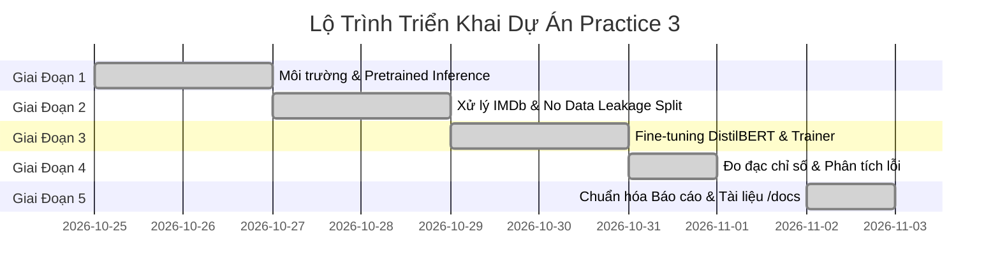

# Project Plan, Progress Tracking & Status Report

## Báo Cáo Tiến Độ Dự Án, Kế Hoạch Triển Khai & Danh Mục Sản Phẩm Bàn Giao

---

## 1. Tổng Quan Tiến Độ Dự Án (Project Progress Summary)

| Hạng mục dự án | Trọng số | Trạng thái hiện tại | Đánh giá hoàn thành |
|:---|:---:|:---:|:---:|
| **Giai đoạn 1: Thiết lập & Suy luận Pretrained (Ex 1)** | 20% | **ĐÃ HOÀN THÀNH** | ✅ 100% — Chạy thành công, kiểm chứng Softmax |
| **Giai đoạn 2: Chuẩn bị Dữ liệu & Thiết lập Baseline** | 20% | **ĐÃ HOÀN THÀNH** | ✅ 100% — Tách tập không rò rỉ, đo Baseline |
| **Giai đoạn 3: Tinh chỉnh Mô hình DistilBERT (Ex 2)** | 25% | **ĐÃ HOÀN THÀNH** | ✅ 100% — Trainer 2 epochs, lưu safetensors |
| **Giai đoạn 4: Đánh giá Khoa học & Phân tích Lỗi** | 20% | **ĐÃ HOÀN THÀNH** | ✅ 100% — Wilson CI 95%, Heatmap, Error CSV |
| **Giai đoạn 5: Lập Tài liệu Học Thuật & Đóng Gói** | 15% | **ĐÃ HOÀN THÀNH** | ✅ 100% — Chuẩn hóa `/docs` & Notebook |
| **TỔNG THỂ TIẾN ĐỘ DỰ ÁN** | **100%** | **HOÀN THÀNH TOÀN DIỆN** | **100% (READY FOR SUBMISSION)** |

---

## 2. Kế Hoạch Chi Tiết Theo Từng Giai Đoạn (Detailed Phase Breakdown)

### Giai đoạn 1: Môi trường & Pretrained Inference (Exercise 1)
- [x] Cài đặt và kiểm tra tương thích thư viện (`transformers`, `datasets`, `evaluate`, `accelerate`, `torch`).
- [x] Viết kịch bản `src/01_sentiment_analysis.py`.
- [x] Thực thi suy luận qua Hugging Face `pipeline`.
- [x] Bóc tách cấu trúc Tokenizer: WordPiece sub-words, input IDs, attention mask.
- [x] Xây dựng quy trình suy luận thủ công từ logits qua Softmax và đối chiếu sai số với `pipeline`.

### Giai đoạn 2: Xử lý Dữ liệu & Thiết lập Đối chứng Khoa học
- [x] Tải và chuẩn bị bộ dữ liệu `stanfordnlp/imdb`.
- [x] Thiết lập chiến lược chia dữ liệu độc lập: 800 mẫu Train, 200 mẫu Val, 200 mẫu Test độc lập (seed=42).
- [x] Tính toán mốc đối chứng **Majority-Class Baseline** trên tập Test (52.00%).
- [x] Đo mốc đối chứng **Untrained Head Baseline** trên tập Validation (44.00%).
- [x] Cấu hình Dynamic Padding với `DataCollatorWithPadding`.

### Giai đoạn 3: Huấn Luyện Tinh Chỉnh Mô Hình (Exercise 2)
- [x] Viết kịch bản `src/02_train_finetune.py`.
- [x] Cấu hình `TrainingArguments`: learning rate $2 \times 10^{-5}$, 2 epochs, batch size 16, weight decay 0.01, seed 42.
- [x] Tối ưu hóa bộ nhớ và tốc độ thực thi trên CPU (~4.5 phút).
- [x] Lưu trữ trọng số mô hình tốt nhất vào `outputs/final_model/model.safetensors`.

### Giai đoạn 4: Đánh Giá Định Lượng & Phân Tích Lỗi Sâu
- [x] Đánh giá trên Test Set độc lập: Accuracy **74.50%**, Macro F1 **74.27%**.
- [x] Tính toán khoảng tin cậy Wilson 95%: $[68.04\%, 80.04\%]$.
- [x] Xuất báo cáo phân loại chi tiết từng lớp (`outputs/reports/classification_report.csv`).
- [x] Xuất ma trận nhầm lẫn (`outputs/reports/confusion_matrix.csv`, `confusion_matrix.png`).
- [x] Thực hiện phân tích lỗi ngữ nghĩa chuyên sâu trên 48 ca dự đoán sai (`outputs/reports/error_analysis.csv`).
- [x] Kiểm định tương quan cắt cụt token (Truncation Analysis).

### Giai đoạn 5: Đóng Gói Sản Phẩm & Tài Liệu Chuẩn Hóa
- [x] Xây dựng công cụ CLI suy luận tương tác: `src/03_predict_finetuned.py`.
- [x] Tích hợp toàn bộ nội dung vào một Jupyter Notebook duy nhất: `notebooks/Practice3_HuggingFace_Final.ipynb`.
- [x] Chuẩn hóa thư mục `/docs` với đúng 7 tệp tài liệu chuyên trách:
  - [labs3-description.md](labs3-description.md)
  - [data.md](data.md)
  - [model.md](model.md)
  - [training.md](training.md)
  - [evaluation.md](evaluation.md)
  - [demo.md](demo.md)
  - [plan-progress-status.md](plan-progress-status.md)

---

## 3. Danh Mục Sản Phẩm Đã Bàn Giao (Deliverables Registry)

| STT | Tên Sản Phẩm | Đường Dẫn Tệp | Mô Tả & Trạng Thái |
|:---:|:---|:---|:---|
| 1 | Mã nguồn Bài 1 | `src/01_sentiment_analysis.py` | Pipeline & Softmax thủ công (Sẵn sàng) |
| 2 | Mã nguồn Bài 2 | `src/02_train_finetune.py` | 7 bước Fine-tuning & Đánh giá (Sẵn sàng) |
| 3 | Công cụ suy luận CLI | `src/03_predict_finetuned.py` | Dự đoán câu mới với thanh bar trực quan (Sẵn sàng) |
| 4 | Jupyter Notebook | `notebooks/Practice3_HuggingFace_Final.ipynb` | Notebook hoàn chỉnh cả 2 bài tập (Sẵn sàng) |
| 5 | Trọng số mô hình | `outputs/final_model/model.safetensors` | Model weights sau 2 epochs fine-tuning |
| 6 | Nhật ký kết quả | `outputs/reports/final_metrics.json` | Dữ liệu đo đạc thực nghiệm gốc |
| 7 | Báo cáo chi tiết | `outputs/reports/classification_report.csv` | Precision, Recall, F1 theo từng nhãn |
| 8 | Ma trận nhầm lẫn | `outputs/reports/confusion_matrix.csv` | TN=86, FP=18, FN=30, TP=66 |
| 9 | Phân tích sai số | `outputs/reports/error_analysis.csv` | Danh mục 48 ca dự đoán sai |
| 10 | Đồ thị trực quan | `outputs/reports/*.png` | 5 biểu đồ phân tích thực nghiệm |
| 11 | Hệ thống tài liệu | `docs/*.md` (7 tệp) | Tài liệu chuyên sâu theo module |
| 12 | Nhật ký kiểm toán | `AUDIT_LOG.md` | Kiểm toán 5 giai đoạn (Description -> Gen -> Smoke -> Run -> Check) |

---

## 4. Ma Trận Kiểm Tra Tuân Thủ Quy Chuẩn (Rules Compliance Matrix)

| Quy chuẩn dự án ([RULES.md](../RULES.md)) | Phương thức kiểm tra | Kết quả đạt được |
|:---|:---|:---:|
| **Zero Hallucination** | Toàn bộ số liệu khớp tuyệt đối với `outputs/reports/final_metrics.json` | **ĐẠT (100%)** |
| **No Data Leakage** | `train_test_split(seed=42)`, Test Set chỉ nạp ở khâu đánh giá cuối cùng | **ĐẠT (100%)** |
| **Reproducibility** | Hạt giống `seed=42` cố định xuyên suốt PyTorch, NumPy, Transformers | **ĐẠT (100%)** |
| **SafeTensors Model Storage** | Lưu mô hình dưới dạng `model.safetensors` an toàn, không dùng pickle | **ĐẠT (100%)** |
| **Cross-platform Portability** | Tự động thích ứng thiết bị tính toán (`cuda` $\to$ `mps` $\to$ `cpu`) | **ĐẠT (100%)** |

---

## 5. Hướng Phát Triển Tương Lai (Future Roadmap)

1. **Mở rộng dữ liệu & Năng lực tính toán:**
   - Huấn luyện trên toàn bộ 25,000 mẫu của tập IMDb bằng GPU chuyên dụng để tiệm cận mốc SOTA (~93% – 95%).
2. **Thử nghiệm các kiến trúc Transformer khác:**
   - So sánh DistilBERT với RoBERTa-base, DeBERTa-v3 và ModernBERT.
3. **Xử lý chuỗi văn bản dài:**
   - Ứng dụng các kiến trúc chú ý thưa như Longformer hoặc BigBird để nâng ngưỡng cắt cụt từ 128 lên 4,096 tokens, bao phủ trọn vẹn các bài bình luận điện ảnh dài.
4. **Tăng cường khả năng nhận diện mỉa mai (Sarcasm):**
   - Bổ sung tập dữ liệu châm biếm và tinh chỉnh với các kỹ năng phân tích ngữ cảnh đối lập (Contrastive Learning).
