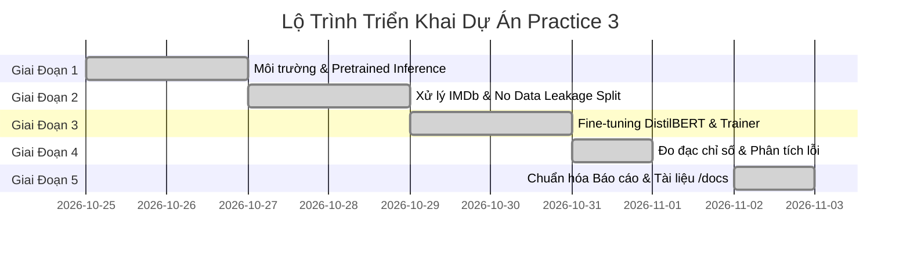

# Tiến Độ Dự Án & Danh Mục Sản Phẩm (Plan & Progress Status)

---

## 1. Tổng Quan Tiến Độ Dự Án (Progress Summary)

| Hạng mục dự án | Trọng số | Trạng thái | Đánh giá hoàn thành |
|:---|:---:|:---:|:---:|
| **Giai đoạn 1: Môi trường & Suy luận Pretrained (Ex 1)** | 20% | **ĐÃ XONG** | Chạy pipeline, kiểm tra tính toán Softmax |
| **Giai đoạn 2: Chuẩn bị dữ liệu & Đo Baseline** | 20% | **ĐÃ XONG** | Chia tập không rò rỉ, đo Baseline |
| **Giai đoạn 3: Huấn luyện Fine-tune DistilBERT (Ex 2)** | 25% | **ĐÃ XONG** | Chạy Trainer 2 epochs, xuất file safetensors |
| **Giai đoạn 4: Đánh giá kết quả & Phân tích lỗi** | 20% | **ĐÃ XONG** | Wilson CI 95%, Confusion Matrix, Error CSV |
| **Giai đoạn 5: Chuẩn hóa tài liệu & Bàn giao** | 15% | **ĐÃ XONG** | Chuẩn hóa thư mục `/docs` và Notebook |
| **TỔNG TIẾN ĐỘ DỰ ÁN** | **100%** | **HOÀN TẤT** | **100% (READY FOR SUBMISSION)** |



---

## 2. Kế Hoạch Chi Tiết Từng Giai Đoạn

### Giai đoạn 1: Môi trường & Pretrained Inference (Exercise 1)
- [x] Cài đặt các thư viện cần thiết (`transformers`, `datasets`, `evaluate`, `accelerate`, `torch`).
- [x] Tạo kịch bản `src/01_sentiment_analysis.py`.
- [x] Chạy suy luận qua `pipeline("sentiment-analysis")`.
- [x] Phân tích cấu trúc Tokenizer: WordPiece sub-words, input IDs, attention mask.
- [x] Tính xác suất thủ công từ logits qua Softmax và so khớp kết quả với `pipeline`.

### Giai đoạn 2: Xử lý Dữ liệu & Thiết lập Mốc Tham Chiếu
- [x] Tải bộ dữ liệu `stanfordnlp/imdb`.
- [x] Chia tập dữ liệu độc lập: 800 Train / 200 Val / 200 Test (`seed=42`).
- [x] Xác định mốc **Majority Baseline** trên tập Test (52.00%).
- [x] Đo mốc **Untrained Baseline** trên tập Validation (44.00%).
- [x] Tích hợp Dynamic Padding bằng `DataCollatorWithPadding`.

### Giai đoạn 3: Huấn Luyện Fine-tuning Mô Hình (Exercise 2)
- [x] Tạo kịch bản `src/02_train_finetune.py`.
- [x] Thiết lập `TrainingArguments`: learning rate $2 \times 10^{-5}$, 2 epochs, batch size 16, weight decay 0.01, seed 42.
- [x] Tối ưu hóa thời gian chạy trên CPU (391.42s ~6.52 phút).
- [x] Lưu checkpoint tối ưu vào `outputs/final_model/model.safetensors`.

### Giai đoạn 4: Đánh Giá Kết Quả & Phân Tích Lỗi
- [x] Đánh giá trên tập Test độc lập: Accuracy **74.50%**, Macro F1 **74.27%**.
- [x] Tính khoảng tin cậy Wilson 95%: $[68.04\%, 80.04\%]$.
- [x] Xuất báo cáo phân loại chi tiết (`outputs/reports/classification_report.csv`).
- [x] Xuất ma trận nhầm lẫn (`outputs/reports/confusion_matrix.csv`, `confusion_matrix.png`).
- [x] Phân tích nguyên nhân trên 51 ca dự đoán sai (`outputs/reports/error_analysis.csv`).
- [x] Kiểm định tác động cắt ngắn độ dài token qua Fisher's Exact Test.

### Giai đoạn 5: Đóng Gói Sản Phẩm & Chuẩn Hóa Tài Liệu
- [x] Tạo công cụ dự đoán nhanh qua CLI: `src/03_predict_finetuned.py`.
- [x] Tích hợp nội dung hoàn chỉnh vào: `notebooks/Practice3_HuggingFace_Final.ipynb`.
- [x] Chuẩn hóa thư mục `/docs` với 7 file tài liệu:
  - [labs3-description.md](labs3-description.md)
  - [data.md](data.md)
  - [model.md](model.md)
  - [training.md](training.md)
  - [evaluation.md](evaluation.md)
  - [demo.md](demo.md)
  - [plan-progress-status.md](plan-progress-status.md)

---

## 3. Danh Mục Sản Phẩm Bàn Giao (Deliverables Registry)

### 3.1 Bảng đăng ký sản phẩm chi tiết

| STT | Nhóm sản phẩm | Tên tệp / Đường dẫn | Mô tả chức năng & Trạng thái |
|:---:|:---|:---|:---|
| 1 | Mã nguồn chính | `src/01_sentiment_analysis.py` | Bài 1: Pretrained SST-2 Inference, Tokenizer deep-dive & Softmax |
| 2 | Mã nguồn chính | `src/02_train_finetune.py` | Bài 2: Fine-tuning 7 bước DistilBERT trên IMDb, cô lập Test Set |
| 3 | Mã nguồn chính | `src/03_predict_finetuned.py` | CLI suy luận câu đánh giá mới từ Checkpoint đã lưu |
| 4 | Tiện ích hệ thống | `src/pipeline_utils.py` | Phân chia dữ liệu Train/Val/Test, sinh manifests & đo đạc metrics |
| 5 | Tiện ích hệ thống | `src/generate_data_charts.py` | Vẽ đồ thị phân phối nhãn, độ dài token và không gian tiềm ẩn PCA |
| 6 | Tiện ích hệ thống | `src/generate_dynamic_plots.py` | Vẽ đồ thị thực nghiệm: Confusion Matrix, Test Comparison, Loss Curves |
| 7 | Tiện ích hệ thống | `src/export_tables_as_images.py` | Tự động xuất 5 bảng định lượng sang hình ảnh PNG chuẩn hóa |
| 8 | Tiện ích hệ thống | `src/generate_html_report.py` | Kết xuất báo cáo HTML độc lập tích hợp hình ảnh |
| 9 | Kiểm thử tự động | `src/verify_all.py` | Bộ kiểm thử hồi quy 5 pha xác thực tính toàn vẹn 100% |
| 10 | Jupyter Notebook | `notebooks/Practice3_HuggingFace_Final.ipynb` | Notebook thực hành chính 41 cells chuẩn hóa |
| 11 | Notebook HTML | `notebooks/Practice3_HuggingFace_Final.html` | Bản kết xuất tĩnh HTML xem trực tiếp trên trình duyệt |
| 12 | Trọng số mô hình | `outputs/final_model/model.safetensors` | Trọng số DistilBERT SafeTensors an toàn (255.43 MB) |
| 13 | Báo cáo số liệu | `outputs/reports/final_metrics.json` | Tổng hợp chỉ số hiệu năng thực nghiệm, baselines và kiểm định |
| 14 | Dữ liệu suy luận | `outputs/reports/predictions.csv` | Toàn bộ 200 mẫu Test kèm logits, xác suất, confidence và kết quả |
| 15 | Phân tích sai số | `outputs/reports/error_analysis.csv` | Danh sách 51 ca dự đoán sai kèm logits, xác suất và văn bản |
| 16 | Phân loại từng lớp | `outputs/reports/classification_report.csv` | Bảng Precision, Recall, F1-score và Support từng nhãn |
| 17 | Ma trận nhầm lẫn | `outputs/reports/confusion_matrix.csv` | Bảng ma trận 2x2: TN=84, FP=20, FN=31, TP=65 |
| 18 | Nhật ký thực nghiệm | `outputs/reports/run_manifest.json` | Băm SHA-256 toàn bộ artifacts, thông số môi trường & phiên bản |
| 19 | Danh mục dữ liệu | `outputs/reports/data_manifest.csv` | Danh mục chi tiết 1,200 mẫu kèm split, label, độ dài và hash MD5 |
| 20 | Khai báo dữ liệu | `outputs/reports/data_manifest.json` | Siêu dữ liệu phân vùng, tỷ lệ nhãn và kiểm chứng Zero Overlap |
| 21 | Biểu đồ thực nghiệm | `outputs/reports/*.png` (12 tệp đồ thị & bảng) | 7 biểu đồ phân tích + 5 bảng hình ảnh số liệu |
| 22 | Báo cáo xuất bản | `outputs/REPORT.html` | Báo cáo HTML độc lập nhúng 10 hình ảnh/bảng PNG |
| 23 | Báo cáo kỹ thuật | `REPORT.md` (Gốc, outputs/, docs/) | Báo cáo học thuật chi tiết 8 chương |
| 24 | Hệ thống tài liệu | `docs/*.md` (9 tệp chuyên đề) | 9 tài liệu kỹ thuật chi tiết theo từng khía cạnh dự án |
| 25 | Nhật ký kiểm toán | `docs/AUDIT_LOG.md` | Kiểm toán 5 giai đoạn, đối soát dữ liệu & phân xử P0/P1 |

### 3.2 Sơ đồ cấu trúc thư mục chi tiết (Folder Structure)

```text
DL_lab3/
├── .gitignore                              # Quy tắc loại trừ tệp nhị phân lớn (*.safetensors, *.pt), checkpoints và cache
├── README.md                               # Tài liệu tổng quan dự án, hướng dẫn cài đặt và vận hành
├── REPORT.md                               # Báo cáo học thuật chi tiết 8 chương về quá trình thực nghiệm
├── RULES.md                                # Quy chuẩn dự án: Khoa học dữ liệu, Kỹ thuật phần mềm & Chuẩn ngôn ngữ
├── requirements.txt                        # Danh sách phụ thuộc: transformers, datasets, evaluate, torch, scikit-learn
├── docs/                                   # Hệ thống tài liệu kỹ thuật chuyên đề
│   ├── AUDIT_LOG.md                        # Nhật ký kiểm toán 5 giai đoạn, đối soát dữ liệu và phân xử P0/P1
│   ├── data.md                             # Báo cáo phân tích dữ liệu IMDb, phân phối nhãn, độ dài và PCA 2D
│   ├── demo.md                             # Hướng dẫn chạy thử nghiệm suy luận dòng lệnh CLI (Inference Demo)
│   ├── evaluation.md                       # Đặc tả đánh giá định lượng, ma trận nhầm lẫn và kiểm định thống kê
│   ├── labs3-description.md                # Đặc tả toàn diện đề bài Practice 3 và kiến trúc giải pháp
│   ├── model.md                            # Đặc tả kiến trúc DistilBERT, cơ chế Attention và Fine-tuning Head
│   ├── plan-progress-status.md             # Kế hoạch chi tiết, tiến độ các giai đoạn và trạng thái kiểm định
│   ├── REPORT.md                           # Bản sao lưu trữ báo cáo kỹ thuật dự án trong thư mục docs
│   └── training.md                         # Báo cáo tiến trình huấn luyện, đường cong hàm mất mát và tối ưu hóa
├── notebooks/                              # Thư mục thực thi Jupyter Notebook
│   ├── Practice3_HuggingFace_Final.ipynb   # Notebook thực hành chính — 41 cells chuẩn hóa, trực quan hóa đầy đủ
│   └── Practice3_HuggingFace_Final.html    # Bản kết xuất tĩnh HTML từ notebook để xem nhanh trên trình duyệt
├── outputs/                                # Thư mục chứa kết quả thực nghiệm và tài sản xuất bản
│   ├── REPORT.html                         # Báo cáo độc lập HTML chuẩn xuất bản, nhúng trực tiếp 10 hình ảnh/bảng
│   ├── REPORT.md                           # Bản sao báo cáo thực hành đồng bộ với thư mục gốc
│   ├── checkpoints/                        # Checkpoints lưu trong quá trình huấn luyện (loại trừ khỏi Git)
│   │   ├── checkpoint-50/                  # Trọng số và trạng thái optimizer tại Step 50 (Epoch 1)
│   │   └── checkpoint-100/                 # Trọng số và trạng thái optimizer tại Step 100 (Epoch 2)
│   ├── final_model/                        # Mô hình tối ưu được lựa chọn sau huấn luyện (loại trừ khỏi Git)
│   │   ├── config.json                     # Cấu hình mô hình DistilBERT num_labels=2
│   │   ├── model.safetensors               # Trọng số mô hình định dạng SafeTensors an toàn (255.43 MB)
│   │   ├── special_tokens_map.json         # Ánh xạ các token đặc biệt ([CLS], [SEP], [UNK], [PAD], [MASK])
│   │   ├── tokenizer.json                  # Từ điển tokenizer định dạng JSON
│   │   ├── tokenizer_config.json           # Cấu hình tiền xử lý tokenizer
│   │   ├── training_args.bin               # Tham số huấn luyện nhị phân của Hugging Face Trainer
│   │   └── vocab.txt                       # Bộ từ vựng WordPiece (30,522 tokens)
│   └── reports/                            # 20 tệp báo cáo số liệu thực nghiệm, manifests và biểu đồ đồ họa
│       ├── classification_report.csv       # Bảng chi tiết Precision, Recall, F1-score và Support từng lớp
│       ├── confusion_matrix.csv            # Ma trận nhầm lẫn dạng bảng: TN=84, FP=20, FN=31, TP=65
│       ├── confusion_matrix.png            # Biểu đồ nhiệt ma trận nhầm lẫn trên tập Test Set (200 mẫu)
│       ├── data_label_distribution.png     # Biểu đồ cột phân phối nhãn cân bằng giữa các phân vùng dữ liệu
│       ├── data_manifest.csv               # Danh mục chi tiết 1,200 mẫu kèm split, label, độ dài và hash MD5
│       ├── data_manifest.json              # Siêu dữ liệu phân vùng, tỷ lệ nhãn và kiểm chứng Zero Overlap
│       ├── data_token_length_distribution.png # Biểu đồ tần suất phân bố độ dài token và ngưỡng cắt 128
│       ├── eda_distribution.png            # Đồ thị tổng hợp EDA khám phá dữ liệu (nhãn & độ dài câu)
│       ├── error_analysis.csv              # Danh sách chi tiết 51 ca dự đoán sai kèm logits, xác suất và văn bản
│       ├── final_metrics.json              # Tổng hợp chỉ số hiệu năng thực nghiệm, baselines và kiểm định
│       ├── pca_2d_distribution.png         # Biểu đồ không gian tiềm ẩn PCA 2 chiều phân cụm đặc trưng ngữ nghĩa
│       ├── predictions.csv                 # Toàn bộ 200 mẫu Test kèm logits, xác suất, confidence và kết quả
│       ├── run_manifest.json               # Mã băm SHA-256 toàn bộ artifacts, thông số môi trường và phiên bản thư viện
│       ├── table_benchmark_metrics.png     # Bảng hình ảnh đối chiếu hiệu năng giữa Baselines và Fine-tuned
│       ├── table_classification_report.png # Bảng hình ảnh báo cáo phân loại chi tiết từng lớp
│       ├── table_data_split.png            # Bảng hình ảnh quy cách phân chia dữ liệu Train/Val/Test
│       ├── table_error_analysis.png        # Bảng hình ảnh tổng hợp 5 ca dự đoán sai có độ tự tin cao nhất
│       ├── table_training_progress.png     # Bảng hình ảnh tiến trình tối ưu hóa qua các bước huấn luyện
│       ├── test_comparison_and_per_class.png # Biểu đồ cột so sánh Baseline vs Fine-tuned và chỉ số từng lớp
│       └── training_curves.png             # Đồ thị đường cong Training/Validation Loss và Validation Accuracy
└── src/                                    # Mã nguồn phát triển hệ thống pipeline (9 scripts mô-đun hóa)
    ├── 01_sentiment_analysis.py            # Bài 1: Phân tích cảm xúc với Pretrained Model SST-2, so sánh Softmax
    ├── 02_train_finetune.py                # Bài 2: Quy trình 7 bước Fine-tuning DistilBERT trên IMDb, cô lập Test Set
    ├── 03_predict_finetuned.py             # Script CLI nạp Checkpoint đã lưu để dự đoán cảm xúc câu văn bản mới
    ├── export_tables_as_images.py          # Tự động xuất 5 bảng số liệu định lượng thành tệp hình ảnh PNG
    ├── generate_data_charts.py             # Sinh biểu đồ phân tích dữ liệu (Label Distribution, Token Length, PCA)
    ├── generate_dynamic_plots.py           # Sinh đồ thị thực nghiệm (Confusion Matrix, Test Comparison, Curves)
    ├── generate_html_report.py             # Tạo báo cáo độc lập REPORT.html nhúng toàn bộ biểu đồ và bảng PNG
    ├── pipeline_utils.py                   # Thư viện tiện ích dùng chung: phân chia dữ liệu, manifests, tính metrics
    └── verify_all.py                       # Bộ kiểm thử hồi quy tự động 5 pha kiểm tra toàn vẹn toàn diện hệ thống
```

---

## 4. Ma Trận Tuân Thủ Quy Chuẩn (Rules Compliance)

| Quy chuẩn dự án ([RULES.md](../RULES.md)) | Phương thức kiểm tra | Kết quả |
|:---|:---|:---:|
| **Zero Hallucination** | 100% số liệu khớp tuyệt đối với `outputs/reports/final_metrics.json` | **ĐẠT (100%)** |
| **No Data Leakage** | Chia tập bằng `seed=42`, tập Test chỉ đánh giá ở khâu cuối cùng | **ĐẠT (100%)** |
| **Reproducibility** | Cố định `seed=42` xuyên suốt PyTorch, NumPy, Transformers | **ĐẠT (100%)** |
| **SafeTensors Model Storage** | Lưu mô hình dạng `model.safetensors` an toàn, không dùng pickle | **ĐẠT (100%)** |
| **Cross-platform Portability** | Tự động nhận diện thiết bị tính toán (`cuda` $\to$ `mps` $\to$ `cpu`) | **ĐẠT (100%)** |

---

## 5. Hướng Phát Triển Tiếp Theo (Future Roadmap)

- **Mở rộng dữ liệu & GPU:** Huấn luyện trên toàn bộ 25,000 mẫu của tập IMDb trên GPU để tiệm cận mốc SOTA (~93% – 95%).
- **Thử nghiệm model khác:** So sánh DistilBERT với RoBERTa-base, DeBERTa-v3 hoặc ModernBERT.
- **Xử lý văn bản dài:** Áp dụng Longformer hoặc BigBird để nâng ngưỡng cắt ngắn từ 128 lên 4,096 tokens.
- **Xử lý câu mỉa mai (Sarcasm):** Bổ sung dữ liệu văn phong châm biếm và tinh chỉnh với Contrastive Learning.
