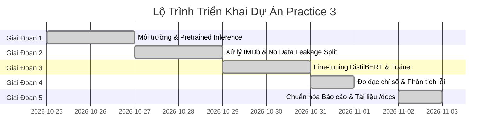

# Tiến Độ Dự Án & Danh Mục Sản Phẩm (Plan & Progress Status)

---

## 1. Tổng Quan Tiến Độ Dự Án (Progress Summary)

| Hạng mục dự án | Trọng số | Trạng thái | Đánh giá hoàn thành |
|:---|:---:|:---:|:---:|
| **Giai đoạn 1: Môi trường & Suy luận Pretrained (Ex 1)** | 20% | **ĐÃ XONG** | Chạy pipeline, kiểm tra tính toán Softmax |
| **Giai đoạn 2: Chuẩn bị dữ liệu & Đo Baseline** | 20% | **ĐÃ XONG** | Chia tập không rò rỉ, đo Baseline |
| **Giai đoạn 3: Huấn luyện Fine-tune DistilBERT (Ex 2)** | 25% | **ĐÃ XONG** | Chạy Trainer 2 epochs, xuất file safetensors |
| **Giai đoạn 4: Đánh giá kết quả & Phân tích lỗi** | 20% | **ĐÃ XONG** | Wilson CI 95%, Confusion Matrix, Error CSV |
| **Giai đoạn 5: Chuẩn hóa tài liệu & Bàn giao** | 15% | **ĐÃ XONG** | Chuẩn hóa thư mục `/docs` và Notebook |
| **TỔNG TIẾN ĐỘ DỰ ÁN** | **100%** | **HOÀN TẤT** | **100% (READY FOR SUBMISSION)** |

---

## 2. Kế Hoạch Chi Tiết Từng Giai Đoạn

### Giai đoạn 1: Môi trường & Pretrained Inference (Exercise 1)
- [x] Cài đặt các thư viện cần thiết (`transformers`, `datasets`, `evaluate`, `accelerate`, `torch`).
- [x] Tạo kịch bản `src/01_sentiment_analysis.py`.
- [x] Chạy suy luận qua `pipeline("sentiment-analysis")`.
- [x] Phân tích cấu trúc Tokenizer: WordPiece sub-words, input IDs, attention mask.
- [x] Tính xác suất thủ công từ logits qua Softmax và so khớp kết quả với `pipeline` (sai số $= 0.00$).

### Giai đoạn 2: Xử lý Dữ liệu & Thiết lập Mốc Tham Chiếu
- [x] Tải bộ dữ liệu `stanfordnlp/imdb`.
- [x] Chia tập dữ liệu độc lập: 800 Train / 200 Val / 200 Test (`seed=42`).
- [x] Xác định mốc **Majority Baseline** trên tập Test (52.00%).
- [x] Đo mốc **Untrained Baseline** trên tập Validation (44.00%).
- [x] Tích hợp Dynamic Padding bằng `DataCollatorWithPadding`.

### Giai đoạn 3: Huấn Luyện Fine-tuning Mô Hình (Exercise 2)
- [x] Tạo kịch bản `src/02_train_finetune.py`.
- [x] Thiết lập `TrainingArguments`: learning rate $2 \times 10^{-5}$, 2 epochs (100 steps), batch size 16, weight decay 0.01, seed 42.
- [x] Tối ưu hóa thời gian chạy trên CPU (391.42s ~6.52 phút).
- [x] Lưu checkpoint tối ưu vào `outputs/final_model/model.safetensors` (255.43 MB).

### Giai đoạn 4: Đánh Giá Kết Quả & Phân Tích Lỗi
- [x] Đánh giá trên tập Test độc lập: Accuracy **74.50%**, Macro F1 **74.27%**.
- [x] Tính khoảng tin cậy Wilson 95%: $[68.04\%, 80.04\%]$.
- [x] Xuất báo cáo phân loại chi tiết (`outputs/reports/classification_report.csv`).
- [x] Xuất ma trận nhầm lẫn (`outputs/reports/confusion_matrix.csv`, `confusion_matrix.png`).
- [x] Phân tích nguyên nhân trên 51 ca dự đoán sai (`outputs/reports/error_analysis.csv`).
- [x] Kiểm định tác động cắt ngắn độ dài token qua Fisher's Exact Test ($p = 0.8153$).

### Giai đoạn 5: Đóng Gói Sản Phẩm & Chuẩn Hóa Tài Liệu
- [x] Tạo công cụ dự đoán nhanh qua CLI: `src/03_predict_finetuned.py`.
- [x] Tích hợp nội dung hoàn chỉnh vào: `notebooks/Practice3_HuggingFace_Final.ipynb` (53 cells, 23 code cells).
- [x] Chuẩn hóa toàn bộ hệ thống tài liệu kỹ thuật chuyên đề trong thư mục `/docs` (toàn bộ $\le 200$ dòng).

---

## 3. Danh Mục Sản Phẩm Bàn Giao (Deliverables Registry)

| Nhóm sản phẩm | Đường dẫn chính | Mô tả chức năng & Trạng thái |
|:---|:---|:---|
| **Mã nguồn chính** | `src/01_sentiment_analysis.py` `src/02_train_finetune.py` `src/03_predict_finetuned.py` | Pipeline suy luận SST-2, quy trình 7 bước fine-tuning DistilBERT và CLI dự đoán câu mới. |
| **Tiện ích & Kiểm thử** | `src/pipeline_utils.py` `src/verify_all.py` `src/export_tables_as_images.py` | Quản lý dữ liệu, manifests, bộ kiểm thử tự động 5 pha và kết xuất bảng định lượng. |
| **Đồ họa & Trực quan** | `src/generate_data_charts.py` `src/generate_dynamic_plots.py` `src/generate_html_report.py` | Sinh 7 biểu đồ phân tích (EDA, PCA, Curves, Matrix) và báo cáo HTML tổng hợp. |
| **Jupyter Notebook** | `notebooks/Practice3_HuggingFace_Final.ipynb` `notebooks/Practice3_HuggingFace_Final.html` | Notebook 53 cells chuẩn hóa, nhúng sẵn toàn bộ kết quả và bản kết xuất tĩnh HTML. |
| **Trọng số mô hình** | `outputs/final_model/model.safetensors` | Trọng số DistilBERT tối ưu sau 2 epochs (255.43 MB) an toàn SafeTensors. |
| **Báo cáo số liệu** | `outputs/reports/final_metrics.json` `outputs/reports/predictions.csv` `outputs/reports/error_analysis.csv` | Hồ sơ số liệu thực nghiệm, 200 dự đoán test set và 51 ca lỗi chi tiết. |
| **Tài liệu dự án** | `README.md`, `REPORT.md`, `RULES.md` `docs/*.md` (9 tài liệu chuyên đề) | Hệ thống tài liệu kỹ thuật hoàn chỉnh tuân thủ nguyên tắc Zero Emoji và dưới 200 dòng. |

---

## 4. Ma Trận Tuân Thủ Quy Chuẩn (Rules Compliance)

| Quy chuẩn dự án ([RULES.md](../RULES.md)) | Phương thức kiểm tra | Kết quả |
|:---|:---|:---:|
| **Zero Hallucination** | 100% số liệu khớp tuyệt đối với `outputs/reports/final_metrics.json` | **ĐẠT (100%)** |
| **No Data Leakage** | Chia tập bằng `seed=42`, tập Test chỉ đánh giá ở khâu cuối cùng | **ĐẠT (100%)** |
| **Reproducibility** | Cố định `seed=42` xuyên suốt PyTorch, NumPy, Transformers | **ĐẠT (100%)** |
| **SafeTensors Model Storage** | Lưu mô hình dạng `model.safetensors` an toàn, không dùng pickle | **ĐẠT (100%)** |
| **Cross-platform Portability** | Tự động nhận diện thiết bị tính toán (`cuda` $\to$ `mps` $\to$ `cpu`) | **ĐẠT (100%)** |

---

## 5. Hướng Phát Triển Tiếp Theo (Future Roadmap)

- **Mở rộng dữ liệu & GPU:** Huấn luyện trên toàn bộ 25,000 mẫu của tập IMDb trên GPU để tiệm cận mốc SOTA (~93% – 95%).
- **Thử nghiệm model khác:** So sánh DistilBERT với RoBERTa-base, DeBERTa-v3 hoặc ModernBERT.
- **Xử lý văn bản dài:** Áp dụng Longformer hoặc BigBird để nâng ngưỡng cắt ngắn từ 128 lên 4,096 tokens.
- **Xử lý câu mỉa mai (Sarcasm):** Bổ sung dữ liệu văn phong châm biếm và tinh chỉnh với Contrastive Learning.
