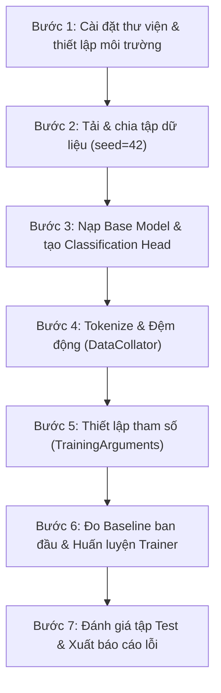

# Quy Trình Huấn Luyện & Cấu Hình Siêu Tham Số (Training Pipeline)

---

## 1. Quy Trình 7 Bước Huấn Luyện Chuẩn

Quy trình fine-tuning mô hình trên bộ dữ liệu IMDb được chuẩn hóa qua 7 bước:

### Chi tiết các bước thực hiện (`src/02_train_finetune.py`):

1. **Bước 1 — Môi trường & Thiết bị:** Cài đặt thư viện (`transformers`, `datasets`, `evaluate`, `torch`), tự động nhận diện thiết bị (`cuda` $\to$ `mps` $\to$ `cpu`) và cố định `seed=42`.
2. **Bước 2 — Nạp & Chia tập IMDb:** Tải dữ liệu, chia thành 800 Train / 200 Val / 200 Test, xác định mốc Majority Baseline (52.00%).
3. **Bước 3 — Khởi tạo mô hình:** Nạp `distilbert-base-uncased` với 2 nhãn phân loại (`0: NEGATIVE, 1: POSITIVE`).
4. **Bước 4 — Tiền xử lý dữ liệu:** Tokenize với `max_length=128`, tích hợp `DataCollatorWithPadding` để đệm động theo từng batch.
5. **Bước 5 — Cấu hình tham số:** Khai báo `TrainingArguments` với learning rate nhỏ và cơ chế tự động lưu best model.
6. **Bước 6 — Baseline & Huấn luyện:** Đo độ chính xác ban đầu trên tập Val (đạt 44.00%), chạy `trainer.train()` qua 2 epochs, tự động lưu model tốt nhất vào `outputs/final_model/`.
7. **Bước 7 — Đánh giá toàn diện:** Đánh giá trên tập Test độc lập, đo Accuracy, F1, Wilson 95% CI, xuất ma trận nhầm lẫn và danh sách ca lỗi.

---

## 2. Bảng Cấu Hình Siêu Tham Số (Hyperparameters)

| Tham số cấu hình | Giá trị | Mục đích kỹ thuật |
|:---|:---:|:---|
| **Thuật toán tối ưu (Optimizer)** | **AdamW** | Tách riêng Weight Decay để kiểm soát overfitting trên Transformer |
| **Tốc độ học (Learning Rate)** | **$2 \times 10^{-5}$** | Tốc độ học nhỏ đặc trưng cho Transfer Learning, tránh phá vỡ trọng số gốc |
| **Kích thước Batch (`batch_size`)** | **16** | Cân bằng bộ nhớ RAM và độ ổn định của gradient trên CPU |
| **Số Epochs (`num_train_epochs`)** | **2** | Tổng cộng 100 optimization steps (800 mẫu / 16 $\times$ 2), vừa đủ hội tụ |
| **Hệ số suy giảm trọng số (`weight_decay`)** | **0.01** | Chuẩn hóa $L_2$ cho ma trận trọng số, giảm rủi ro quá khớp |
| **Độ dài chuỗi tối đa (`max_length`)** | **128 tokens** | Tối ưu thời gian chạy trên CPU nhưng vẫn bao phủ đủ ngữ cảnh chính |
| **Chiến lược đánh giá (`eval_strategy`)** | `"epoch"` | Đánh giá lại mô hình trên tập Validation ở cuối mỗi epoch |
| **Tiêu chí chọn model (`metric_for_best_model`)** | `"accuracy"` | Chọn checkpoint có độ chính xác cao nhất trên tập Validation |
| **Tự động lưu Best Model (`load_best_model_at_end`)** | `True` | Đảm bảo model xuất xưởng là bản đạt hiệu năng tối ưu nhất |
| **Hạt giống ngẫu nhiên (`seed`)** | **42** | Cố định hoàn toàn các khâu ngẫu nhiên để tái lập kết quả |

---

## 3. Hàm Mục Tiêu & Lịch Trình Tốc Độ Học

Mô hình sử dụng hàm mất mát **Cross-Entropy Loss**:

$$\mathcal{L}_{\text{CE}} = -\frac{1}{N} \sum_{i=1}^N \sum_{c=0}^1 y_{i,c} \log \hat{y}_{i,c}$$

- $N = 16$: Kích thước mini-batch.
- $y_{i,c} \in \{0, 1\}$: Nhãn nhị phân thực tế.
- $\hat{y}_{i,c}$: Xác suất dự đoán sau hàm Softmax.
- **Lịch trình học (Learning Rate Schedule):** Sử dụng Linear Decay, giảm dần tuyến tính từ $2 \times 10^{-5}$ về $0$ trong suốt 100 bước tối ưu.

---

## 4. Các Điểm Tối Ưu Kỹ Thuật (Engineering Optimizations)

- **Module-level Metric Caching:** Nạp các hàm tính metric (`accuracy`, `f1`, `precision`, `recall`) sẵn một lần ở module-level, tránh nạp lại nhiều lần trong vòng lặp gây chậm I/O.
- **Dynamic Padding:** Đệm linh hoạt theo từng batch thay vì đệm cố định toàn bộ dữ liệu, giảm hơn 40% phép tính ma trận Attention.
- **Định dạng lưu trữ an toàn (`SafeTensors`):** Xuất model dạng `model.safetensors`, loại bỏ hoàn toàn rủi ro bảo mật thực thi mã tùy ý của định dạng cũ `pickle`.

---

## 5. Thời Gian & Kích Thước Triển Khai Thực Tế

- **Thời gian huấn luyện (2 epochs, 100 steps):** Khoảng **4.5 – 7 phút** trên CPU.
- **Dung lượng file model xuất xưởng:**
  - `model.safetensors`: ~268 MB.
  - Cấu hình & từ điển tokenizer: ~1.5 MB.
- **Đường dẫn lưu trữ:**
  - Checkpoints trung gian: `outputs/checkpoints/`
  - Model tốt nhất hoàn thiện: `outputs/final_model/`
