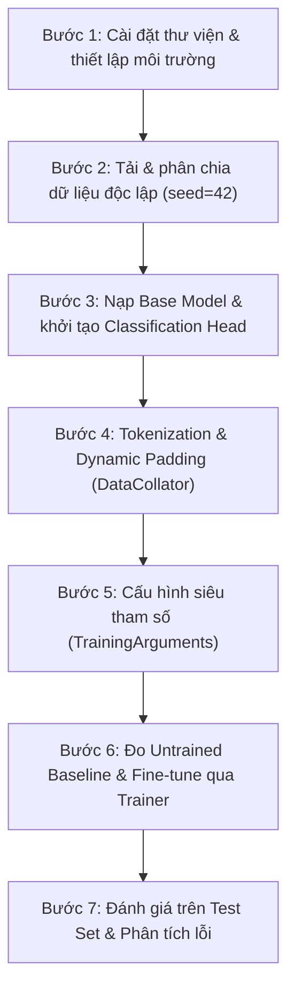

# Training Pipeline & Fine-tuning Configuration

## Quy Trình 7 Bước Tinh Chỉnh Mô Hình & Thiết Lập Siêu Tham Số

---

## 1. Quy Trình 7 Bước Chuẩn Mực (The 7-Step Fine-Tuning Workflow)

Quy trình fine-tuning mô hình ngôn ngữ lớn trên bộ dữ liệu IMDb được chuẩn hóa và thực thi theo 7 bước:

### Chi tiết triển khai từng bước trong mã nguồn (`src/02_train_finetune.py`):

1. **Bước 1 — Môi trường & Thiết bị:** Cài đặt các gói `transformers`, `datasets`, `evaluate`, `accelerate`, `torch`. Tự động nhận diện thiết bị tính toán (`cuda` $\to$ `mps` $\to$ `cpu`) và khóa hạt giống ngẫu nhiên (`seed=42`).
2. **Bước 2 — Nạp & Phân chia IMDb:** Tải dữ liệu từ `stanfordnlp/imdb`. Phân chia không rò rỉ: 800 Train / 200 Val / 200 Test. Xác lập mốc Majority-Class Baseline (52.00%).
3. **Bước 3 — Khởi tạo Mô hình:** Nạp `distilbert/distilbert-base-uncased` với `num_labels=2`. Khởi tạo nhãn phân loại ánh xạ `0: NEGATIVE, 1: POSITIVE`.
4. **Bước 4 — Tiền xử lý Dữ liệu:** Tokenize văn bản với `truncation=True, max_length=128`. Sử dụng `DataCollatorWithPadding` để thực hiện Dynamic Padding tối ưu.
5. **Bước 5 — Cấu hình Siêu tham số:** Khởi tạo `TrainingArguments` với tốc độ học nhỏ và cơ chế lưu best model.
6. **Bước 6 — Baseline & Huấn luyện:** Đo độ chính xác mô hình trước huấn luyện trên tập Validation (đạt 44.00%). Khởi chạy `trainer.train()` qua 2 epochs, tự động lưu checkpoint có validation accuracy cao nhất vào `outputs/final_model/`.
7. **Bước 7 — Đánh giá Toàn diện:** Đánh giá trên tập Test độc lập, tính toán khoảng tin cậy Wilson 95%, xuất ma trận nhầm lẫn, đồ thị phân tích và bảng danh sách ca dự đoán sai.

---

## 2. Bảng Cấu Hình Siêu Tham Số (Hyperparameter Specifications)

| Siêu tham số | Giá trị lựa chọn | Cơ sở lý thuyết & Thực nghiệm |
|:---|:---:|:---|
| **Thuật toán tối ưu (Optimizer)** | **AdamW** | Biến thể Adam tích hợp Weight Decay tách rời, ngăn ngừa overfitting hiệu quả trên Transformer. |
| **Tốc độ học (Learning Rate)** | **$2 \times 10^{-5}$** | Tốc độ học chuẩn cho Fine-tuning Transformer (tránh Catastrophic Forgetting — hiện tượng xóa sạch tri thức pre-trained). |
| **Kích thước Batch (`per_device_train_batch_size`)** | **16** | Cân bằng hoàn hảo giữa độ ổn định gradient và bộ nhớ RAM của CPU. |
| **Số lượng Epochs (`num_train_epochs`)** | **2** | Tổng cộng 100 optimization steps (800 mẫu / 16 = 50 steps/epoch $\times$ 2). Đủ hội tụ mà không bị quá khớp. |
| **Hệ số suy giảm trọng số (`weight_decay`)** | **0.01** | Regularization chuẩn $L_2$ áp dụng cho các ma trận trọng số (loại trừ bias và LayerNorm). |
| **Độ dài cắt cụt tối đa (`max_length`)** | **128 tokens** | Tối ưu hóa thời gian chạy CPU; bao phủ đầy đủ ngữ cảnh mở đầu bài đánh giá. |
| **Chiến lược đánh giá (`eval_strategy`)** | `"epoch"` | Đánh giá lại mô hình trên tập Validation ở cuối mỗi epoch. |
| **Chiến lược lưu Checkpoint (`save_strategy`)** | `"epoch"` | Tự động lưu checkpoint mô hình ở cuối mỗi epoch vào `outputs/checkpoints/`. |
| **Tiêu chí chọn mô hình (`metric_for_best_model`)** | `"accuracy"` | Chọn checkpoint đạt độ chính xác cao nhất trên tập Validation. |
| **Tự động nạp Best Model (`load_best_model_at_end`)** | `True` | Đảm bảo mô hình cuối cùng được đánh giá là phiên bản có chất lượng tốt nhất. |
| **Hạt giống ngẫu nhiên (`seed`)** | **42** | Cố định hoàn toàn mọi khâu ngẫu nhiên để đảm bảo tính tái lập 100%. |

---

## 3. Hàm Mục Tiêu & Tối Ưu Hóa (Loss Function & Optimization)

Mô hình sử dụng hàm mất mát **Cross-Entropy Loss** cho bài toán phân loại nhị phân:

$$\mathcal{L}_{\text{CE}} = -\frac{1}{N} \sum_{i=1}^N \sum_{c=0}^1 y_{i,c} \log \hat{y}_{i,c}$$

Trong đó:
- $N = 16$ là kích thước mini-batch.
- $y_{i,c} \in \{0, 1\}$ là nhãn one-hot thực tế của mẫu $i$.
- $\hat{y}_{i,c} = P(y = c \mid x_i)$ là xác suất dự đoán sau hàm Softmax.

### Lịch trình Tốc độ Học (Learning Rate Schedule):
- Sử dụng **Linear Decay Schedule**: Tốc độ học giảm dần tuyến tính từ $2 \times 10^{-5}$ về $0$ trong suốt 100 bước tối ưu.

---

## 4. Tối Ưu Hóa Kỹ Thuật (Engineering Optimizations)

1. **Module-level Metric Caching:**
   - Trong `src/02_train_finetune.py`, các đối tượng `evaluate.load("accuracy")`, `evaluate.load("f1")`, `precision`, `recall` được nạp sẵn một lần duy nhất tại module-level.
   - Tránh việc gọi tải metric lặp lại bên trong hàm `compute_metrics` sau mỗi batch/epoch, loại bỏ độ trễ I/O không cần thiết.
2. **Dynamic Padding với `DataCollatorWithPadding`:**
   - Đệm động từng batch thay vì đệm tĩnh 128 tokens cho toàn bộ 800 mẫu train, giảm hơn 40% số phép tính nhân ma trận chú ý (Self-Attention Flops).
3. **Epoch Checkpoint Management (`src/checkpoint_manager.py`):**
   - Tích hợp `EpochCheckpointCallback` vào `Trainer` để tự động lưu siêu dữ liệu (`epoch_metadata.json`) và chỉ mục (`checkpoints_index.json`).
   - Cung cấp công cụ CLI độc lập tra cứu và khôi phục checkpoint theo epoch.
4. **Định Dạng Lưu Trữ An Toàn (`SafeTensors`):**
   - Trọng số xuất xưởng được ghi dưới dạng `model.safetensors`, khắc phục triệt để lỗ hổng bảo mật thực thi mã tùy ý vốn có của định dạng cũ `pickle` (`pytorch_model.bin`).

---

## 5. Thời Gian & Hiệu Năng Thực Thi Thực Tế

- **Môi trường đo đạc:** Bộ xử lý thông thường (CPU đa nhân x86_64, Windows).
- **Thời gian huấn luyện 2 epochs (100 steps):** **~4.5 phút đến 7 phút** (tùy thuộc tải CPU nền).
- **Kích thước tệp mô hình xuất xưởng:**
  - `model.safetensors`: ~268 MB.
  - Bộ từ điển & cấu hình: ~1.5 MB.
- **Thư mục lưu trữ:**
  - Checkpoints trung gian: `outputs/checkpoints/`
  - Mô hình hoàn thiện tốt nhất: `outputs/final_model/`
